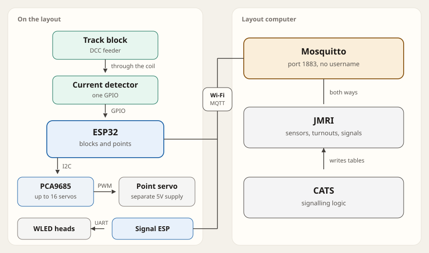
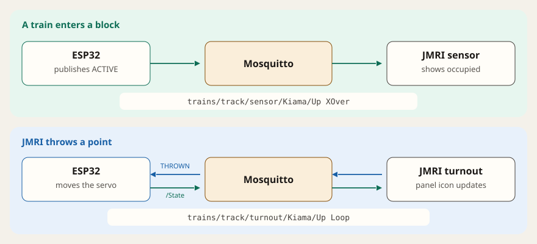
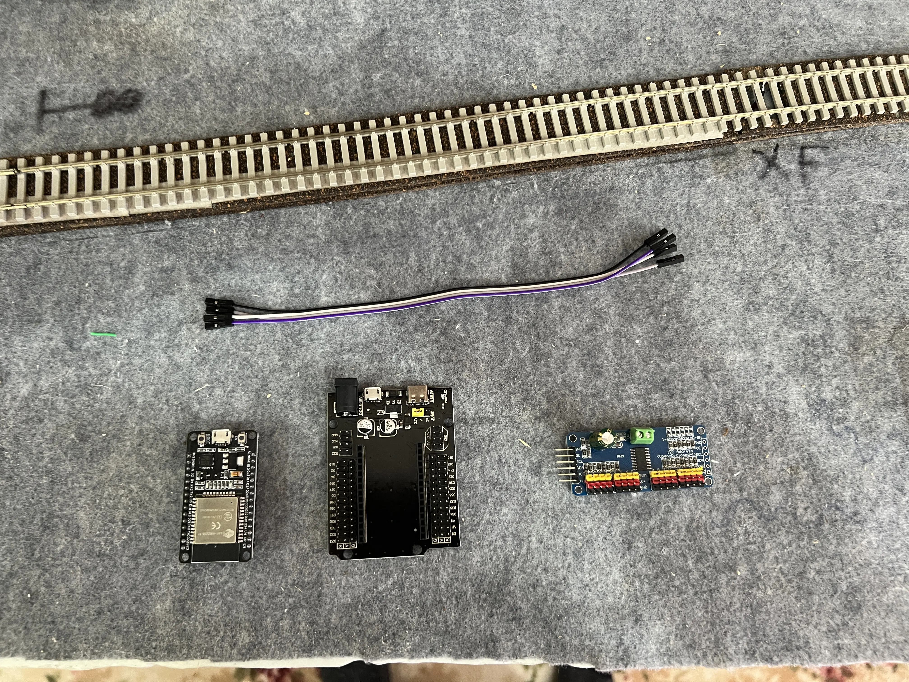

# ESPHome for Model Railroading

ESP32 boards for a model railroad: block detection and point control, talking to JMRI/CATS over MQTT.

A board watches the track and throws points. JMRI (with CATS doing the signalling logic) is the brain. The boards and JMRI meet on MQTT.

## How it fits together



The layout computer runs Mosquitto and JMRI. CATS writes the signalling into JMRI’s tables, and those tables are the MQTT topics. Each ESP joins the 2.4 GHz Wi-Fi and uses the computer’s LAN address, never `localhost`. The point servos take a separate 5V supply. Signals are not in the configurator: a second ESPHome board listens for mast topics and drives a WLED board over a serial link.



A block publishes `ACTIVE` or `INACTIVE`. Leaving the block publishes `INACTIVE`. A point listens for `CLOSED` or `THROWN`, moves the servo, then publishes that same word on `<topic>/State` so the panel icon updates. The topics in the diagram are the My First Board examples. Yours are whatever you put in the configurator. Since JMRI 5.1.2 the `trains/` prefix is often blank, so check Preferences before copying one.

## What you’ll need

**Hardware.** Everything except transformers I source from AliExpress.



- ESP32 with a CP2102 USB chip: https://www.aliexpress.com/item/1005004337178335.html
- PCA9685 16-channel PWM board (one per ESP, up to 16 servos)
- Servo Leads (the ones used in model aircraft - get a few different lengths)
- Two power supplies: one for the ESP (about 6.5V into the board’s regulator) and a separate 5V supply for the servos. Keep both off the DCC bus so a track short doesn’t move points or signals.

**On the computer**

- Windows 10/11, or a Mac
- ESPHome Device Builder and Mosquitto, from the install script below
- 2.4 GHz Wi-Fi with DHCP (these boards cannot use 5 GHz)
- Chrome or Edge for the first USB flash

## Start here

### 1. Install ESPHome and Mosquitto

The script asks install or uninstall. Install opens the dashboard when it finishes.

Mac — Terminal:

```bash
curl -fsSL https://raw.githubusercontent.com/aaron9589/esphome-for-model-railroading/main/scripts/install-mac.sh -o /tmp/esphome-mr-setup.sh && bash /tmp/esphome-mr-setup.sh
```

Windows — PowerShell. You do not need to start it as administrator. The script asks for that itself.

```powershell
irm https://raw.githubusercontent.com/aaron9589/esphome-for-model-railroading/main/scripts/install-windows.ps1 -OutFile "$env:TEMP\esphome-mr-setup.ps1"; Start-Process powershell -Verb RunAs -Wait -ArgumentList "-NoProfile -ExecutionPolicy Bypass -File `"$env:TEMP\esphome-mr-setup.ps1`""
```

Type `1` to install. The click-by-click version is [installing-esphome-cheatsheet.md](docs/installing-esphome-cheatsheet.md).

### 2. Build `board.yaml`

**[Open the Board Configurator](https://aaron9589.github.io/esphome-for-model-railroading/)**

Click **My first board**, fill in Wi-Fi and this computer’s MQTT address, add the blocks and points you actually have, then download the file. Paste it into ESPHome. Don’t edit the YAML by hand — import the same file back into the configurator when you want to change something. The file contains your Wi-Fi password, so don’t commit it.

### 3. Flash it

[Flash the downloaded file](docs/first-board-setup-guide.md) by USB the first time. Later changes install over Wi-Fi.

### 4. Check it in JMRI

[Check it in JMRI](docs/jmri-mqtt-verification-guide.md) once a train and a turnout move.

## After the first board

Wiring, detector tuning, how points remember their positions, and the layout this was built for are in [How the boards work](docs/README.md).

| If you want… | Go here |
|---|---|
| The detector schematic and how to tune a block | [How the boards work](docs/README.md) |
| The same YAML, split into files you edit yourself | [samples/](samples/) |
| Install without the script | [installing-esphome-cheatsheet.md](docs/installing-esphome-cheatsheet.md) |

Signals are not in the configurator. They use WLED on a second ESP. That sample is [wled_signal.yaml](samples/advanced-samples/wled_signal.yaml).

Open an issue if you get stuck. I’ll help where I can.
