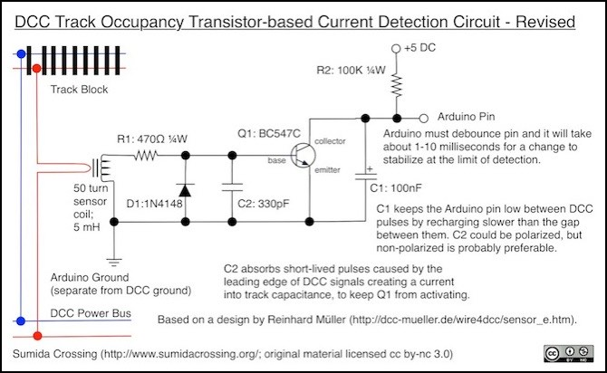
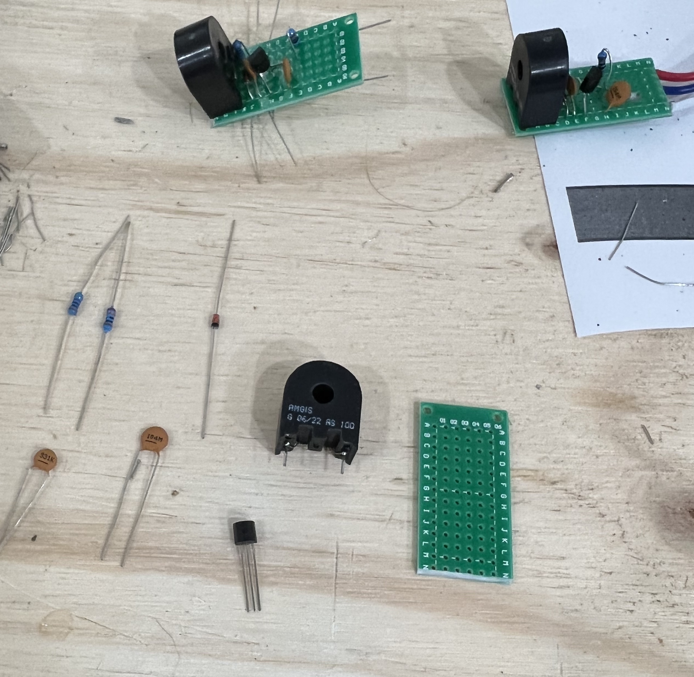
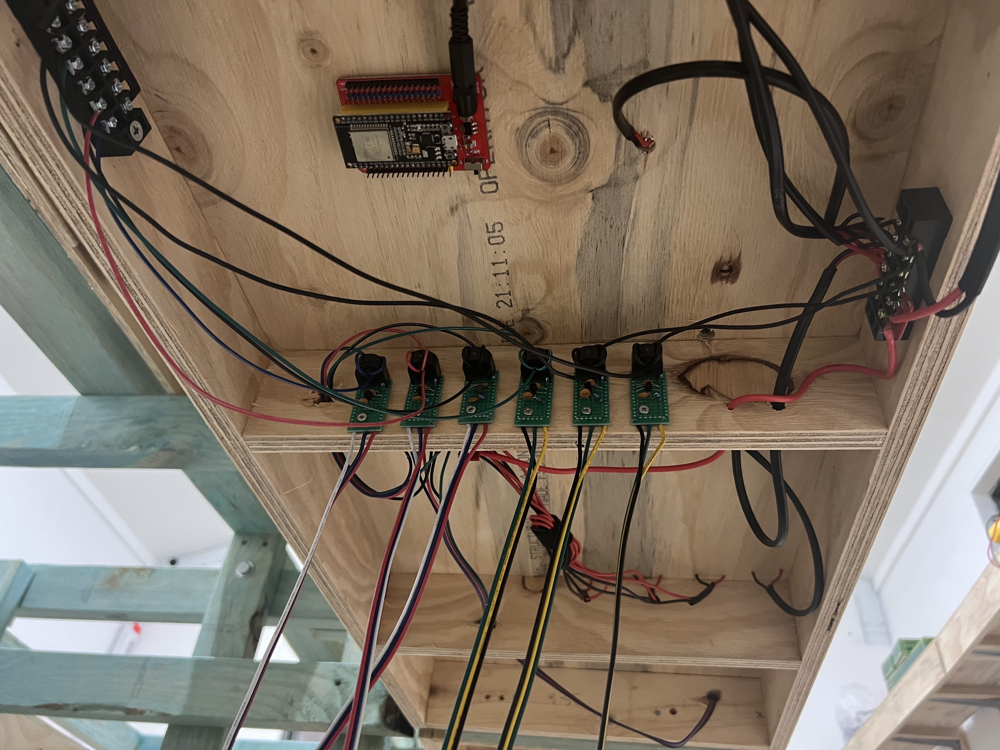

# ESPHome for Model Railroading

ESP32 boards for a model railroad: block detection and point control, talking to JMRI/CATS over MQTT.

## Start here

**[Open the Board Configurator](https://aaron9589.github.io/esphome-for-model-railroading/)**

That page builds your `board.yaml`. Click **My first board**, fill in Wi-Fi and this computer’s MQTT address, add the blocks and points you actually have, then download the file. Paste it into ESPHome. Don’t edit the YAML by hand — import the same file back into the configurator when you want to change something. The file contains your Wi-Fi password, so don’t commit it.

1. **Install ESPHome and Mosquitto.** The script asks install or uninstall. Install opens the dashboard when it finishes.

   Mac — Terminal:

   ```bash
   curl -fsSL https://raw.githubusercontent.com/aaron9589/esphome-for-model-railroading/main/scripts/install-mac.sh -o /tmp/esphome-mr-setup.sh && bash /tmp/esphome-mr-setup.sh
   ```

   Windows — PowerShell. You do not need to start it as administrator. The script asks for that itself.

   ```powershell
   irm https://raw.githubusercontent.com/aaron9589/esphome-for-model-railroading/main/scripts/install-windows.ps1 -OutFile "$env:TEMP\esphome-mr-setup.ps1"; Start-Process powershell -Verb RunAs -Wait -ArgumentList "-NoProfile -ExecutionPolicy Bypass -File `"$env:TEMP\esphome-mr-setup.ps1`""
   ```

   Type `1` to install. The click-by-click version is [installing-esphome-cheatsheet.md](installing-esphome-cheatsheet.md).

2. **[Flash the downloaded file](first-board-setup-guide.md)** by USB the first time.
3. **[Check it in JMRI](jmri-mqtt-verification-guide.md)** once a train and a turnout move.

### What you’ll need

**Hardware.** Everything except transformers I source from AliExpress.


- ESP32 with a CP2102 USB chip: https://www.aliexpress.com/item/1005004337178335.html
- PCA9685 16-channel PWM board (one per ESP, up to 16 servos)
- 20cm female-female Dupont wires
- Two power supplies: one for the ESP (about 6.5V into the board’s regulator) and a separate 5V supply for the servos. Keep both off the DCC bus so a track short doesn’t move points or signals.

**On the computer**

- Windows 10/11, or a Mac
- ESPHome Device Builder and Mosquitto, from the install script above
- 2.4 GHz Wi-Fi with DHCP (these boards cannot use 5 GHz)
- Chrome or Edge for the first USB flash

---

## The layout

The layout is the Illawarra line in the early 2000s, between Bomaderry/Nowra and Kiama. More at [illawarraline.net](https://illawarraline.net).

Earlier attempts were CTI Train-Brain on an [N scale layout](https://steinosub.blogspot.com), then ESP32 proofs of concept in [Arduino](https://github.com/aaron9589/block-detection-poc) and [MicroPython](https://github.com/aaron9589/IoCATS).

JMRI is the backbone. CATS does the signalling logic and writes it into JMRI tables. Those tables show up as MQTT topics, which is what the ESP boards publish and subscribe to.

- [JMRI MQTT documentation](https://www.jmri.org/help/en/html/hardware/mqtt/index.shtml)
- [Herding Cats](https://www.youtube.com/watch?v=H-P1guhnVpw&list=PLfmcarbF8DzEG9taeiSSWonbz3h6VQs3F) — the CATS series

### Block detection

The detector is the *DCC Track Occupancy Transistor-based Current Detection Circuit - Revised*. About $5 a block, and it wires to one ESP input. The diagram is stored in this repo because the Sumida Crossing page it came from no longer loads.



Sumida Crossing, CC BY-NC 3.0. Based on a design by [Reinhard Müller](http://dcc-mueller.de/wire4dcc/sensor_e.htm). The original page was http://sumidacrossing.org/LayoutControl/TrainDetection/InductiveDetectionCircuit/.

Current sensors (AS-100) from Digikey. Prototype boards from AliExpress: https://www.aliexpress.com/item/32923792538.html — each board splits lengthways into two detectors.





Tune one block before you wire the next.

- Start with the wire straight through the coil.
- Occupied with nothing on the track: fewer turns.
- Nothing detected with a train on it: more turns.
- If you still can’t hold both states, put a 10K potentiometer ([example](https://www.jaycar.com.au/10k-ohm-linear-b-single-gang-9mm-potentiometer/p/RP8510)) across the coil.

In the [configurator](https://aaron9589.github.io/esphome-for-model-railroading/), add a block, set its name, MQTT topic, and GPIO, then download again and install wirelessly. The log line looks like `Kiama/Up XOver | OCCUPIED`.

### Point control

A PCA9685 drives the servos over I2C, up to 16 turnouts on one ESP. The servo power rail (V+) comes from the separate 5V supply, not from the ESP.

In the [configurator](https://aaron9589.github.io/esphome-for-model-railroading/), add a point and set its MQTT topic, PCA9685 channel, and how fast it throws. You do **not** set the closed and thrown positions there. After the board is online, open `http://<board-name>.local` in Chrome or Edge and use the sliders. The ESP remembers them, so you can adjust a turnout later without a new YAML file.

### Signals

Signals are not in the configurator. They use [WLED](https://kno.wled.ge) on a second ESP driving WS2812B heads. The sample is [wled_signal.yaml](samples/advanced-samples/wled_signal.yaml). The build notes are at https://illawarraline.net/signals-for-the-illawarra-line/.

---

## If you want the YAML files

The configurator is the way to build a board. These files are the same ideas, split up, for when you want to edit them yourself.

| File | What it is |
|---|---|
| [my-first-board/board.yaml](samples/my-first-board/board.yaml) | Wi-Fi, MQTT, and which modules to load |
| [block_detectors.yaml](samples/my-first-board/modules/block_detectors.yaml) | Current detectors |
| [point_control.yaml](samples/my-first-board/modules/point_control.yaml) | PCA9685 servos |
| [secrets.yaml](samples/secrets.yaml) | Placeholder Wi-Fi and MQTT values for the hand-edited files |

Other layouts (end-of-block sensors, ground throws, bell codes, a staff machine) are in [samples/advanced-samples/](samples/advanced-samples/).

---

## Questions

Open an issue. I’ll help where I can.
