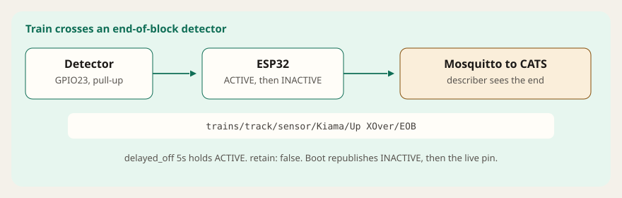
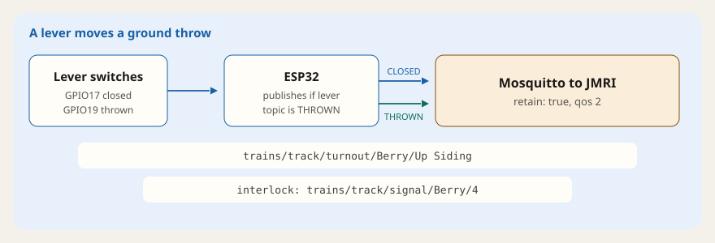
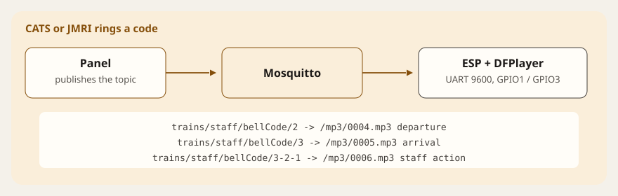
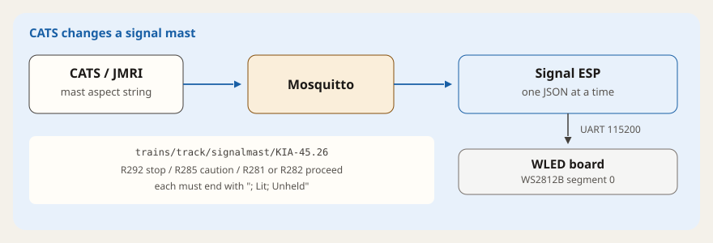

# Advanced samples

These YAML files are **not** Board Configurator compatible. They are patterns from a working layout where ESPHome does more than block detectors and PCA9685 points.

For a first board, use the [Board Configurator](https://aaron9589.github.io/esphome-for-model-railroading/). Ordinary blocks and points live there. Copy ideas from these files into your own ESPHome config. Import in the Configurator will not understand them.


Keep these off the Configurator board. Add only the files you need as ESPHome packages on a separate device, so each job stays in its own file:

```yaml
packages:
  eob: !include end_of_block.yaml
  bells: !include bellcodes.yaml
  staff: !include staff_machine.yaml
  throws: !include ground_throws.yaml
  signals: !include wled_signal.yaml
```

The topics below are the ones written in the files (Illawarra names). Change the substitutions to match your panel.

| File | What the YAML actually does |
|---|---|
| [end_of_block.yaml](end_of_block.yaml) | Short occupancy pulse on an `/EOB` sensor topic |
| [ground_throws.yaml](ground_throws.yaml) | Lever switches publish a retained turnout topic |
| [bellcodes.yaml](bellcodes.yaml) | Bell-code topics play numbered MP3s |
| [staff_machine.yaml](staff_machine.yaml) | RFID staff token, with a remote lockout |
| [wled_signal.yaml](wled_signal.yaml) | Mast aspect strings become WLED JSON over UART |

---

## End of block

Wrong-road running needs CATS to see which end of the block the train entered. This sensor is `internal` (it is not a panel object of its own). On press it publishes `ACTIVE`. `delayed_off: 5s` holds that until the pin has been clear for five seconds, then it publishes `INACTIVE`. Both use QoS 2 and `retain: false`. On boot it publishes `INACTIVE`, then publishes whatever the pin is doing now.

The example pin is GPIO23, inverted, with the internal pull-up on. Wiring is the same kind of current-detector output as a Configurator block.



Example topic: `trains/track/sensor/Kiama/Up XOver/EOB`.

---

## Ground throws

Some points are moved by hand. Two microswitches (pull-up, inverted, 250 ms debounce) report the lever: GPIO17 publishes `CLOSED`, GPIO19 publishes `THROWN`. Both messages are QoS 2 and **retained**, so JMRI still sees the lever after a broker restart.

The publish is wrapped in a check. The ESP subscribes to `trains/track/signal/Berry/4` and only sends the turnout message when that text is exactly `THROWN`. Delete the `if` if you do not want that interlock.



Example turnout topic: `trains/track/turnout/Berry/Up Siding`.

---

## Bell codes

Any payload on a bell topic plays one file on a DFPlayer Mini. UART is 9600 baud, TX GPIO1, RX GPIO3. Files on the card are `/mp3/0001.mp3` and so on. The YAML maps:

| Topic | File | Meaning in the comments |
|---|---|---|
| `trains/staff/bellCode/2` | 4 | departure |
| `trains/staff/bellCode/3` | 5 | arrival |
| `trains/staff/bellCode/3-2-1` | 6 | train waiting / staff action |



The staff machine also publishes `trains/staff/bellCode/3-2-1` when a token is issued or a digital lockout starts.

---

## Staff machine

One RC522 reader stands for a single-line staff. SPI is clock GPIO14, MOSI GPIO13, MISO GPIO27, chip-select GPIO22. Only IDs in `valid_tokens` do anything. An unknown card is logged and ignored.

First scan of a valid token: publish `trains/staff/bellCode/3-2-1` as `ACTIVE`, play DFPlayer file 2, then set `trains/staff/nowra-berry` to the token id (`retain: true`) and `trains/track/sensor/nowra-berry` to `ACTIVE`. Scanning that same token again plays file 3, clears the staff topic (retained empty string), and publishes the sensor `INACTIVE`. Boot also clears the staff topic and publishes the sensor `INACTIVE`, so a restart does not leave a stale token.

Remote lockout uses `trains/track/sensor/nowra-berry/lockOut`. `ACTIVE` is ignored if a real token is already out. Otherwise the staff payload becomes `CATS` (retained), `.../lastOut` becomes `DIGITAL`, and the section sensor flips `ACTIVE` / `INACTIVE` every second until lockout clears. UART for the DFPlayer here is TX GPIO1 and RX GPIO4 (not GPIO3, which the bell-only sample uses).


---

## WLED signals

This ESP does not drive the LEDs itself. It subscribes to `trains/track/signalmast/KIA-45.26` and, for one matching string, queues a JSON frame onto a second board running [WLED](https://kno.wled.ge). UART is 115200 on TX pin 1 and RX pin 3, so USB logging is turned off (`logger` baud 0). A queued script waits if the bus is already busy, so two aspects cannot overlap on the wire.

The strings this file actually handles, including the trailing `; Lit; Unheld`:

| Payload | Log | LEDs (segment 0) |
|---|---|---|
| `R292; Lit; Unheld` | STOP | red |
| `R285; Lit; Unheld` | CAUTION | amber |
| `R281; Lit; Unheld` or `R282; Lit; Unheld` | PROCEED | green |

The file header also mentions caution-turnout and medium-turnout aspects. Those are not in the `if` blocks, so they do nothing until you add them. Hardware notes: https://illawarraline.net/signals-for-the-illawarra-line/



---

Open an issue if you adapt one of these and get stuck.
