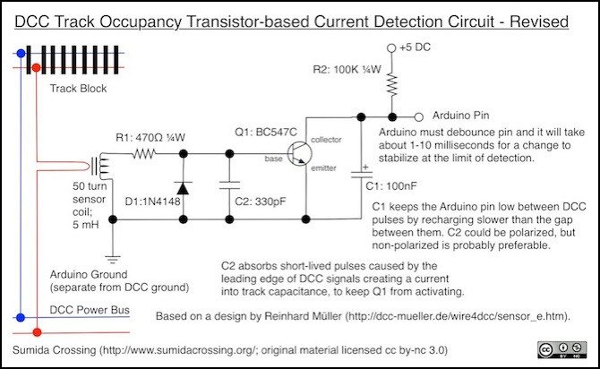
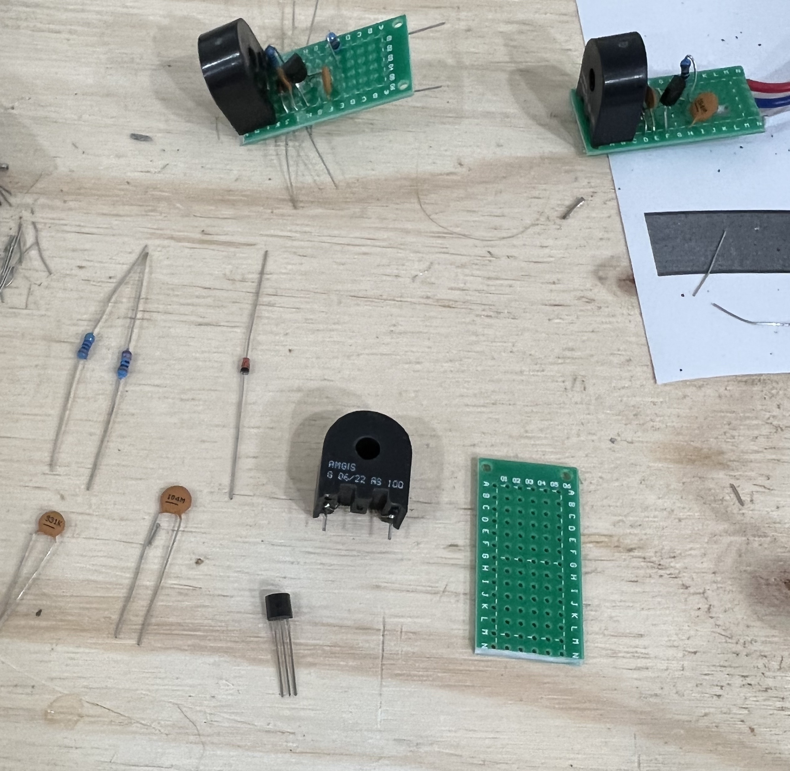
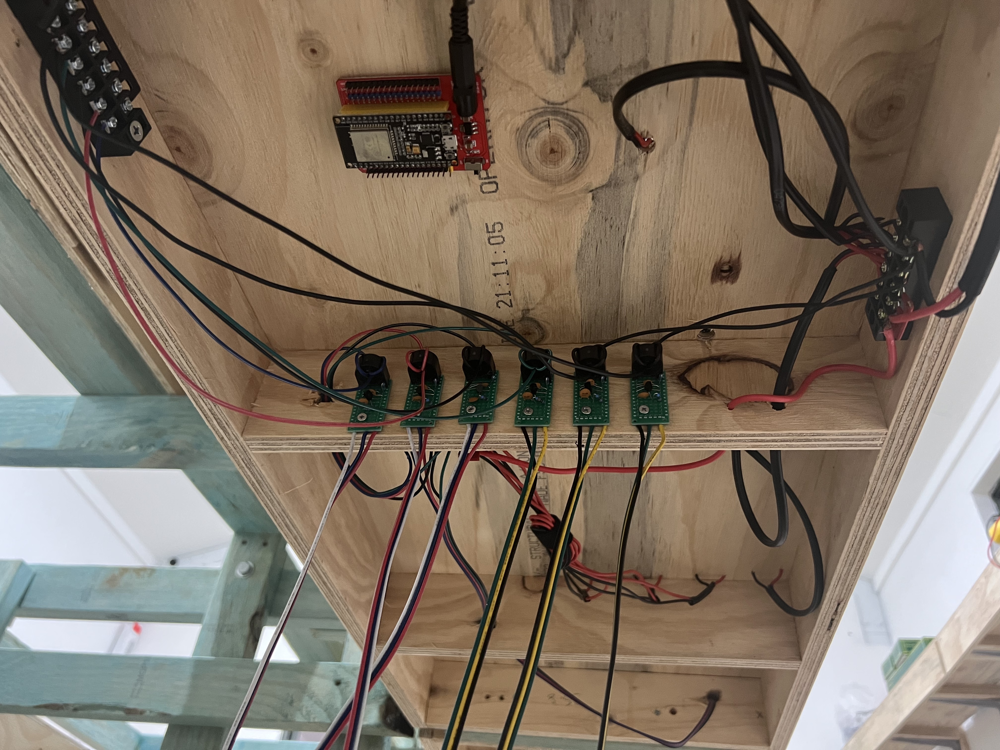

# How the boards work

Install, the configurator, and the first flash are on the [README](../README.md). This page lists every guide and spec, then covers what the boards are doing and how the detectors and points are wired.

## The guides, in the order to read them

1. [First Board Setup Guide](first-board-setup-guide.md): paste the configurator's YAML, flash by USB, and check MQTT. It has the failure checks too.
2. [JMRI MQTT Verification Guide](jmri-mqtt-verification-guide.md): check sensors and turnouts in JMRI.
3. This page, below: detector wiring, point calibration and the layout.
4. [Field Logic Guide](field-logic-guide.md): the Logic page's Field Logic mode, where a board works out its signals from rules.
5. [MSS Logic Guide](mss-logic-guide.md): the Logic page's MSS Logic mode, where you describe a module and pair it at a meet. Read the Field Logic guide first.
6. [advanced-samples](../advanced-samples/README.md): hand-edited patterns that are not configurator-compatible.

## Specs and plans

These are for people building or checking the Logic page. You do not need them to use it.

- [Field Logic spec](field-logic-spec.md): the design of the logic engine and the Field Logic mode.
- [MSS emulation spec](mss-emulation-spec.md): the design of MSS Logic, on the same engine.
- [Implementation plan](field-logic-implementation-plan.md): the releases and work items for both.
- [Screenshot checklist](screenshot-checklist.md): the screenshots the guides still need. The configurator pictures in the Field Logic and MSS Logic guides are taken by a script instead (`configurator/test/screenshots/`).

## Which board

The boards in use are the original ESP32. The metal can says `ESP32-WROOM-32`. The configurator supports the wide 38-pin board and the 30-pin DevKit with EN and Boot at the antenna end. Both write `variant: esp32`. Pins marked VP, VN, 34, and 35 have no internal pull-up, so a panel button cannot use them. A block detector can, because the detector drives the wire itself. GPIO0, GPIO2, GPIO5, GPIO12, and GPIO15 are strapping pins. The pin list marks them, and the page warns if one is selected.

## The layout

The layout is the Illawarra line in the early 2000s, between Bomaderry/Nowra and Kiama. More at [illawarraline.net](https://illawarraline.net).

Earlier attempts were CTI Train-Brain on an [N scale layout](https://steinosub.blogspot.com), then ESP32 proofs of concept in [Arduino](https://github.com/aaron9589/block-detection-poc) and [MicroPython](https://github.com/aaron9589/IoCATS).

JMRI is the backbone. CATS does the signalling logic and writes it into JMRI tables. Those tables show up as MQTT topics, which is what the ESP boards publish and subscribe to.

- [JMRI MQTT documentation](https://www.jmri.org/help/en/html/hardware/mqtt/index.shtml)
- [Herding Cats](https://www.youtube.com/watch?v=H-P1guhnVpw&list=PLfmcarbF8DzEG9taeiSSWonbz3h6VQs3F) — the CATS series

### Block detection

The detector is the *DCC Track Occupancy Transistor-based Current Detection Circuit - Revised*. About $5 a block, and it wires to one ESP input. The diagram is stored in this repo because the Sumida Crossing page it came from no longer loads.

Sumida Crossing, CC BY-NC 3.0. Based on a design by [Reinhard Müller](http://dcc-mueller.de/wire4dcc/sensor_e.htm). The original page was http://sumidacrossing.org/LayoutControl/TrainDetection/InductiveDetectionCircuit/.

Current sensors (AS-100) from Digikey. Prototype boards from AliExpress: https://www.aliexpress.com/item/32923792538.html — each board splits lengthways into two detectors.

Tune one block before you wire the next.

- Start with the wire straight through the coil.
- Occupied with nothing on the track: fewer turns.
- Nothing detected with a train on it: more turns.
- If you still can’t hold both states, put a 10K potentiometer ([example](https://www.jaycar.com.au/10k-ohm-linear-b-single-gang-9mm-potentiometer/p/RP8510)) across the coil.

In the [configurator](https://aaron9589.github.io/esphome-for-model-railroading/), add a block, set its name, MQTT topic, and GPIO, then download again and install wirelessly. The log line looks like `Kiama/Up XOver | OCCUPIED`.

Run out of ESP pins? An MCP23017 expander adds 16 sensor pins over I2C, and can share a PCA9685 board's SDA and SCL pins. Click **Add expander** at the bottom of the Sensors page. Its sensors are listed under it, with its own **Add sensor**, the same way turnouts sit under their PCA9685. Wire a detector to an expander pin and GND, as you would an ESP pin.

### Point control

A few servos can connect straight to ESP pins with PWM. They take power from the ESP, and you can generally only run 3-4 that way. A PCA9685 is how this scales up: the servos then use a separate 5V supply, not the ESP.

A PCA9685 drives up to 16 servos over I2C. One ESP can drive two PCA9685 boards (32 turnouts), each wired to its own SDA and SCL pins, because an ESP32 has two I2C buses. The servo power rail (V+) comes from the separate 5V supply, not from the ESP.

In the [configurator](https://aaron9589.github.io/esphome-for-model-railroading/), add a point and set its MQTT topic, PCA9685 channel or servo pin, and how fast it throws. With PCA9685 boards, each board shows its SDA and SCL pins with its points listed under it. Click a board's title to fold it away while you work on another; expanders on the Sensors page fold the same way. Use **Add turnout** on the board the servo is plugged into, and **Add PCA9685** for a second board. A point can also have fascia buttons on pull-up pins, each wired to GND, with an optional light for closed and one for open (thrown). A press while that servo is still moving is ignored. The throw drives to the end, waits 2 seconds, then backs off, and a second press in that window was leaving the servo short of the end it was sent to. A control can instead be a toggle switch that stays where you put it. Set **What's wired here?** to **Toggle switch: the point follows the switch**, wired between the pin and GND. Flip it and watch the point. If it goes the opposite way to what you expect, tick **Reverse the switch**. The point follows the switch whenever it moves. If the servo is still moving, the board waits for the throw to finish, then catches up. On boot the switch wins over the saved position. A JMRI command still moves the point, and the switch then disagrees until it is next moved. One toggle switch per point. Tick **Remote lock** to add a Lock topic, `<turnout topic>/Lock`. Publish `LOCKED` to hold the turnout, or `UNLOCKED` to let it move. While locked, the fascia buttons and the closed/thrown commands do nothing. A toggle switch flipped while locked is not lost: when `UNLOCKED` arrives, the point moves to match the switch. The board reports the lock on `trains/track/sensor/<turnout>/Locked`, `ACTIVE` or `INACTIVE`, so JMRI and CATS can see it. The default you pick is how it starts after a reboot, until a lock message arrives. A retained message on that topic replaces the default once the board connects. You do **not** set the closed and thrown positions there. After the board is online, open `http://<board-name>.local` in Chrome or Edge and use the sliders. The ESP remembers them, so you can adjust a turnout later without a new YAML file. It also remembers whether the point was closed or thrown, and moves the servo back there on boot. Several servos each wait a fraction of a second, picked at random, so they do not all start together. A point with nothing stored starts at normal. After every move, and when it connects, the board reports the position on `trains/track/sensor/<turnout>/Thrown`: `ACTIVE` when thrown, `INACTIVE` when closed. **Download JMRI XML** sets that sensor as the turnout's feedback in JMRI.

### Signals

In the [configurator](https://aaron9589.github.io/esphome-for-model-railroading/), add a mast and stack its lamps. Each aspect can be a CATS name (`R292; Lit; Unheld`) or a string you type. A lit lamp can stay steady, blink, or pulse. Pulse fades to off, stays off, then fades back up. JMRI sends the aspect name, then `Lit` or `Unlit`, then `Held` or `Unheld`. The board shows an aspect when the message matches it exactly, or when the aspect name matches. An `Unlit` message (CATS approach lighting) turns the mast dark. A `Held` message (CATS hold) shows the Stop aspect, `R292` or `Stop`, or turns the mast dark if it has neither.

Addressable LEDs are one WS2812B strip per mast. The strip is wired from the base, so LED 0 is the lowest lamp. A lamp can be several LEDs that always light together, such as a route indicator of three. Paint each lamp with the layout colours. The strip wants 5 V and a common ground with the ESP. A level shifter is the reliable fix for the 3.3 V data pin.

Individual LEDs use one GPIO per lamp. The lamp is on or off, and blink and pulse still work. The colour is whatever LED you wired.

Tick **Show at startup** on the aspect that should appear before JMRI sends one. One aspect per mast.

The board web page at `http://<board-name>.local` has one set of sliders for every mast. Their names start with `Signal -` so they sit together, and the ESP remembers them. Each slider can go down to 0.1. Steady lamps use Signal - Brightness. Blink and pulse each have their own brightness. Steady brightness starts at 44.6%. Blink brightness starts at 66.6%. Pulse brightness starts at 88.5%. Blink starts at 0.6 seconds on and 0.2 seconds off. Pulse rate, the fade down and back, starts at 0.5 seconds. Pulse gap, the time spent off, starts at 0.3 seconds.

CATS aspects need the signal template loaded in JMRI. The configurator offers a download, [cats-signal-template.zip](../configurator/cats-signal-template.zip). Unzip it into the JMRI profile folder so you get `resources/signals/cats-masts`, then restart JMRI. The same files are in [`.jmri/resources/signals/cats-masts`](../.jmri/resources/signals/cats-masts/).

The earlier WLED pattern in [wled_signal.yaml](../advanced-samples/wled_signal.yaml) is obsolete. New masts come from the configurator. The old build notes remain at https://illawarraline.net/signals-for-the-illawarra-line/.

---

## Advanced samples

Hand-edited patterns that are **not** Configurator-compatible (end-of-block sensors, ground throws, bell codes, staff machine) live in [advanced-samples/](../advanced-samples/). The old WLED signal file there is obsolete.

---

## Questions

Open an issue. I’ll help where I can.
