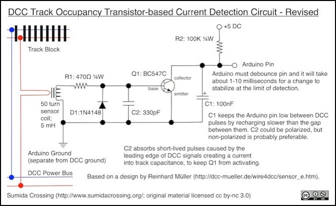
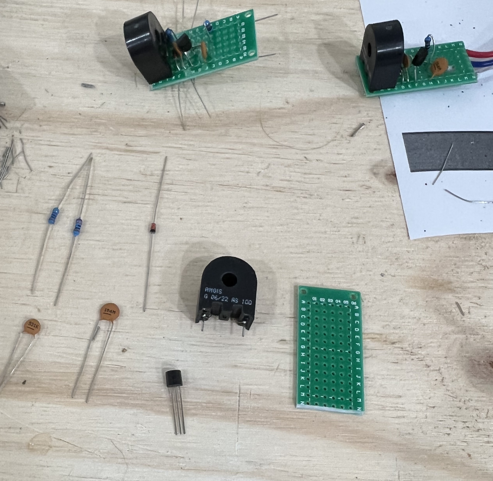
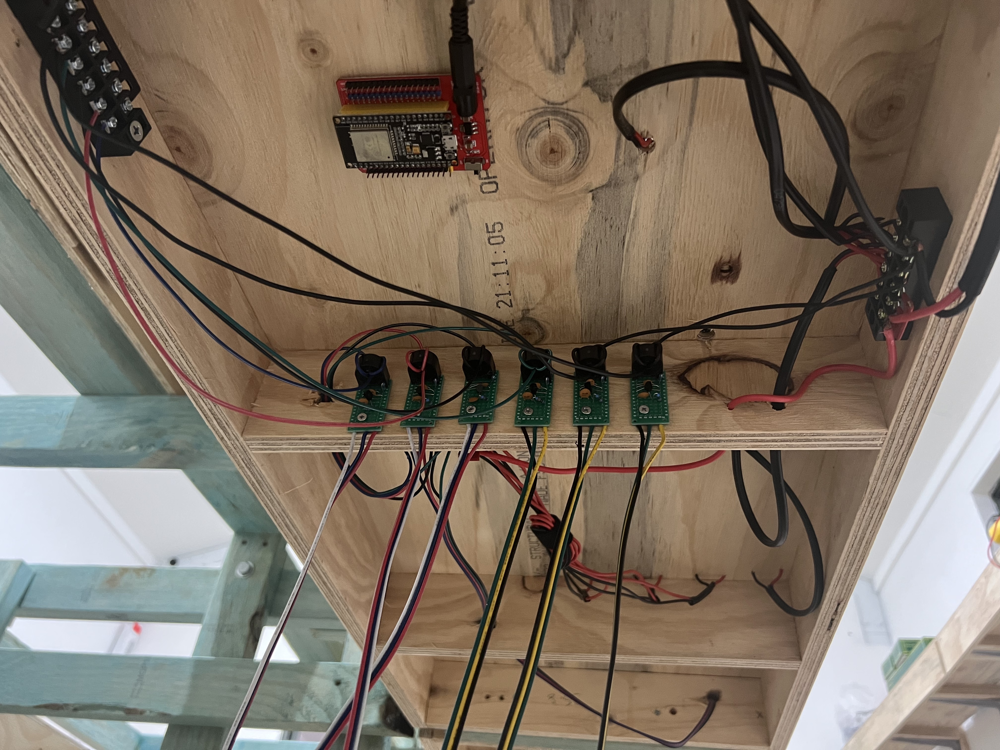

# How the boards work

Install, the configurator, and the first flash are on the [README](../README.md). This page is what the boards are doing, and how the detectors and points are wired.

## The layout

The layout is the Illawarra line in the early 2000s, between Bomaderry/Nowra and Kiama. More at [illawarraline.net](https://illawarraline.net).

Earlier attempts were CTI Train-Brain on an [N scale layout](https://steinosub.blogspot.com), then ESP32 proofs of concept in [Arduino](https://github.com/aaron9589/block-detection-poc) and [MicroPython](https://github.com/aaron9589/IoCATS).

JMRI is the backbone. CATS does the signalling logic and writes it into JMRI tables. Those tables show up as MQTT topics, which is what the ESP boards publish and subscribe to.

- [JMRI MQTT documentation](https://www.jmri.org/help/en/html/hardware/mqtt/index.shtml)
- [Herding Cats](https://www.youtube.com/watch?v=H-P1guhnVpw&list=PLfmcarbF8DzEG9taeiSSWonbz3h6VQs3F) — the CATS series

### Block detection

The detector is the *DCC Track Occupancy Transistor-based Current Detection Circuit - Revised*. About $5 a block, and it wires to one ESP input. The diagram is stored in this repo because the Sumida Crossing page it came from no longer loads.

Sumida Crossing, CC BY-NC 3.0. Based on a design by [Reinhard Müller](http://dcc-mueller.de/wire4dcc/sensor_e.htm). The original page was http://sumidacrossing.org/LayoutControl/TrainDetection/InductiveDetectionCircuit/.

Current sensors (AS-100) from Digikey. Prototype boards from AliExpress: https://www.aliexpress.com/item/32923792538.html — each board splits lengthways into two detectors.

Tune one block before you wire the next.

- Start with the wire straight through the coil.
- Occupied with nothing on the track: fewer turns.
- Nothing detected with a train on it: more turns.
- If you still can’t hold both states, put a 10K potentiometer ([example](https://www.jaycar.com.au/10k-ohm-linear-b-single-gang-9mm-potentiometer/p/RP8510)) across the coil.

In the [configurator](https://aaron9589.github.io/esphome-for-model-railroading/), add a block, set its name, MQTT topic, and GPIO, then download again and install wirelessly. The log line looks like `Kiama/Up XOver | OCCUPIED`.

### Point control

A PCA9685 drives the servos over I2C, up to 16 turnouts on one ESP. The servo power rail (V+) comes from the separate 5V supply, not from the ESP.

In the [configurator](https://aaron9589.github.io/esphome-for-model-railroading/), add a point and set its MQTT topic, PCA9685 channel, and how fast it throws. You do **not** set the closed and thrown positions there. After the board is online, open `http://<board-name>.local` in Chrome or Edge and use the sliders. The ESP remembers them, so you can adjust a turnout later without a new YAML file.

### Signals

Signals are not in the configurator. They use [WLED](https://kno.wled.ge) on a second ESP driving WS2812B heads. The sample is [wled_signal.yaml](../advanced-samples/wled_signal.yaml). The build notes are at https://illawarraline.net/signals-for-the-illawarra-line/.

---

## Advanced samples

Hand-edited patterns that are **not** Configurator-compatible (end-of-block sensors, ground throws, bell codes, staff machine, WLED signals) live in [advanced-samples/](../advanced-samples/).

---

## Questions

Open an issue. I’ll help where I can.
