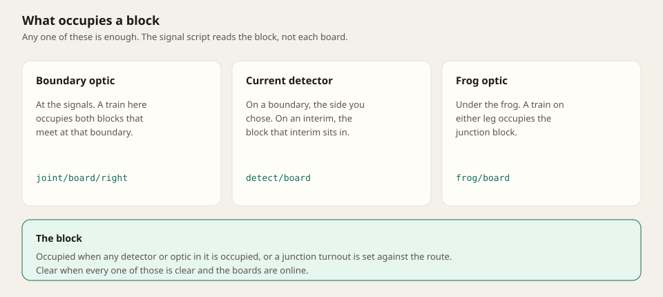
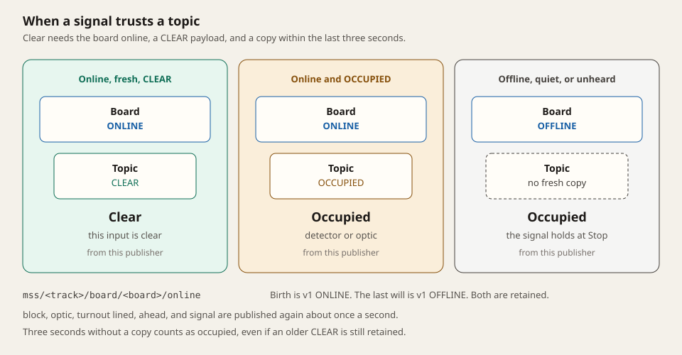
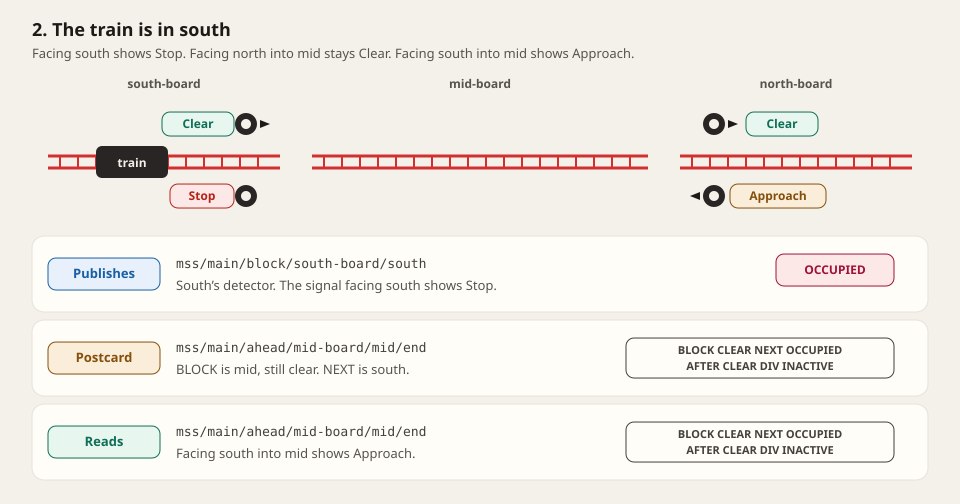
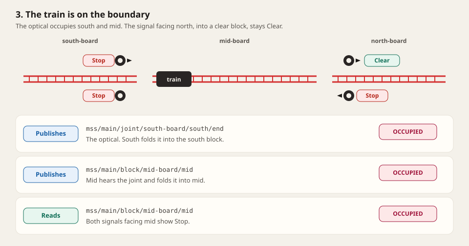
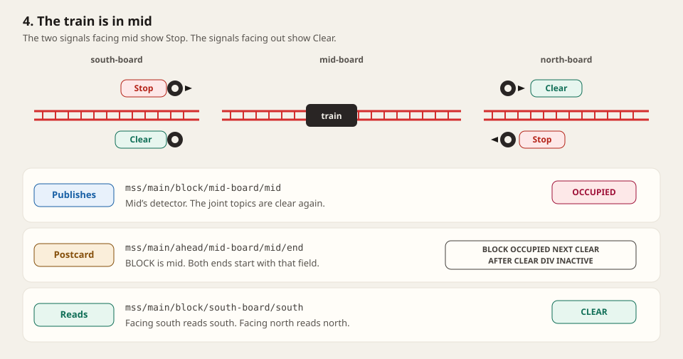
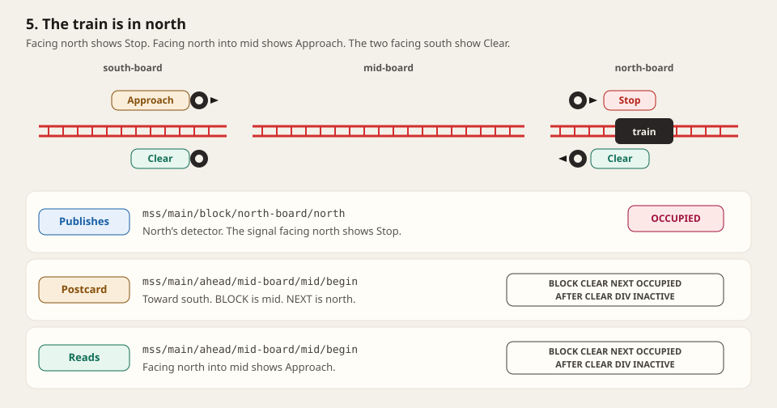

# Block signalling on ESPHome

The [Modular Signal System](http://www.modularsignalsystem.info/) (MSS 2.0.2) animates signals from the blocks ahead. No computer has to choose each aspect. This spec keeps those indications. A dispatcher can hold a home signal at Stop when you want that, and the same script fills the aspect once the hold lifts.

Each board publishes the occupancy it measured. Each signal runs one script over those topics. The Board Configurator would write the YAML. It does not generate this yet.


The standard, the fundamentals, and the planning notes are the three PDFs on the MSS site:

- [Design standard 2.0.2](http://www.modularsignalsystem.info/ModularSignalSystemStandardV2.0.2.pdf)
- [User guide part 1, fundamentals](http://www.modularsignalsystem.info/MSSUserGuide1.pdf)
- [User guide part 2, planning](http://www.modularsignalsystem.info/MSSUserGuide2.pdf)


Optical detectors and signal masts each have their own page in the configurator. **Block signalling** assigns them to the ends of a signal block. Skip that page when JMRI is still choosing every aspect.

On that page you add signal blocks. Each block uses current sensors you already created on the Blocks page. Each end of the block is a boundary. It gets an optical detector and two signals, one facing into the block and one facing out toward the neighbour. Optical detectors are their own page: a GPIO input for now, until the sensing circuit is filled in. When two signal blocks meet on this board, one end names the other block. An end that meets another module is filled in on the board's web page at the layout, or named in the configurator when you already know the neighbour.

## What stays the same

Each signalled track is its own set of topics. A signal block is a stretch of that track. A block is occupied when any of these is true:

- A current detector on its feeder sees a train.
- An optical detector at either boundary sees any part of a train. That sensor occupies both blocks, so the signals hold until the last car clears the boundary.
- A turnout in the block is set against the signalled route.



Signals stand at the block boundaries. The one facing a block shows the first row that matches:

| What the script sees | Indication |
|---|---|
| An absolute mast, and CATS is holding it | Stop |
| The block it protects is occupied | Stop |
| That block is clear, the next is occupied, and diverging is active | Approach Diverging |
| That block is clear, and the next block is occupied | Approach |
| Those two are clear, and the one after is occupied | Advance Approach |
| Those are clear, and a train is in the block behind | Clear |
| Nothing ahead, and the block behind is clear, with approach lighting on | Dark |
| Nothing ahead, and approach lighting is off | Clear |

Stop wins over everything. Approach Diverging replaces Approach, and only then. Advance Approach, Approach Diverging, and approach lighting are optional. Stop, Approach, and Clear are not. The absolute row applies only to a mast you mark Absolute. A permissive mast skips it.


A crossover module only detects. It has no signal. A cascade module is a block boundary and usually has the signals. A junction is a cascade where the signalled track splits. The route that is not lined is held occupied, so the signal facing that route stays at Stop. Approach Diverging is published only when the diverging route is lined and that block is actually clear. A signal one block back, with no Approach Diverging aspect, still sees the lined-away block as occupied, so it shows Approach.

Sidings and spurs that are not signalled stay out of this. Both rails are still gapped at each block boundary, and every feeder for a block still passes through a current detector. The planning guide's list is unchanged: one optical at each boundary, current detection on every module that feeds the track, and the turnout position on each signalled turnout.

## What the boards publish

A board publishes the facts it can measure. Retained, QoS 1. `OCCUPIED` or `CLEAR` for a block or a joint. `ACTIVE` or `INACTIVE` for diverging.

```
mss/<track>/block/<board>/<block>
mss/<track>/joint/<board>/<block>/<end>
mss/<track>/diverging/<board>/<name>
```

`block` is that block's signalling occupancy: its current detectors, opticals this board owns, a neighbour joint it has heard, a turnout against the route, and a route held occupied at a junction. `joint` is one optical, on its own, so the other block can count it before the neighbour republishes. `diverging` is `ACTIVE` only when the branch is lined and that block's own detectors are clear.

The Blocks page is separate. Those topics are for JMRI (`trains/track/sensor/...`, not retained). A current sensor used here is one you already created there. The signal script does not read the JMRI topic.

Each board also publishes:

```
mss/<track>/node/<board>/online
```

`ONLINE` while it is connected, `OFFLINE` as its last will. Both are retained. Block, joint, diverging, and postcard topics are published again about once a second. A subscriber treats a block or joint as occupied unless the board is `ONLINE`, the payload is `CLEAR`, and a copy arrived within the last three seconds. A missing diverging topic stays `INACTIVE`, so a dark neighbour shows Stop or Approach and does not show Approach Diverging.



On a home layout you name the next blocks in the configurator. The signal subscribes to those block topics, the joint topics, and the diverging topic. That is the whole input to the script.

At a meet you do not know the neighbour until the modules are placed. Open `http://<board-name>.local`. Each end that was left for the web page has two text boxes. The address box is already filled in with this end, slashes included, such as `board/block/end`. Copy that value into the other module. The box title uses dashes, like `board - block - end address`, because ESPHome rejects `/` in a name. The neighbour box starts empty. Paste the other module's address there, still with slashes. Editing the address box does not stick; it returns to this end. There is also a Signaled track field, already set to the name you flashed (usually `main`). Both modules must show the same track name. The broker address stays in the flashed file.

That end then publishes one postcard, retained, QoS 1:

```
mss/<track>/ahead/<board>/<block>/<end>
```

Four words, in order: `BLOCK NEXT AFTER DIVERGING`. `BLOCK` is this block. `NEXT` is the block beyond it. `AFTER` is one further. `DIVERGING` is `ACTIVE` or `INACTIVE`. A clear road reads `CLEAR CLEAR CLEAR INACTIVE`.

A crossover has a postcard out of each end. Its `BLOCK` is its own block topic. `NEXT`, `AFTER`, and `DIVERGING` come from the postcard on the other end: `NEXT` is that postcard's `BLOCK`, `AFTER` is its `NEXT`, and `DIVERGING` is passed through. The far signal learns the block beyond the crossover from that one message.

The board that owns an optical folds that sensor into its own block, and into the signal that protects the neighbour block. The neighbour folds the joint topic into its block topic. That is how the signal on the far side of the block drops to Stop.

## A plain stretch

Three boards, one signalled track named `main`. Block `south`, then `mid`, then `north`. Each boundary has two signals, one facing each way. The neighbours are paired on the web page, so the postcards are in use. A home layout with the same three names would subscribe to the block topics and leave the postcards out. The aspects in the pictures would be the same.


**south** is the cascade at the south end of `mid`. On its web page the north end's neighbour is `mid-board/mid/begin`.

- Current detector on block `south`. That occupancy is `mss/main/block/south-board/south`.
- Optical at the boundary, `mss/main/joint/south-board/south/end`. South folds it into the south block. Mid folds it into the mid block.
- The signal facing south protects `south`. Stop is the south block. A train that is only in `mid` does not put this signal at Stop.
- The signal facing north protects `mid`. Stop is mid's `BLOCK`. Approach is mid's `NEXT`, which is whatever mid copied from north.

**mid** is the crossover. Both ends are web-page neighbours, `south-board/south/end` and `north-board/north/begin`. It has a current detector and no signal. Its block topic is that detector plus the two joint topics. Its postcard toward north is `mss/main/ahead/mid-board/mid/end`. Its postcard toward south is `mss/main/ahead/mid-board/mid/begin`.

**north** mirrors south. Its south end's neighbour is `mid-board/mid/end`.

Watching MQTTX on `127.0.0.1:1883`, subscribe to `mss/main/#`.










Approach lighting is off in these pictures, so a clear road shows Clear. `AFTER` and `DIVERGING` stay clear, and every board stays online.

## A junction

Tick **The track splits here** on the signal block that holds the points. That is an advanced cascade in MSS: Beginning, Main, and Diverging, and each of those three signals faces into the block. The block you are editing is the straight route. Pick the branch and the point, or a pin, that lines it. Thrown lines the branch unless you untick that.


The inactive route is held occupied on its block topic, so a signal that has no Approach Diverging aspect still shows Approach. The diverging topic is `ACTIVE` only when the diverging route is lined and that block's detectors are clear. A crossover passes that field through in the postcard, so the signal one block back does not need the junction's name. On a home layout that signal subscribes to `mss/<track>/diverging/<board>/<name>` directly.

Advance Approach stays the block you named one past the next. It stays on that path when the junction is thrown.

## On the mast

The Signals page still paints the lamps. The script picks the aspect by the label you type there (`Stop`, `Approach`, and so on). One mast, one signal.

Approach lighting needs a Dark aspect with every lamp off, and the block behind the signal. The switch is per mast and starts off. With it off, a clear road stays Clear and the mast stays lit.

The signal starts at Stop until the topics it reads have reported.

Open `http://<board-name>.local` for the same brightness and blink sliders as any other mast.

## A dispatcher, when you want one

Permissive signals are the ones between stations. They follow the blocks, with the dispatcher left out. Home signals, and the signals at a junction, are the ones to mark **Absolute**.


An absolute mast listens on the topic it already has, `trains/track/signalmast/<name>`. The payload is the JMRI line, such as `Stop; Lit; Held`.

- `Held` forces Stop. The aspect word in that message can be stale, so the board does not paint it. Lit and Unlit are ignored.
- `Unheld` means the dispatcher has cleared the signal. The script then shows Clear, Approach, Advance Approach, or Approach Diverging.
- The board publishes the name of the aspect it is showing, and only that name. Example: `Approach`. A full `Approach; Lit; Unheld` line would clear the hold CATS had just set.

The mast topic is not retained, and CATS publishes when its rule changes. After a reboot an absolute mast stays at Stop until a fresh `Held` or `Unheld` arrives.

While that signal is cleared, the board ignores fascia throws for the points in the block it protects. After CATS returns the signal to Stop, those points stay locked until the block is clear. A permissive signal does not take that lock. A turnout against the route still occupies the block, which is enough for those signals.

With CATS closed, leave Absolute off. The line runs from the blocks alone.

In Designer, for each absolute mast:

- Check Hold on the signal template.
- Put the JMRI signal mast user name in the signal name field.
- Use a JMRI MQTT signal mast on this topic, with the same aspect names the Signals page shows.
- Leave the signal-head colour decoder fields empty. CATS is talking at mast level.

CATS lines points through the turnout topics the board already follows.
