# Block signalling on ESPHome

The [Modular Signal System](http://www.modularsignalsystem.info/) (MSS 2.0.2) animates signals from the blocks ahead. No computer has to choose each aspect. This spec keeps those indications. A dispatcher can hold a home signal at Stop when you want that, and the same script fills the aspect once the hold lifts.

There are three boards. A **boundary** and a **junction** end a block. An **interim** sits inside a block and only detects. Each board publishes what it measured. Each signal runs one script over those topics. The Board Configurator would write the YAML. It does not generate this yet.

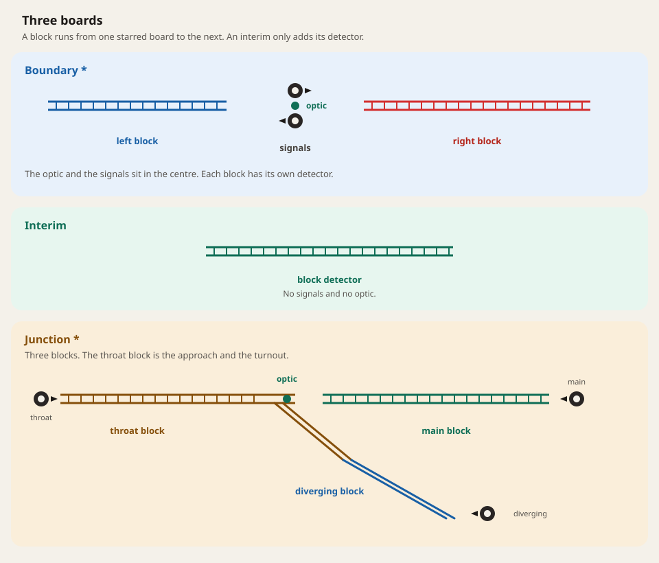

The standard, the fundamentals, and the planning notes are the three PDFs on the MSS site:

- [Design standard 2.0.2](http://www.modularsignalsystem.info/ModularSignalSystemStandardV2.0.2.pdf)
- [User guide part 1, fundamentals](http://www.modularsignalsystem.info/MSSUserGuide1.pdf)
- [User guide part 2, planning](http://www.modularsignalsystem.info/MSSUserGuide2.pdf)

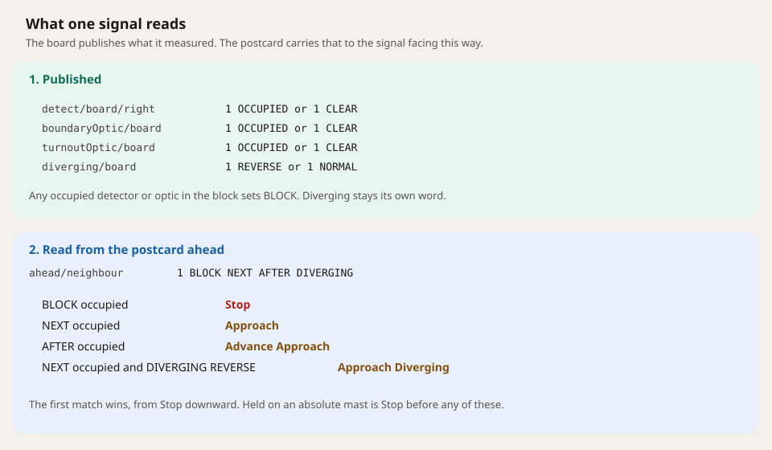

## The three boards

A block runs from one boundary or junction to the next boundary or junction. Those two are marked * below. An interim cannot be the end of a block.

**Boundary \*.** Signals facing both ways, an optic at the same place as the signals, and one current detector. The optic occupies both blocks that meet at the signals. The current detector occupies the block on one side. The web page has a left/right choice for that side. It starts on the left.

**Interim.** A current detector. No signals and no optic. The detector occupies the one block this board sits in. Several interims in a row all belong to that same block.

**Junction \*.** A turnout. One signal on each leg — throat, main, and branch — facing the turnout. One current detector. One optic under the frog, so a train on either leg is seen. The detector and the frog optic occupy the junction block. The frog optic does not occupy the blocks that approach the turnout.

Skip this when JMRI is still choosing every aspect. Optical detectors and signal masts each have their own page. The optic is a GPIO input for now, until the sensing circuit is filled in.

## What stays the same

Each signalled track is its own set of topics. A block is occupied when any of these is true:

- A current detector on a boundary, on the side chosen for that board, sees a train.
- A current detector on an interim in the block sees a train.
- The optic at a boundary sees any part of a train. That occupies both blocks that meet there, so the signals hold until the last car clears the joint.
- The frog optic sees a train on either leg of a junction.
- A turnout in a junction is set against the route that signal is protecting.


Signals stand at the boundaries, and on each leg of a junction. The one facing a block shows the first row that matches:

| What the script sees | Indication |
|---|---|
| An absolute mast, and CATS is holding it | Stop |
| The block it protects is occupied | Stop |
| That block is clear, the next is occupied, and diverging is active | Approach Diverging |
| That block is clear, and the next block is occupied | Approach |
| Those two are clear, and the one after is occupied | Advance Approach |
| Those are clear, and a train is in the block behind | Clear |
| Nothing ahead, and the block behind is clear, with approach lighting on | Dark |
| Nothing ahead, and approach lighting is off | Clear |

Stop wins over everything. Approach Diverging replaces Approach, and only then. Advance Approach, Approach Diverging, and approach lighting are optional. Stop, Approach, and Clear are not. The absolute row applies only to a mast you mark Absolute. A permissive mast skips it.

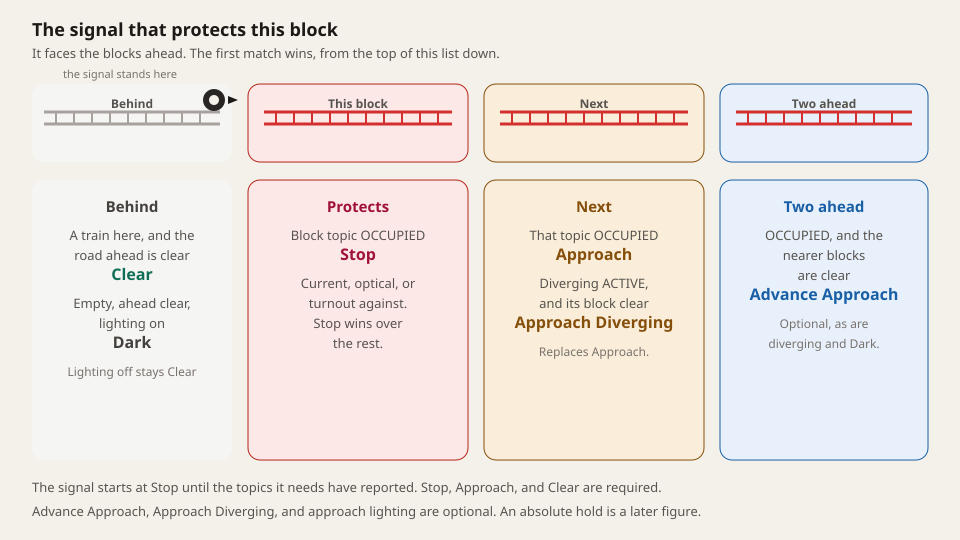

An interim is not a step in that list. A train on an interim occupies the whole block between the two starred boards, so the signals that protect that block show Stop. The next block shows Approach only when that whole block is the next one.

The route that is not lined at a junction is held occupied, so the signal on that leg stays at Stop. Approach Diverging is published only when the branch is lined and that block is actually clear. A signal that has no Approach Diverging aspect still sees the lined-away block as occupied, so it shows Approach.

Sidings and spurs that are not signalled stay out of this. Both rails are still gapped at each block boundary, and every feeder for a block still passes through a current detector.

## What the boards publish

A board publishes the facts it measured. Retained, QoS 1. `OCCUPIED` or `CLEAR` for a detector, a joint, or a turnout. `ACTIVE` or `INACTIVE` for diverging.

```
mss/<track>/detect/<board>
mss/<track>/joint/<board>/<end>
mss/<track>/turnout/<board>
mss/<track>/diverging/<board>
```

`detect` is that board's current detector. `joint` is the optic at one end of a boundary. `turnout` is the optic under the frog. `diverging` is `ACTIVE` only when the branch is lined and that block's own detectors are clear.

The Blocks page is separate. Those topics are for JMRI (`trains/track/sensor/...`, not retained). A current sensor used here is one you already created there. The signal script does not read the JMRI topic.

Each end also publishes one postcard, retained, QoS 1:

```
mss/<track>/ahead/<board>/<end>
```

Four words, in order: `BLOCK NEXT AFTER DIVERGING`. A clear road reads `CLEAR CLEAR CLEAR INACTIVE`.

An interim adds itself to the block and passes the rest through. `BLOCK` is occupied when its own detector is occupied or the postcard from the other end says the block is occupied. `NEXT`, `AFTER`, and `DIVERGING` are copied.

A boundary or a junction is the edge of a block. The postcard it sends across that edge names this block as `BLOCK`, the next signal block as `NEXT`, and the one after as `AFTER`.

Two boundaries can be neighbours with no interim between them. Each reads the other's postcard. A row of interims still adds up to one block, and `NEXT` still arrives at the far boundary. That is how a train in the following block becomes Approach on the signal behind the interims.

Each board also publishes:

```
mss/<track>/node/<board>/online
```

`ONLINE` while it is connected, `OFFLINE` as its last will. Both are retained. Detector, joint, turnout, diverging, and postcard topics are published again about once a second. A block input counts as occupied unless the board is `ONLINE`, the payload is `CLEAR`, and a copy arrived within the last three seconds. A missing diverging topic stays `INACTIVE`.


## Pairing

A boundary has two ends, **left** and **right**. A junction has three legs, **throat**, **main**, and **branch**. An interim has two ends, **one** and **two**. The buttons on an interim read Board one and Board two. Either button can take either neighbour. You use each button once.

Each end stores the neighbour's address, such as `east-board/left` or `gap-board/one`. That address is the end of the postcard and joint topics. Pairing writes it into the box on the web page. You can still correct it by hand.

**Flash** blinks the signals that face that end. Nothing is stored. Use it to see which side you are about to pair. An interim has no signals, so it has no Flash button. Flash the boundary or the junction, then press Pair on Board one or Board two.

**Pair** uses one topic for the whole track:

```
mss/<track>/pair
```

It is not retained. QoS 1. Pair one joint at a time.

1. Press Pair on one end. The board publishes `OFFER west-board/right` and flashes that side.
2. Press Pair on an end of the other board. That board publishes `ACCEPT east-board/left west-board/right`.
3. West stores `east-board/left` as its right neighbour. East stores `west-board/right` as its left neighbour.
4. Both ends flash three slow blinks. An interim has no signals, so the board with signals flashes, and both web pages show the new address. On an interim that address lands in Board one or Board two, whichever button you pressed.

An offer lasts 30 seconds. A new offer replaces one that has not been accepted. A board ignores an offer from itself.

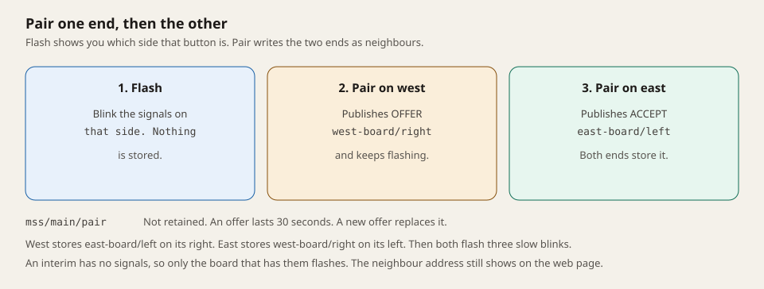

Open `http://<board-name>.local`. A boundary shows Left and Right, each with Flash and Pair. A junction shows Throat, Main, and Branch. An interim shows Board one and Board two, each with Pair, and the address box fills in when the pair is accepted. Both boards must use the same signalled track, usually `main`. The broker address stays in the flashed file.

## A plain stretch

West and east are boundaries. An interim named gap sits between them. That is one block. The track past east is the next block.

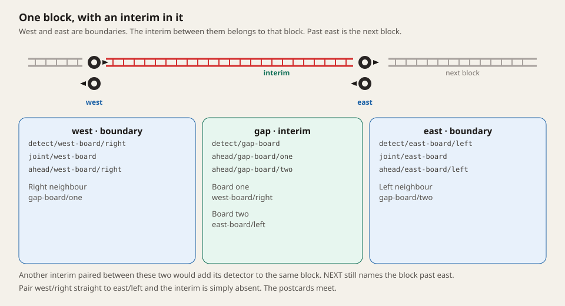

On the web page, west's right neighbour is `gap-board/one`. Board one shows `west-board/right`. Board two shows `east-board/left`. East's left neighbour is `gap-board/two`. East's right neighbour is whatever begins the next block.

The signal on west that faces east protects this block. Stop is this block. Approach is the next block, which east names in `NEXT`. The signal on east that faces east protects the next block. The signal on east that faces west protects this block.

Watching MQTTX on `127.0.0.1:1883`, subscribe to `mss/main/#`.

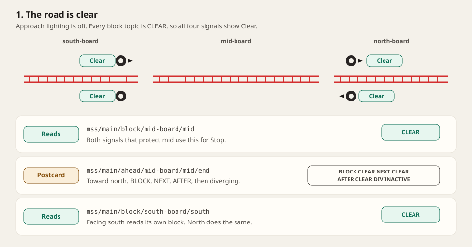

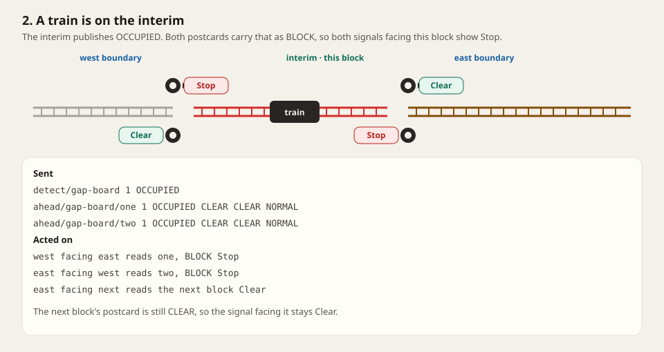

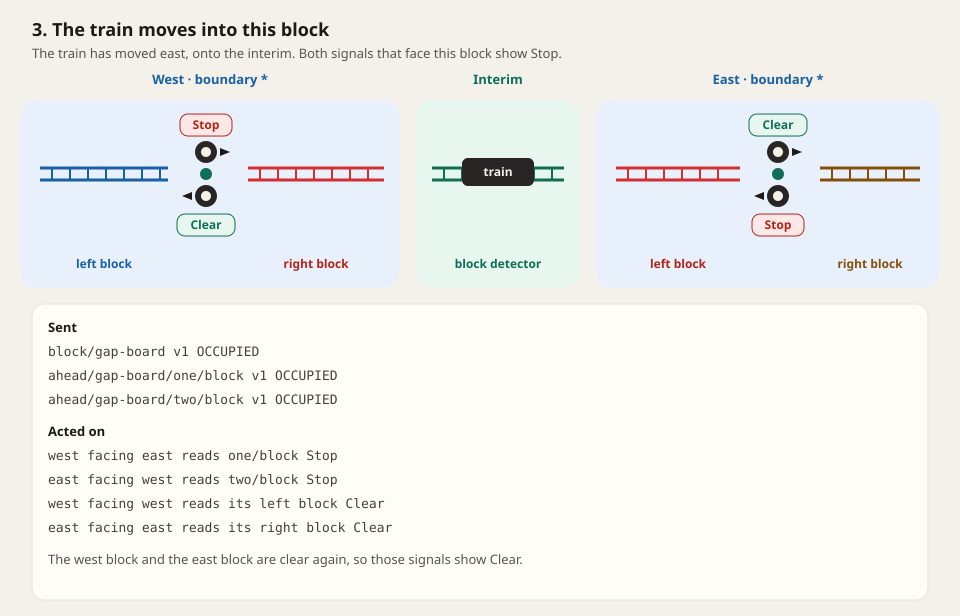

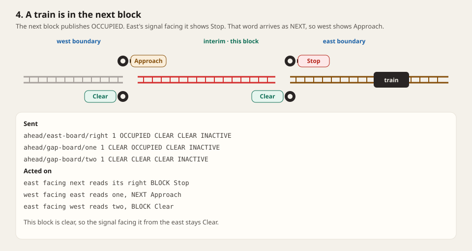

Approach lighting is off in these pictures, so a clear road shows Clear. Add another interim between west and east and a train on either interim still occupies this one block. Pair west straight to east, with no interim, and the same two signals still protect the block between them.

## A junction

A junction is a starred end of every block that meets it. The three signals face the turnout, so each one protects entry along that leg. The leg that is not lined is held occupied. The frog optic and the current detector occupy the junction block whichever way the train is moving.

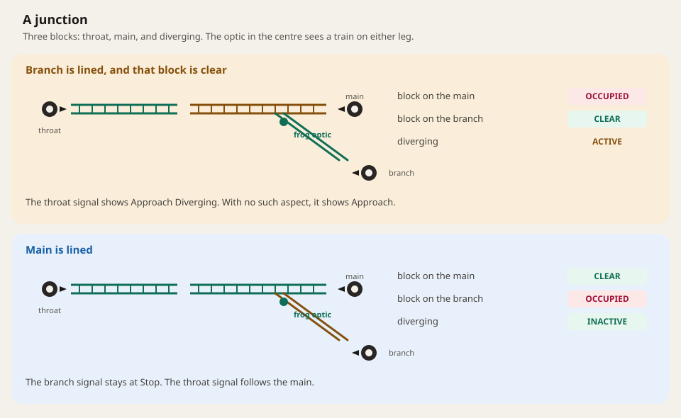

Thrown lines the branch unless you untick that on the web page. An interim on the way to the junction adds its detector to the approach block. The postcard into the junction carries that block as `BLOCK`. The junction sends `DIVERGING` as `ACTIVE` only when the branch is lined and clear, and the interim copies that field through to the boundary one block back.

Advance Approach stays the block you named one past the next. It stays on the straight path when the junction is thrown.

Pair each leg the same way as a left or right end. The buttons read Throat, Main, and Branch. Flash blinks the signal on that leg.

## On the mast

The Signals page still paints the lamps. The script picks the aspect by the label you type there (`Stop`, `Approach`, and so on). One mast, one signal.

Approach lighting needs a Dark aspect with every lamp off, and the block behind the signal. The switch is per mast and starts off. With it off, a clear road stays Clear and the mast stays lit.

The signal starts at Stop until the topics it reads have reported.

Open `http://<board-name>.local` for the same brightness and blink sliders as any other mast.

## A dispatcher, when you want one

Permissive signals are the ones between stations. They follow the blocks, with the dispatcher left out. Home signals, and the signals at a junction, are the ones to mark **Absolute**.

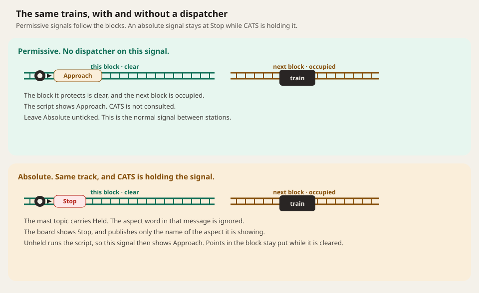

An absolute mast listens on the topic it already has, `trains/track/signalmast/<name>`. The payload is the JMRI line, such as `Stop; Lit; Held`.

- `Held` forces Stop. The aspect word in that message can be stale, so the board does not paint it. Lit and Unlit are ignored.
- `Unheld` means the dispatcher has cleared the signal. The script then shows Clear, Approach, Advance Approach, or Approach Diverging.
- The board publishes the name of the aspect it is showing, and only that name. Example: `Approach`. A full `Approach; Lit; Unheld` line would clear the hold CATS had just set.

The mast topic is not retained, and CATS publishes when its rule changes. After a reboot an absolute mast stays at Stop until a fresh `Held` or `Unheld` arrives.

While that signal is cleared, the board ignores fascia throws for the points in the block it protects. After CATS returns the signal to Stop, those points stay locked until the block is clear. A permissive signal does not take that lock. A turnout against the route still occupies the block, which is enough for those signals.

With CATS closed, leave Absolute off. The line runs from the blocks alone.

In Designer, for each absolute mast:

- Check Hold on the signal template.
- Put the JMRI signal mast user name in the signal name field.
- Use a JMRI MQTT signal mast on this topic, with the same aspect names the Signals page shows.
- Leave the signal-head colour decoder fields empty. CATS is talking at mast level.

CATS lines points through the turnout topics the board already follows.
