# Field Logic Guide

Field Logic lets a board work out its own signals, so they keep working when JMRI is closed. You do not write rules for it. You **draw your track** on the configurator's **Logic** page, cut it into blocks, and stand signals on it. The board works out from the drawing which trains may go where, and it keeps them apart by itself. Your own buttons, switches, lamps and rules come on top, and they can only hold a signal back. They can never clear one that the drawing would keep at Stop.

This guide builds one example from an empty board: a **gauntlet over a bridge**. Then it has two shorter chapters: a **crossing loop** with two turnouts, and an **industry siding** worked from a local panel.

MSS Logic, the second mode, has its own [MSS Logic Guide](mss-logic-guide.md). Read this guide first.

Use this after the [First Board Setup Guide](first-board-setup-guide.md) and the [JMRI MQTT Verification Guide](jmri-mqtt-verification-guide.md). Your board should be online in ESPHome, and JMRI should have its MQTT connection set up.

> **Testers:** the Logic page is not on the live configurator yet. Until it is, open it from the `feature/logic` branch. Download the branch as a ZIP from GitHub (**Code → Download ZIP** on the `feature/logic` branch), unzip it, and open `configurator/index.html` in Chrome or Edge. It does not see the board saved on the live site, so bring it across with **Import → From a file** and your `board.yaml`.

---

## The worked example

Two tracks come together to cross a single bridge, then separate again. Only one train may be on the bridge at a time, and a signal at each end tells the driver when it may go.

- Three blocks: **Left**, **Bridge** and **Right**. Each has a current detector: **Left current**, **Bridge current** and **Right current**.
- Two signals: **Left Bridge**, for trains heading right onto the bridge, and **Right Bridge**, for trains heading left.
- Each outer track carries trains one way only. A train from Left crosses the bridge and leaves on its own track at the top right. It never goes back out through Right.

The Bridge block runs from one signal to the other, and out along both tracks that trains leave by. Wire its detector's feeders to all of that track, so a train is seen until it has left the board.

> **Screenshot placeholder:** a sketch of the gauntlet: two tracks converging onto a bridge, the Left, Bridge and Right blocks marked, and a signal at each end of the bridge.

---

## Step 1: The board's name, and a clean start

Boards that run logic need a name that no other board at a meet has. The configurator adds six characters to every new board's name, such as `gauntlet-k7m4x2`. Those six characters are this board's own, and they stay when you rename it.

1. Open the configurator's **Board** page.
2. Type **gauntlet** in **Board name**, and fill in your Wi-Fi as in the first board guide.
3. Look just after the box. The suffix is the dash and six characters in the blue tag, such as `-k7m4x2`. If there is none, click the blue **Add a suffix** button under the box.

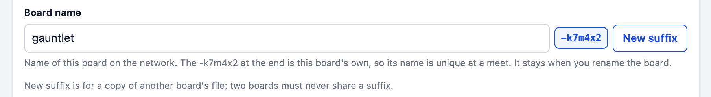

**Copied a file?** If you made this board from another board's `board.yaml`, click **New suffix**, then **Yes, give it a new suffix**. Two boards must never share a suffix. A new suffix changes the board's network name, so the next flash must be by USB.

A new board comes with an example sensor (**Kiama/Up XOver**) and an example turnout (**Kiama/Up Loop**). The gauntlet uses neither. On the **Sensors** page, click **Clear this page**, then **Yes, clear the Sensors page**. Do the same on the **Turnouts** page.

You do not need to add sensors or signals on their own pages first. The Logic page makes each one where it goes on the drawing.

---

## Step 2: Choose Field Logic

1. Open the **Logic** page.
2. Under **Logic**, pick **Field Logic**.

The page now shows one line for the mode, the six steps, and an empty drawing:

The steps are **Draw**, **Sensors**, **Signals**, **Behaviour and rules**, **Try it** and **Download**. A step opens once the one before it has something in it. A step with problems shows how many, such as *2 problems*. Each step ends with a blue **Next** button.

### Settings and linked boards

Click **Settings and linked boards**, at the right of the top line, to see them. Click **Hide the settings** to fold them away again.

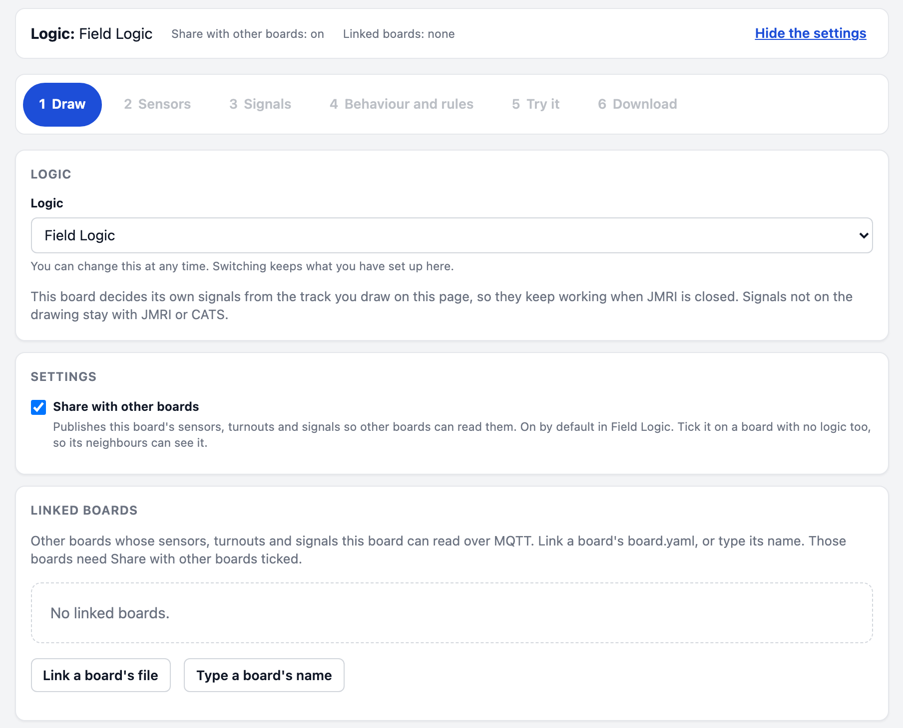

Leave **Share with other boards** ticked. It makes the board publish what other boards need to read it:

| What | Topic | JMRI sees it? |
|---|---|---|
| Board online | `trains/track/sensor/board/<board>/Online` | Yes, as a sensor |
| Each sensor's state, kept on the broker | `<sensor topic>/State` | No |
| Each turnout's movement | `trains/track/sensor/<turnout>/Moving` | No |
| Each signal's aspect | `<mast topic>/State` | No |

The board also checks that no other board on the broker has its name. If one does, it says **Clash** on the board's web page, under **Board name check**, and in its logs.

**Linked boards** are for reading the board next door. See [Reading another board's sensors](#reading-another-boards-sensors).

---

## Step 3: Draw the track

The drawing is a grid of dots. Track runs from dot to dot, straight across, straight up and down, or at 45 degrees. Below, a *space* is the gap from one dot to the next.

1. With **Draw** picked, press on a dot, drag to another dot, and let go. That draws one straight line. Two clicks, one at each end, do the same.
2. Draw the gauntlet on three rows of dots, one space apart, leaving a space free at the left:
   - the top left track: three spaces along the top row, then a slope one space down and right, to the middle row
   - the bottom left track: three spaces along the bottom row, then a slope one space up and right, to the same dot
   - the bridge: four spaces along the middle row
   - the right side, the same as the left turned round: a slope up and three spaces along the top row, and a slope down and three spaces along the bottom row.

   Lines that meet at a dot join there.
3. Drew one wrong? Pick **Erase** and drag along it.

Where three lines meet, the page draws a red **?**. It cannot tell whether there is a turnout there. The Draw step shows *2 problems* until you say.

4. Click **Select**, then click the first **?**. The panel beside the drawing says **Where three lines meet**.

5. Under **Turnout**, pick **No turnout: two tracks that join, as on a gauntlet**. Do the same for the other **?**.
6. Say which way trains run on the outer tracks. Click the top left track. Under **Trains run**, pick **Only right**. Make the bottom left track **Only left**, the top right track **Only right**, and the bottom right track **Only left**. An arrow on the track shows the way.

One way applies up to the next turnout, crossing or end. The bridge itself stays **Both ways**.

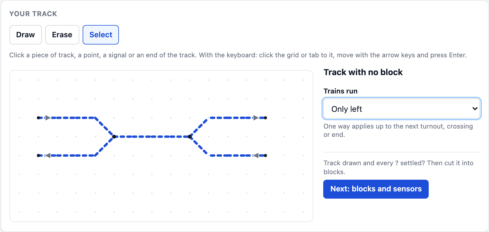

Success looks like:
- The Draw step shows a tick and no problems.
- Click **Next: blocks and sensors**.

---

## Step 4: Blocks and sensors

A **block** is the stretch of track between two **block breaks**: short lines across the track. Signals stand at block breaks, so each signal's place needs one.

1. Click the dot on the top left track where Left Bridge will stand, two spaces in from the left end. The panel says **Point on the track**. Click **Add a block break**.
2. Click the dot on the bottom right track where Right Bridge will stand, two spaces in from the right end, and add a break there too.

That cuts the track into three pieces: the top left end, everything in the middle, and the bottom right end.

3. Click the top left piece. Under **Block name**, type **Left**. The **MQTT topic** fills in as `trains/track/sensor/Left`.
4. Under **New sensor in this block**, the name is already **Left current**. Click **Add the sensor**. The page makes the sensor on the next free pin and ticks it under **Sensors in this block**. A green note says which pin it took. Its full settings are on the Sensors page.
5. Do the same for the middle piece (**Bridge**, with **Bridge current**) and the bottom right piece (**Right**, with **Right current**).

A block with no sensor is drawn dashed: nothing sees a train there.

The three yellow warnings say that no signal checks each block yet. That is right for now. They go in the next step.

**Optical sensors at a break.** A current detector misses unpowered cars, so the tail of a train can leave a block reading clear. An optical sensor at the block break covers that. Click the break, and tick the sensor under **Sensors at this break**. A sensor at a break holds the blocks on both sides occupied.

**Wiring.** Wire each sensor's output to its pin, and its GND to GND (see [detector wiring](README.md)). An optical sensor module needs a digital output (often labelled `DO` or `OUT`) that goes low when it sees something, and a pull-up of its own. Most modules with a `DO` pin have one.

**Timing.** Each block has a folded **Timing** section. **Free its track when clear for** is how long the block must stay clear behind a train before another train can have its track (3 seconds unless you change it). **Hold after cancelling** keeps the track for a while if a signal drops in front of a train (railways call this approach locking).

Success looks like:
- The three blocks are named and drawn solid, each with its sensor ticked.
- The **Sensors** page lists Left current, Bridge current and Right current.
- Click **Next: signals**.

---

## Step 5: Signals

1. Click the block break on the top left track. Its panel has a **New signal for trains heading right** box.
2. Type **Left Bridge** in its **Name**. Leave **Kind of mast** on **One head: a red, a yellow and a green LED**, and click **Make the signal**.
3. Click the block break on the bottom right track. In **New signal for trains heading left**, make **Right Bridge** the same way.

The page makes each mast on the **Signal Masts** page, with its lamps on free pins and its aspects from the CATS list, and stands it on the drawing. Its head is on the driver's left, and its arrow points the way its trains go.

> **Running out of pins?** A mast of three LEDs takes three pins. If the board has too few left, the page says so and makes nothing. Pick **One head: one WS2812B LED** instead: one pin for the whole mast.

4. Say what is beyond each end that trains leave by. Click the dot at the right end of the top right track. Under **Beyond this end**, pick **Plain track, no more signals: the signal before it can show Clear**. Do the same at the left end of the bottom left track. Each end now says *plain track*.

Other choices at the end of a track are **End of signalled track** (the signal before it shows Approach at best) and **Another board** (see [Reading another board's sensors](#reading-another-boards-sensors)).

A signal's panel has more, all optional:

- **Button for** the signal: a push button on the fascia, wired to GND. See [Auto and Manual](#auto-and-manual).
- **Manual only**: always asked for by a person, whatever the Auto/Manual switch says.
- **Light only while a train comes up to it**: approach lighting. The signal is dark until the block behind it is occupied.
- **Aspects for each meaning**: which of the mast's aspects it shows for Stop, Approach, Clear and the rest. The usual ones are filled in for you.

Success looks like:
- No message at the top of the page. Each step up to **Try it** has a tick.
- The **Signal Masts** page lists Left Bridge and Right Bridge.
- Click **Next: behaviour and rules**.

---

## Step 6: See what protects the bridge

You have not written a single rule, and the bridge is already protected. Click things on the drawing to see how.

**Click the Bridge block.** The panel says:

> *Signals "Left Bridge" and "Right Bridge" each have a route onto this block. Only one of those routes can be set at a time: a route takes all its track at once, and gives it back behind its train.*

The two routes are drawn in blue.

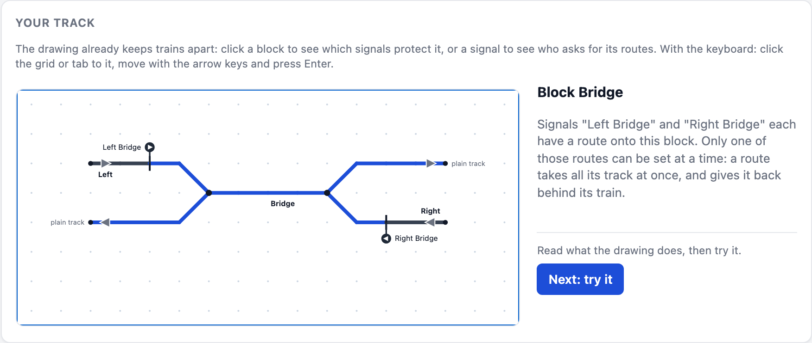

**Click Left Bridge.** The panel says it is a **controlled signal**: a route from it can clash with another signal's, so it clears only for a route that has been **asked for** and **set**.

Here is what that means for a train:

1. **Asked for.** A train arrives in Left. The board asks for Left Bridge's route over the bridge.
2. **Set.** If the bridge is free, and no other route holds any of its track, the route is set. It takes the Bridge block for this train, and Left Bridge clears.
3. **Released.** Once the train is in the Bridge block, Left Bridge goes back to Stop. When the train has gone and the Bridge block has been clear for its 3 seconds, the bridge is given back.

While Left Bridge's route holds the bridge, Right Bridge's cannot be set, so a train in Right waits at Stop. The two signals can never both clear.

A signal whose routes can never clash with another's is a **block signal**. It does not need asking: it shows the best the track ahead allows.

### Auto and Manual

The board has an **Auto** switch (on its web page, and as a light in JMRI). It decides who asks for a controlled signal's route:

- **Auto** (the usual): the board asks, when a train arrives at the signal. If the train never comes, the request is dropped once the block behind has been clear for its time.
- **Manual**: a person asks. CATS or JMRI asks by clearing (unholding) the signal, or someone presses the signal's **Button**. Holding the signal again, or pressing its button again, cancels the request.

---

## Step 7: A button and a rule

Now add something of your own: Left Bridge should stay at Stop until the driver presses a **go** button on the fascia.

1. Still in **Behaviour and rules**, click **Left Bridge**.
2. Click **Example: hold this signal until a button is pressed**.

The page puts a button called **Left Bridge go** on the drawing below the signal, marked **B**, and writes one rule on Left Bridge. A red message says the button has no pin yet.

3. Click the **B** on the drawing. Under **Pin**, pick the pin the button is wired to. Skip pins marked *(strapping)*: the ESP32 reads those at start-up.

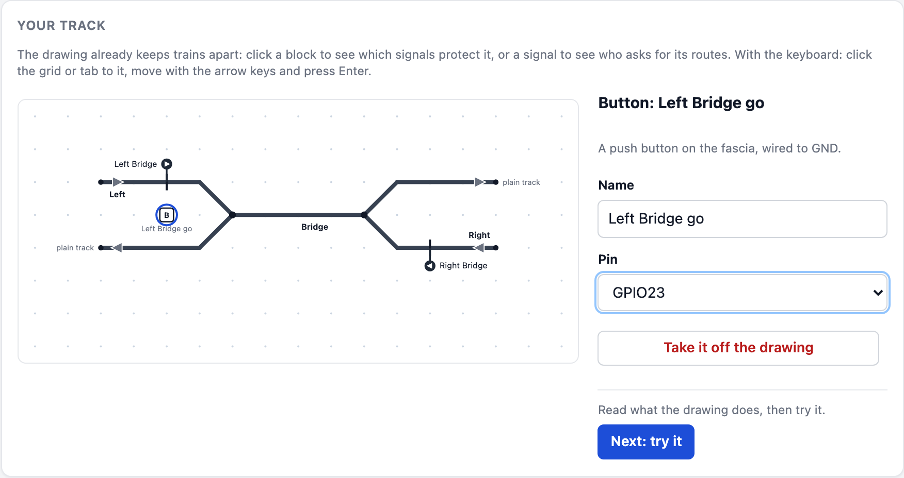

4. Click **Left Bridge** again. Under **Rules on Left Bridge** is the rule, as one sentence:

> *Keep at Stop unless: Left Bridge go was pressed in the last 30 seconds.*

A dotted line on the drawing joins the signal to what its rule reads.

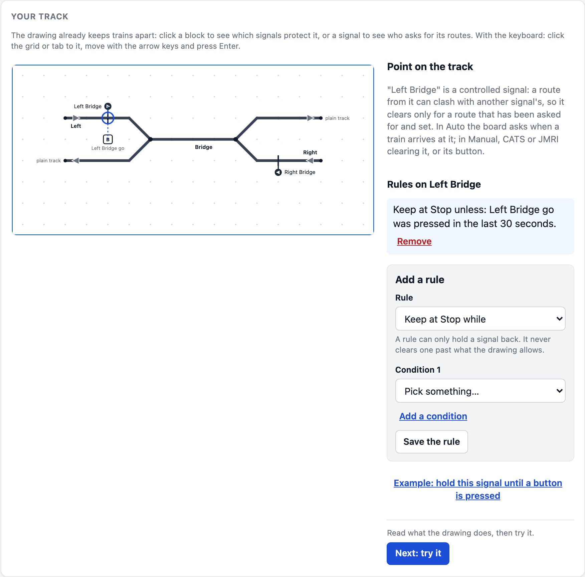

A rule can only hold a signal back. With this one, Left Bridge still needs its route set over the bridge, **and** the button pressed in the last 30 seconds.

**Your own rules.** Use **Add a rule** under any signal, turnout or lamp:

1. Pick the **Rule**: for a signal, *Keep at Stop while*, *Keep at Stop unless* or *No better than Approach while*; for a turnout, *Lock it while* or *Only its own buttons move it while*; for a lamp, *Light while* or *Flash while*.
2. Pick what it reads under **Condition 1**: a block, turnout, signal, switch or button, and what it must be. **Add a condition** adds another, with **All of them** or **Any of them**.
3. Click **Save the rule**. It reads back as a sentence. **Remove** takes it away.

**Buttons, switches and lamps.** Click an empty dot on the drawing to put one there. Pick its **Kind**, give it a name and a pin, and click **Put it here**. A switch is a toggle on the fascia, on when closed to GND. A lamp is an LED.

Success looks like:
- No message at the top of the page.
- Click **Next: try it**.

---

## Step 8: Try it

**Try it** lets you work the track on the page before you flash anything. Nothing here touches the layout or the board.

- Click a **block** to put a train in it, and again to take it out.
- Click a **turnout** to throw it (unless it is locked), a **button** to press it, a **switch** to flip it.
- Click a **signal** to see what it shows and why. **Ask for a route** and **Cancel its route** do what its button, or CATS, would.
- **Step** moves time on a tenth of a second. **Skip ahead 1 second** and **Skip ahead 10 seconds** move it further. **Start again** clears everything.
- **Switch to Manual** flips the Auto switch.

Train in red, a route set and waiting for its train in green, track taken by a route in grey, and a locked turnout with a black square.

1. **Put a train in Left.** Click the Left block, then **Skip ahead 1 second**.

The board has asked for Left Bridge's route and set it: the whole route over the bridge is green. But Left Bridge still shows **Stop**, because nobody has pressed the go button.

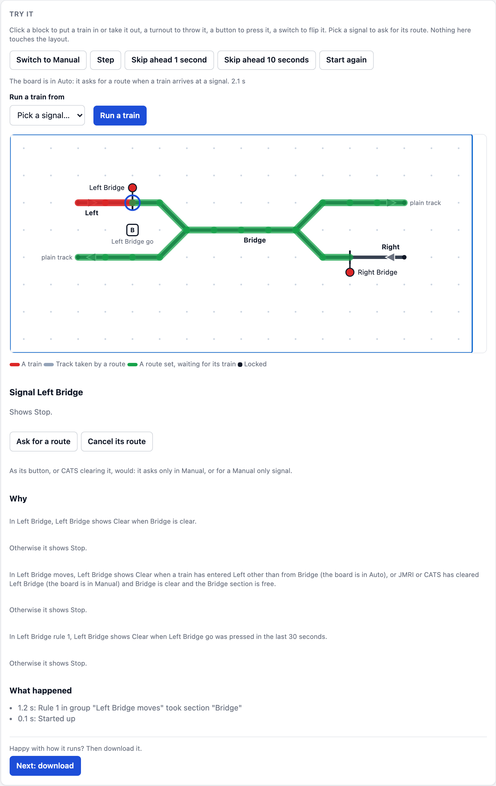

2. **Press the button.** Click the **B**, then **Step**. Left Bridge shows **Clear**.
3. **Put a train in Right**, then **Skip ahead 1 second**. Click Right Bridge: it shows **Stop**. The bridge is Left Bridge's, so this train waits.

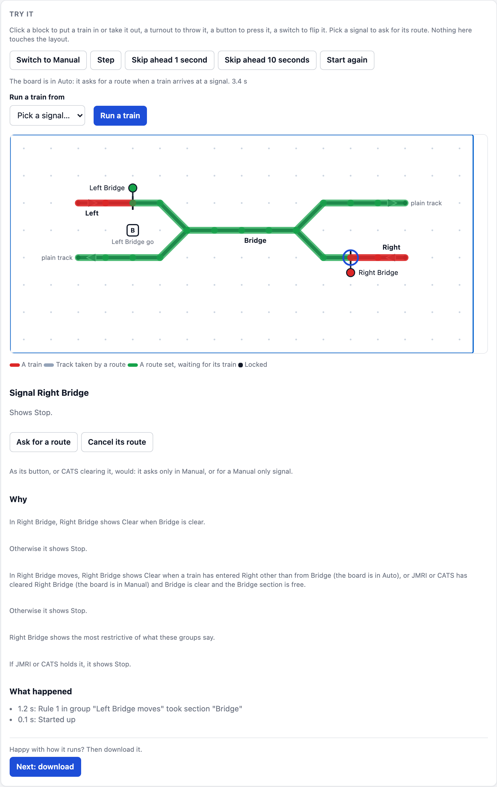

4. **Let the first train cross.** Click Bridge (the train is on it), then Left (it has left Left), and **Skip ahead 1 second** after each. Then click Bridge again (it has left), and **Skip ahead 10 seconds** twice.
5. Click Right Bridge. It now shows **Clear**: the bridge was given back 3 seconds after the train left it, and the waiting train's route was set.

**Why** under a signal says what it shows in each case, one sentence for each part that sets it: the drawing's own (named after the signal, and *<signal> moves* for its routes) and each of your rules (*Left Bridge rule 1*). **What happened** lists what the board did, newest first.

**Run a train.** Pick a signal under **Run a train from** and click **Run a train**. A train runs from the block behind it along the route its turnouts are set for, block by block.

---

## Problems

The page checks your work as you go. Messages appear in the box at the top of every page, and under the drawing as **Problems in this step**. The step they belong to shows a count. Each says what is wrong and what to do.

- A red message is an **error**. It stops the download until you fix it.
- A yellow message is a **warning**. It never stops the download, but read it.
- Click **Show** to go to the step it belongs to.

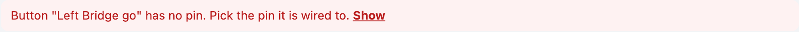

Some you may meet:

| The message says | What to do |
|---|---|
| *Pick the turnout at the point at …, or choose no turnout for gauntlet track.* | Click the **?** in the Draw step and say what is there. |
| *No signal on the drawing checks block "…"* | A warning: a train standing there holds no signal at Stop. Put a signal before it, unless you only want to see the block in JMRI. |
| *Some track past signal "…" has no sensor of its own* | A train standing on that track may not be seen. Put that track in a block with a sensor. |
| *Button "…" is on GPIO…, which "…" already uses* | A pin can do one job. Pick another pin. |

Once nothing else is wrong, the page also runs a **checker**. It tries the drawing and your rules against every mix of trains it can, and warns if a train could wait for ever, or a rule can never apply. A big station is checked from its routes instead. A head-on meeting with a train that came in from beyond an end of the drawing is not counted: the layout beyond holds that train, or you release the route by hand.

---

## Step 9: Download and flash

### The Logic version

1. Click **Next: download**, or open the **Download** page. With Field Logic, the first card is **Logic version**, with a short code such as `1c4e6ea0`. Under it are **Download summary** and **Warnings about the logic**.

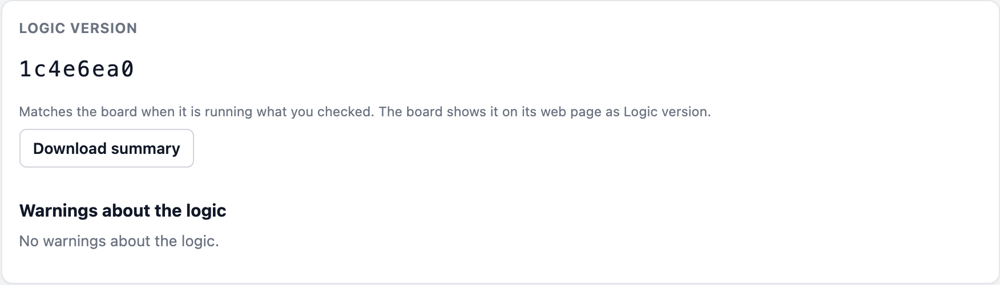

Your code may be different: it is worked out from your drawing and rules, and changes whenever they do. After you flash, the board shows the same code on its web page (**Logic version**). If they differ, the board is running an older file: flash again.

**Download summary** saves a one-page file, `<board name>-summary.html`, to print and keep under the module: each signal with what it shows, each block with its sensors and their pins. It carries the Logic version too.

### Flash

Download the YAML and install it, as in the [First Board Setup Guide](first-board-setup-guide.md). Install by USB if you added a suffix. Otherwise install wirelessly. The first build is long, because ESPHome fetches the Field Logic component from GitHub.

Success looks like the board's web page showing:
- **Logic version**, with the same code as the Download page
- a **Field logic** switch and an **Auto** switch, both on
- a **Release Left Bridge** and a **Release Right Bridge** button.

> **Screenshot placeholder:** the board's web page with the Field logic and Auto switches, Logic version and the two Release buttons.

### Check it in MQTTX

Open MQTTX, connect to `127.0.0.1:1883` with no username, and subscribe to `trains/#`. The names below are for the board `gauntlet-k7m4x2`. Yours will have its own suffix.

| Topic | What it shows |
|---|---|
| `trains/track/sensor/Left` (and `Bridge`, `Right`) | Each block: `ACTIVE` while occupied, `INACTIVE` when clear. |
| `trains/track/sensor/logic/gauntlet-k7m4x2/Bridge/Held` | `ACTIVE` while a route holds the bridge, `INACTIVE` when it is free. Watch this one first. |
| `trains/track/logic/gauntlet-k7m4x2/Bridge/State` | The bridge in a word: `IDLE` (free), `ACTIVE` (taken, waiting for the train), `PASSED` (the train is on it) or `CANCELLING` (held a while after the request was dropped). |
| `trains/track/signalmast/Left Bridge/State` | The aspect Left Bridge is showing, by its JMRI aspect name. |
| `trains/track/light/logic/gauntlet-k7m4x2` | `ON` or `OFF`: the **Field logic** switch. |
| `trains/track/light/auto/gauntlet-k7m4x2` | `ON` in Auto, `OFF` in Manual. |
| `trains/track/logic/gauntlet-k7m4x2/Version` | The Logic version, as the board sent it when it connected. |

Try it for real:

1. Run a train into Left (or cover the Left current detector). `Bridge/Held` goes `ACTIVE`, and `Bridge/State` goes `ACTIVE`. Left Bridge stays at Stop.
2. Press the go button. Left Bridge goes Clear.
3. Let the train onto the bridge. `Bridge/State` goes `PASSED`, and Left Bridge goes back to Stop.
4. Once the train has left the Bridge block, and 3 seconds later, `Bridge/State` goes `IDLE` and `Held` goes `INACTIVE`.

> **Screenshot placeholder:** MQTTX showing the Bridge Held and State topics, and Left Bridge's State.

### In JMRI

On the Download page, under **JMRI tables**, tick **Logic**, then click **Download JMRI XML** and load it in PanelPro (**File → Load table content and panels**, then **File → Store table content and panels**). It adds:

- a sensor for each block (`MSLeft`, `MSBridge`, `MSRight`) and the board's Online sensor
- `MSlogic/gauntlet-k7m4x2/Bridge/Held`, which mirrors Held
- a **Release** turnout for each signal's routes, such as `MTlogic/gauntlet-k7m4x2/Left Bridge moves/Release`
- the lights `MLlogic/gauntlet-k7m4x2` (Field logic on or off) and `MLauto/gauntlet-k7m4x2` (Auto or Manual).

CATS can use `MSBridge` as the block's detector.

### Logic on and off, and Release

**Field logic.** Turn the switch off, and the board hands its signals back to JMRI and CATS. Turn it on, and the board works them out again. The light `MLlogic/<board>` does the same from JMRI. Signals that are not on the drawing are never affected.

**Release.** If a detector fails or a train stalls, a route can stay set. Press **Release Left Bridge** on the board's web page (or throw its Release turnout in JMRI) to free that signal's route by hand. The signal goes to Stop. Releasing with a train still on the track is your call. A release that arrives in the first 5 seconds after the board connects is ignored, because it may have been waiting on the broker for hours.

### CATS hold

CATS has a **Hold Only** option on a signal template. With it, CATS does not set the aspect. It only holds the signal at Stop, and lets go.

- A held signal shows Stop, whatever the drawing says.
- In **Manual**, letting go of the hold asks for the signal's route, and holding it again cancels the request.
- A hold left on the broker when JMRI closed keeps the signal at Stop. That is on purpose. Unhold the signal in CATS or JMRI to clear it.

---

## More sensor pins: an expander

Logic boards need a lot of inputs. When the Sensors page says no ESP pins are free, add an **MCP23017 expander**. It adds 16 sensor pins over I2C.

1. On the **Sensors** page, scroll past the sensors to **Expanders (MCP23017)** and click **Add expander**. A card called **MCP 1** appears.
2. Check its **I2C bus**. On a board with a PCA9685 for turnouts, it says **Shares PCA9685 1**: keep it. Otherwise pick **Its own SDA and SCL pins** and set them.
3. Set **Address** to match the A0, A1 and A2 links on the expander board. All three to GND is `0x20`.
4. Click the **Add sensor** button inside the MCP 1 card. The sensor is listed under the expander, on its first free pin, such as **MCP 1 · A0**. Change its **Pin** to the one you wired.

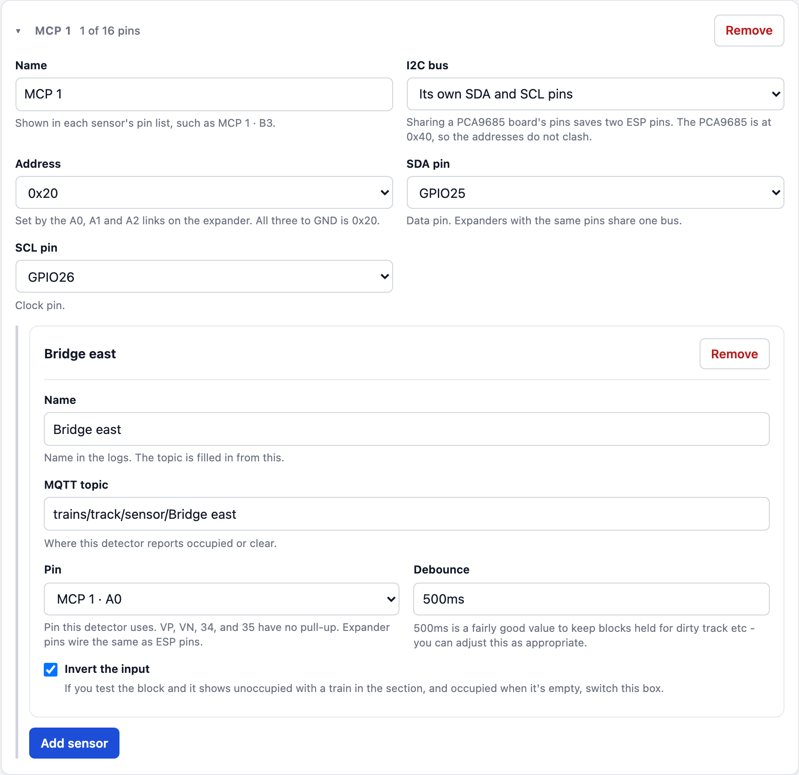

The sensor is then on the Logic page's block lists like any other: tick it under **Sensors in this block**, or under **Sensors at this break**.

If an expander stops answering, any block with a sensor on it reads **occupied** until it answers again. A train is never lost that way.

---

## Reading another board's sensors

A block can include a sensor from the board next door, such as an optical sensor at the edge of that board. That board must have **Share with other boards** ticked.

1. Click **Settings and linked boards**. Under **Linked boards**, click **Link a board's file** and pick the other board's `board.yaml`. Only its names and topics are kept, never its Wi-Fi or passwords.
   - No file to hand? Click **Type a board's name**, type its full name, suffix included, and list its sensors one per line.
2. When the other board changes, click **Refresh** on it and pick its file again.

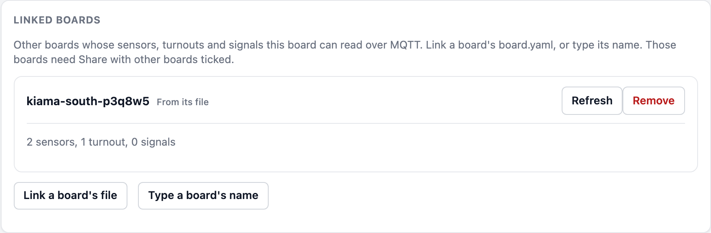

3. In the **Sensors** step, click a block. Under **Sensors in this block**, that board's sensors are listed under its name, below this board's. Tick the one you want.

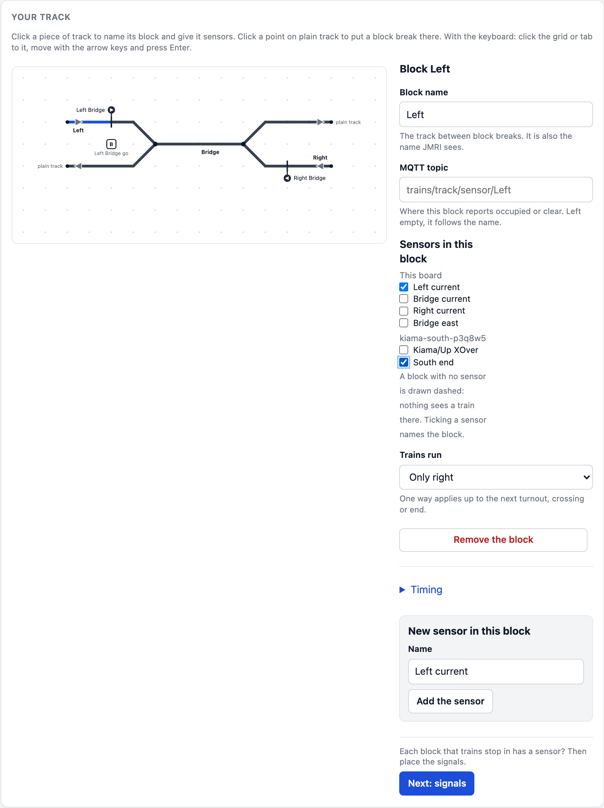

A sensor from another board counts as **occupied** until this board has heard from it, and whenever that board is offline. A block that uses one reads occupied until both boards are running. It is never clear by mistake.

An end of the drawing can lead to a linked board too: under **Beyond this end**, pick **Another board**, then its next signal and its blocks that must be clear.

---

## A crossing loop

A single line with a loop where two trains can pass. Start a new board, or clear the Sensors, Turnouts, Signal Masts and Logic pages of this one (Logic keeps Field Logic and Share).

**Draw.** A main line 16 spaces long, and the loop above it: a slope up from three spaces in, eight spaces along the row above, and a slope back down, three spaces from the other end. Where the slopes leave the main line, the page draws a **?**.

1. Click each **?**. Under **New turnout here**, name it (**West turnout**, **East turnout**) and click **Make the turnout**. The page makes the turnout on the Turnouts page.
2. **Straight line goes** is already **The line that carries straight on**. Change **Turnout is straight when** if yours is straight when thrown.
3. Leave **Lock it while a train is on it** ticked, so its points never move under a train.

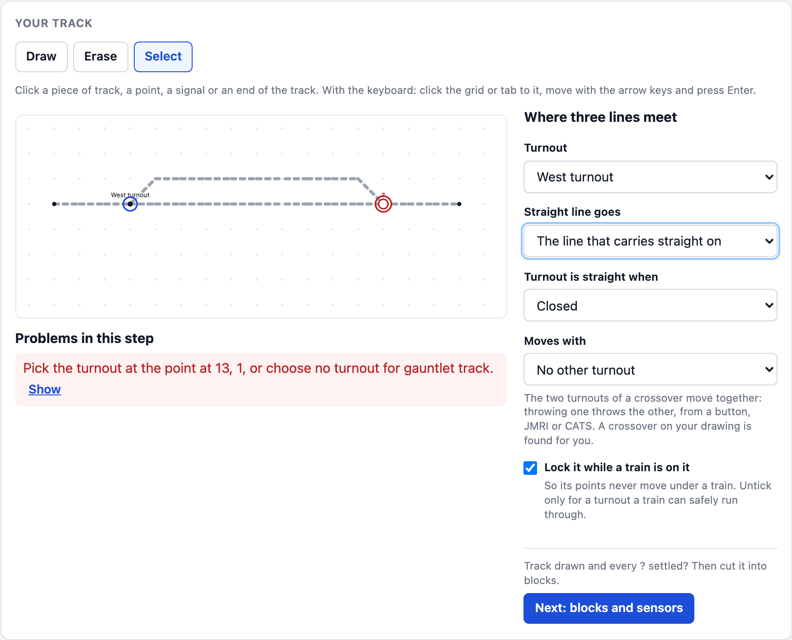

Two turnouts that make a crossover are found on the drawing and move together. **Moves with** pairs two by hand.

**Sensors.** Put a block break on the main line one space in from each end, and on both tracks two spaces inside each turnout. Name six blocks, each with a sensor: **West**, **West points**, **Main**, **Loop**, **East points** and **East**. The turnout's block (West points) runs from the outer break to both inner ones.

**Signals.** Six signals, one at each inner break facing out of the loop, and one at each outer break facing in: **West Home** (heading right), **Main West** and **Loop West** (heading left), **Main East** and **Loop East** (heading right), **East Home** (heading left). Six signals of three LEDs each would need more pins than the board has, so make each one **One head: one WS2812B LED**. Make both ends **Plain track**.

**Behaviour.** Every route here can clash with another, so all six are controlled signals. Each route from a signal takes everything to the next signal at once: the turnout's block, the turnout set and locked, and the loop or main line. Nothing to add.

**Try it: a meet.** Click **East turnout** to throw it to the loop. Put a train in **West** and one in **East**, and **Skip ahead 1 second**. Both routes are set: West Home's along the main line, East Home's into the loop. They share no track, so both trains can come in.

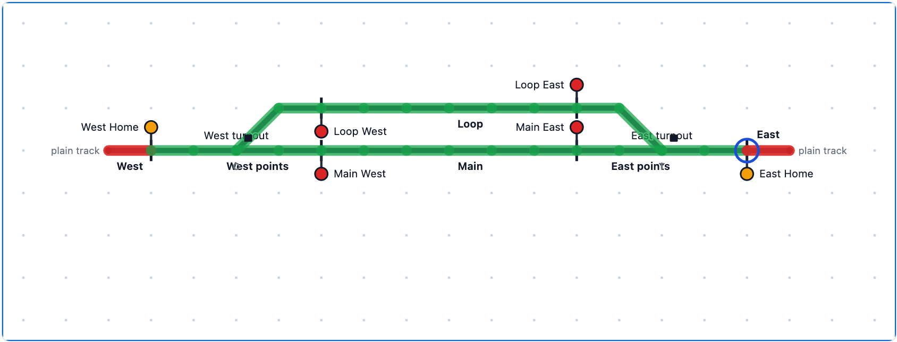

West Home and East Home show **Approach**, not Clear, because the signals at the far end of the loop are at Stop: each train must stop there for the other. A one-head mast has no aspect for a diverging route of its own, so East Home shows Approach into the loop too.

---

## An industry siding with a local panel

A main line with a siding off it, worked by a switch and a lamp on a local panel. While the panel has it, the siding's turnout moves only from its own fascia buttons, not from JMRI or CATS.

**Draw, sensors and signals,** as before:
- a main line 12 spaces long, with a slope up from four spaces in, to a siding four spaces long that ends there
- a turnout where they meet (**Siding turnout**)
- block breaks two spaces in from each main line end, and one on the siding a space past the slope
- four blocks: **West**, **Main** (the turnout and the main line between the breaks), **Siding** and **East**
- two signals, **West Home** heading right and **East Home** heading left, each **One head: one WS2812B LED**, and both main line ends **Plain track**.

The siding's own end is left as it is: **End of signalled track**.

**Behaviour and rules.** Click the turnout, then **Example: hand this turnout to a local panel**. The page puts a switch, **Siding turnout local**, and a lamp, **Siding turnout lamp**, under the turnout, and writes rules:

- On the turnout: *Only its own buttons move it while: Siding turnout local is on and West Home has shown Stop for 30 seconds and East Home has shown Stop for 30 seconds.*
- On each signal: *Keep at Stop while: Siding turnout local is on.*
- On the lamp: *Light while* the panel has the turnout, and *Flash while: Siding turnout local is off and Siding turnout is thrown.* A flashing lamp says: put the turnout back before you hand over.

Click the switch and the lamp on the drawing and give each a pin. A dotted line runs from the turnout to everything its rule reads.

So the person at the panel turns the switch on. Both signals go to Stop at once. Thirty seconds later, so that a train already given a signal has had time to stop, the turnout is the panel's, and the lamp lights. They work the siding with the turnout's own buttons. To hand back, they close the turnout and turn the switch off.

**Try it.** Flip the switch, then **Skip ahead 10 seconds** three times. Both signals show Stop, the lamp is lit, and the turnout shows the black square: JMRI and CATS cannot move it.

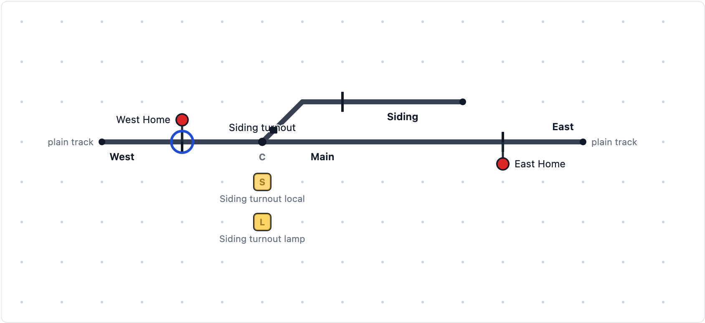

On the board, the turnout's fascia buttons still work while the panel has it. Commands from JMRI and CATS are ignored until the switch is off again.

---

## When something is wrong

Check one thing at a time, in this order.

**A block stays occupied with nothing on the track.**
1. In MQTTX, check each sensor in the block. One of them is `ACTIVE`, or it is from another board.
2. For a sensor from another board, check that board's Online topic shows `ACTIVE`. If it shows nothing, tick **Share with other boards** on that board, flash it, then click **Refresh** on it here.
3. For a sensor on an expander, look in the board's Logs for an I2C or MCP23017 warning. Check the expander's power, SDA, SCL and address links.

**A signal will not clear.**
1. In Try it, put a train in the block behind it and skip ahead. Click the signal and read **Why**. If it clears there, the drawing is fine and the fault is in the wiring or the board.
2. Is its route set? In Try it, set track is green. If not, another route holds some of its track: **What happened** says which.
3. Is one of your rules holding it? **Why** lists each rule that sets it.
4. On the board: check the **Auto** switch. In Manual, nothing asks for the route until CATS, JMRI or its button does.
5. Check the signal is not held by CATS or JMRI (see [CATS hold](#cats-hold)).

**A route never frees.**
1. Each block on the route must be clear for its **Free its track when clear for** time. Look at each block's sensors in MQTTX. One that reads `ACTIVE` with nothing on the track holds the route. A sensor on a linked board counts as occupied while that board is offline.
2. In an emergency, press **Release** for that signal on the board's web page.

**Every signal shows Stop, and the drawing seems right.**
1. Check the **Field logic** switch on the board's web page is on, and `trains/track/light/logic/<board>` is `ON`.
2. Check **Logic version** on the board's web page matches the Download page. If not, flash again.

**The Online sensor stays Inactive.**
1. Check the board shows **Online** in ESPHome.
2. Check the board's MQTT broker is `layout-mqtt.local`, as in the first board guide.

**The page says there is a problem, and Show goes nowhere.**
1. Fix the first red message first, because others often follow from it.
2. Renamed or deleted something on the Sensors, Turnouts or Signal Masts page? Deleting leaves the old name on the drawing, and the message names it.
