# Field Logic Guide

Field Logic lets a board work out its own signals from rules you build on the configurator's **Logic** page, so the signals keep working when JMRI is closed.

This guide is written in chapters, one for each part of the Logic page as it is built. So far it covers:

- the groundwork: a name that is unique at a meet (the **suffix**), more sensor pins with an **expander**, **Share with other boards**, **blocks** (a stretch of track made of several sensors, which JMRI sees as one sensor) and **linked boards**
- a first working set of signals: a **starter** (One-train section) that writes the rules for you, the **signals** it sets, **Try it**, the checker's **problems**, then **downloading and flashing**
- two more starters in short: **Lock turnouts under a train** and **Block signals**
- **plant ends**, which join one board to the next: adding an end, pairing two boards, and what to do at a meet.

The groundwork works on its own: a block reports to JMRI and CATS like any sensor. The rest of the guide uses a second worked example, a **gauntlet over a bridge**, which you can build from an empty board. MSS Logic, the second mode, has its own [MSS Logic Guide](mss-logic-guide.md).

Use this after the [First Board Setup Guide](first-board-setup-guide.md) and the [JMRI MQTT Verification Guide](jmri-mqtt-verification-guide.md). Your board should be online in ESPHome, and JMRI should have its MQTT connection set up.

> **Testers:** the Logic page is not on the live configurator yet. Until it is, open it from the `feature/logic` branch. Download the branch as a ZIP from GitHub (**Code → Download ZIP** on the `feature/logic` branch), unzip it, and open `configurator/index.html` in Chrome or Edge. It does not see the board saved on the live site, so bring it across with **Import → From a file** and your `board.yaml`.

---

## The worked example

One board, `kiama-north`, watches one stretch of track called **Int 2**. It has three sensors:

- **Int 2 current**: the current detector you already know, which sees anything drawing track power anywhere in Int 2
- **Int 2 East** and **Int 2 West**: an optical sensor at each end of Int 2, which sees any car at that spot, powered or not.

A current detector misses unpowered cars, so the tail of a train can leave Int 2 reading clear behind it. An optical sensor at the boundary covers that gap. Grouped as a block, Int 2 reads occupied while **any** of the three sees something.

> **Screenshot placeholder:** a sketch of Int 2: the current detector's feeder across the whole block, and an optical sensor in the track at each end.

---

## Step 1: Check the board's name has a suffix

Boards that share or run logic need a name that no other board at a meet has. The configurator adds six characters to every new board's name, such as `kiama-north-k7m4x2`. Those six characters are this board's own, and they stay when you rename it.

1. Open the configurator's **Board** page.
2. Look at **Board name**. You type the first part in the box. The suffix is the dash and six characters in the blue tag just after the box, such as `-k7m4x2`. If it is there, go on to Step 2.
3. If there is none, there is a blue **Add a suffix** button under the box. Click it.

Adding a suffix changes the board's network name, so the next flash must be by USB (Step 6).

**Copied a file?** If you made this board from another board's `board.yaml`, click **New suffix**, beside the suffix, then **Yes, give it a new suffix**. Two boards must never share a suffix. This changes the network name too, so flash by USB next.

---

## Step 2: Add the sensors

Both kinds of sensor go on the **Sensors** page, and both are wired the same way: the sensor's output to the pin, and its GND to GND. The Sensors page does not need to know which kind each one is.

1. Click **Add sensor**, at the top right of the Sensors page. A new card appears at the bottom of the list, on the next free pin.
2. Type **Int 2 current** in its **Name**. The **MQTT topic** fills in as `trains/track/sensor/Int 2 current`. Change the **Pin** if your wire is on another one.
3. Add **Int 2 East** and **Int 2 West** the same way.
4. Leave **Debounce** at `500ms`. It bridges the gap between two cars passing an optical sensor.

For an optical sensor, use a module with a digital output (often labelled `DO` or `OUT`) that goes low when it sees something. The ESP pin has no pull-up of its own, so the module must drive the wire itself, as a current detector does (see [detector wiring](README.md)). Most modules with a `DO` pin have their own pull-up and do. A bare sensor with no module board needs a pull-up resistor. Power the module from the ESP's 3.3V pin, and wire `OUT` to the sensor pin and `GND` to GND. Check the module's own notes before you power it. (An expander pin does have a pull-up, so either kind works there.)

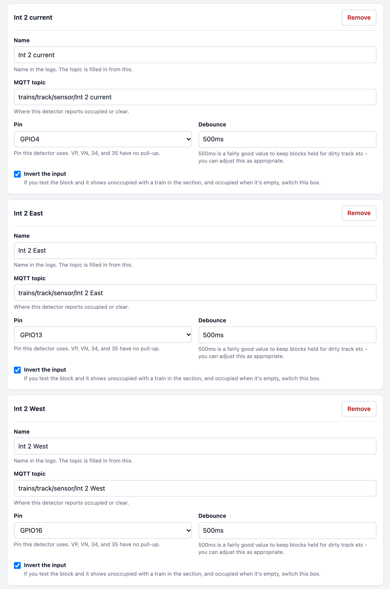

Success looks like:
- The three sensors are listed, each with its own pin, and there is no red message at the top of the page.

---

## Step 3 (if you run out of pins): Add an expander

Logic boards need a lot of inputs: a current detector for every block and an optical sensor at every boundary. When the Sensors page says no ESP pins are free, add an **MCP23017 expander**. It adds 16 sensor pins over I2C.

1. On the **Sensors** page, scroll past the sensors to **Expanders (MCP23017)** and click **Add expander**. A card called **MCP 1** appears. Click its title to fold it away, and again to open it.
2. Check its **I2C bus**:
   - On a board with a PCA9685 for turnouts, it already says **Shares PCA9685 1** with that board's two pins. Keep it. That saves two ESP pins, and the addresses do not clash.
   - Otherwise, pick **Its own SDA and SCL pins**, then set its **SDA pin** and **SCL pin**.
3. Set **Address** to match the A0, A1 and A2 links on the expander board. All three to GND is `0x20`. Two expanders on the same bus need different addresses.
4. Click the **Add sensor** button inside the MCP 1 card (not the one at the top of the page). The new sensor is listed under the expander, on its first free pin, such as **MCP 1 · A0**. Name it, and change its **Pin** to the expander pin you wired, such as **MCP 1 · B3**. Wire it the same as an ESP pin: the sensor's output to the expander pin, and GND to GND.

A sensor you already have can move to the expander too: pick an expander pin in its **Pin** list, and its card moves under the expander.

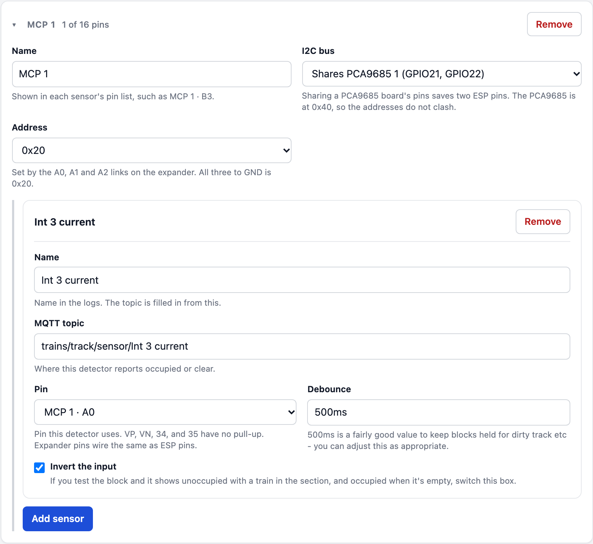

The card's title says how many of its 16 pins are used (here *1 of 16 pins*).

If an expander stops answering while the board is running, its pins keep their last value. So any block with a sensor on that expander reads **occupied** until the expander answers again. A train is never lost that way. The sensor's own JMRI sensor may keep its last value meanwhile.

---

## Step 4: Choose Field Logic, and share

1. Open the **Logic** page.
2. Set **Logic** to **Field Logic**.
3. Under **Settings**, leave **Share with other boards** ticked. It is on by default in Field Logic.

Share makes the board publish what other boards need to read it:

| What | Topic | JMRI sees it? |
|---|---|---|
| Board online | `trains/track/sensor/board/<board>/Online` | Yes, as a sensor |
| Each sensor's state, kept on the broker | `<sensor topic>/State` | No |
| Each turnout's movement | `trains/track/sensor/<turnout>/Moving` | No |
| Each signal's aspect | `<mast topic>/State` | No |

The board also checks that no other board on the broker has its name. If one does, it says **Clash** on the board's web page, under **Board name check**, and in its logs.

A board with no logic can tick Share too, so the boards next to it can read its sensors.

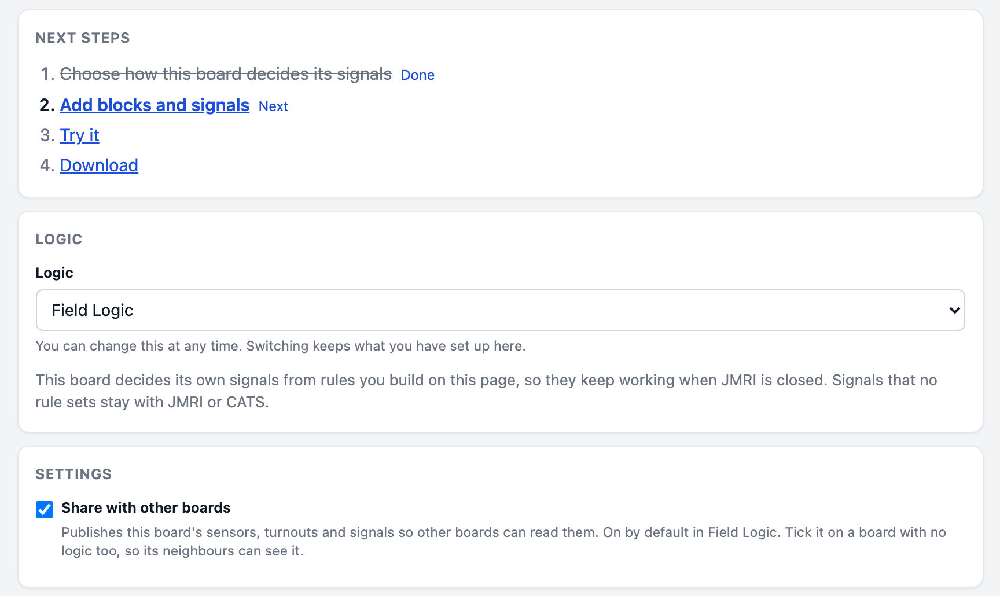

**Next steps**, at the top of the Logic page, is your checklist. Each line is a link to the part of the page it means. Choosing Field Logic crosses off the first line, and **Add blocks and signals** is marked **Next**.

---

## Step 5: Add the block

1. On the Logic page, under **Blocks**, click **Add a block**.
2. Type **Int 2** as its **Name**. The **MQTT topic** fills in as `trains/track/sensor/Int 2`.
3. Open the **Add a sensor…** list under **Sensors in this block** and pick **Int 2 current**. Then pick **Int 2 East**, then **Int 2 West**. Each one you pick joins the list above it.

The block now reads occupied while any of the three sees something.

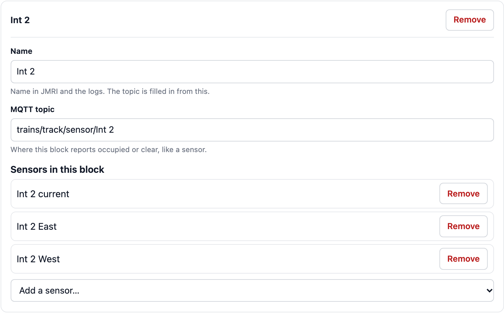

**A sensor between two blocks.** An optical sensor at a boundary belongs to the blocks on both sides of it. If the next block east is Int 3, add Int 2 East to Int 3 as well. Each block then holds occupied until the last car has passed the boundary. A sensor in three or more blocks gets a warning, because a boundary only has two sides.

Success looks like:
- The block lists its three sensors, and none says *not found*.
- No red message at the top of the page.
- **Next steps** still shows *Add blocks and signals* as **Next**. That is right: it turns **Done** once the board has rules to set its signals too, which comes with [the gauntlet](#start-from-a-starter-one-train-section).

If a message says a block *uses sensor "…", which is not on the Sensors page*, that sensor was deleted or renamed somewhere else. Renaming a sensor on the Sensors page renames it in every block too, so this usually means it was deleted. Pick another sensor, or remove that one from the block.

---

## Step 6: Flash the board and watch MQTT

1. Download the YAML and install it, as in the [First Board Setup Guide](first-board-setup-guide.md). If you clicked **Add a suffix** or **New suffix** in Step 1, install by USB (**Install → Plug into this computer**). Otherwise install wirelessly, as usual.
2. Open **MQTTX**, connect to `127.0.0.1:1883` with no username, and subscribe to `trains/#`.

Success looks like:
- `trains/track/sensor/board/kiama-north-k7m4x2/Online` shows `ACTIVE`.
- Covering **Int 2 East** with your hand shows `ACTIVE` on `trains/track/sensor/Int 2 East` **and** on `trains/track/sensor/Int 2`.
- Uncovering it shows `INACTIVE` on both. Each change comes about half a second after the sensor sees it (the Debounce).
- `trains/track/sensor/Int 2/State` shows the same, and MQTTX marks it as retained.

In the board's ESPHome **Logs**, the block logs `Int 2 | OCCUPIED` and `Int 2 | UNOCCUPIED`.

> **Screenshot placeholder:** MQTTX showing `trains/track/sensor/Int 2` and `trains/track/sensor/Int 2 East` both ACTIVE, and the board's Online topic.

---

## Step 7: See the block in JMRI

1. On the configurator's **Download** page, under **JMRI tables**, tick **Logic**. Its hint says *This board's Online sensor, 1 block and the Logic on / off light.* You can untick the others if JMRI already has them.
2. Click **Download JMRI XML**.
3. In PanelPro, use **File → Load table content and panels** and pick the file. Then use **File → Store table content and panels** so JMRI keeps them.
4. Open the **Sensor Table** (Tools → Tables → Sensors).

Success looks like:
- `MSInt 2` and `MSboard/kiama-north-k7m4x2/Online` are in the table.
- `MSboard/kiama-north-k7m4x2/Online` is **Active**.
- Covering an optical sensor turns `MSInt 2` **Active**. Uncovering it turns it **Inactive**.

> **Screenshot placeholder:** JMRI Sensor Table with `MSInt 2` Active and the board's Online sensor.

CATS can use `MSInt 2` as the block's detector and ignore the three sensors inside it. Those keep their own topics, so a panel that already uses them still works.

---

## Reading another board's sensors

A block can include a sensor from the board next door. For example, an optical sensor at the edge of one board can hold a block on the next board. That board must have **Share with other boards** ticked.

1. On the Logic page, under **Linked boards**, click **Link a board's file** and pick the other board's `board.yaml`. Only its names and topics are kept, never its Wi-Fi or passwords. The board is listed by its full name, marked *From its file*, with a count of its sensors, turnouts and signals.
   - No file to hand? Click **Type a board's name** and type its name exactly, suffix included. Then list its sensors one per line, as they are named on that board. This only works for sensors on the usual `trains/track/sensor/<name>` topics; for a board with its own topics, link its file.
2. In the block's **Add a sensor…** list, that board's sensors and blocks are listed under its name, below this board's own. Pick one, such as **Int 1 East**.
3. When the other board changes, click **Refresh** on it and pick its file again. The configurator says what changed.

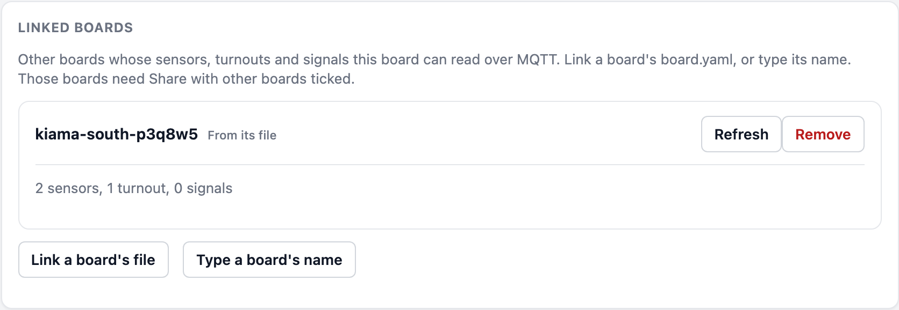

In the block, a sensor from another board is listed with that board's name after it:

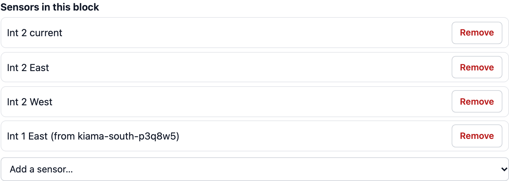

A sensor from another board counts as **occupied** until this board has heard from it, and whenever that board is offline. A block that uses one therefore reads occupied until both boards are running and connected. It is never clear by mistake.

---

## The gauntlet over a bridge

From here the guide uses a second example. Two tracks come together to cross a single bridge, then separate again. Only one train may be on the bridge at a time, and a signal at each end tells the driver when it is safe.

- Three blocks: **Left**, **Bridge** and **Right**.
- Two signals: **Left Bridge**, at the Left end of the bridge, and **Right Bridge**, at the Right end.
- The tracks converge onto the bridge and separate again, so a train that crosses from Left leaves onto its own track beyond Right. It never goes back out through the Right block.

You can add this to the board you already have, or start a new one. Either way, the board needs these before you start. If you built the Int 2 example, you have done this kind of step already.

1. **Sensors page:** one sensor for each block. Call them **Left current**, **Bridge current** and **Right current**. A sensor and a block cannot share a name, which is why they have a different name here.
2. **Signal Masts page:** two masts, **Left Bridge** and **Right Bridge**, each with a red lamp over a green one. For each mast:
   1. Click **Add mast** and type its **Name**.
   2. Under **Lamps**, click **Add lamp**, then **Add lamp at the top**. The top lamp (Lamp 2) will be red and the bottom one (Lamp 1) green.
   3. Under **Aspects**, pick **R292** in the list at the bottom and click **Add CATS aspect**. Type **Stop** over its name. Click the top lamp in its small mast picture, then **Red**. Tick **Show at startup**.
   4. Pick **R281**, click **Add CATS aspect**, and type **Clear** over its name. Click the bottom lamp, then **Green**.

   R292 and R281 are the CATS template's names for Stop and Clear. Starting from them fills in each aspect's **JMRI aspect**, which every aspect needs, and later its meaning on the Logic page.
3. **Logic page:** Logic set to **Field Logic**, as in Step 4. Under **Blocks**, add **Left**, **Bridge** and **Right**, and put each one's current sensor in it (Step 5).

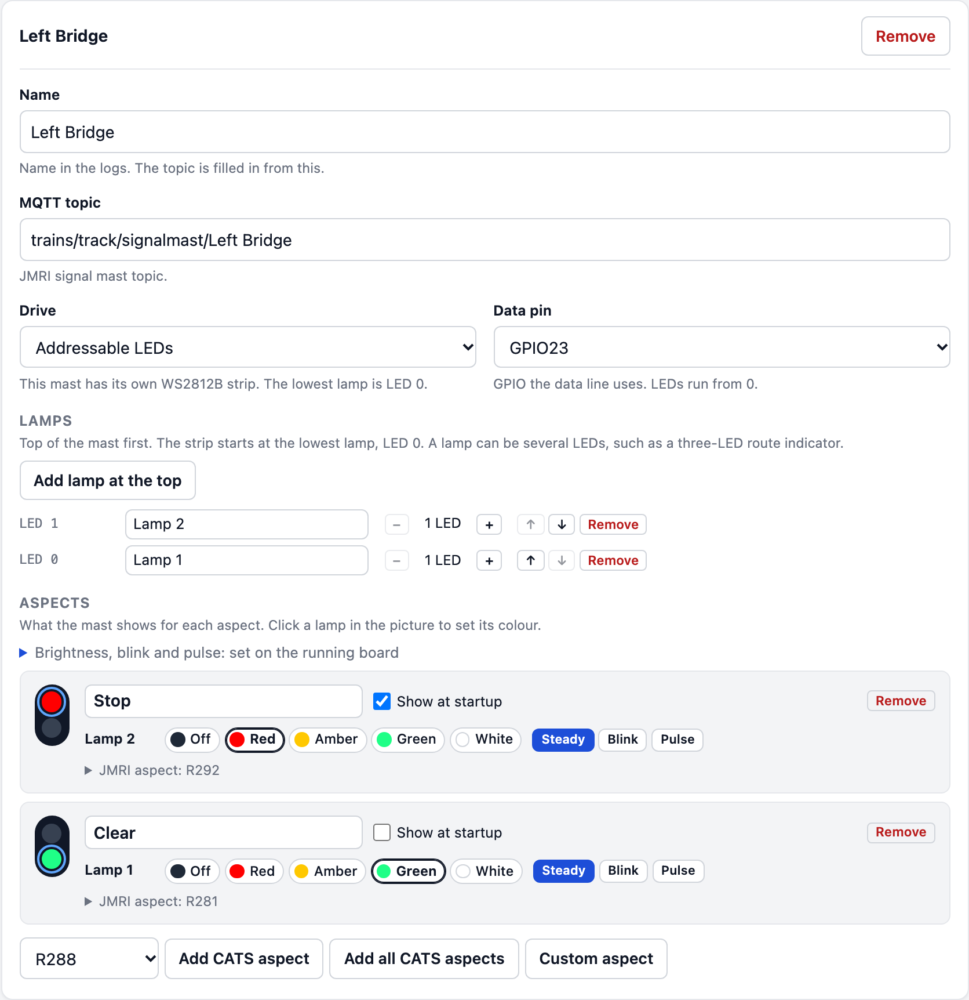

> **Screenshot placeholder:** a sketch of the gauntlet: two tracks converging onto a bridge, blocks Left, Bridge and Right marked, and a signal at each end of the bridge.

Success looks like:
- No red message at the top of the page.
- **Next steps** still shows *Add blocks and signals* as **Next**. The starter in the next part writes the rules, and then it turns **Done**.

---

## Start from a starter: One-train section

You do not write rules for the gauntlet. A **starter** asks a few plain questions and writes the rules for you, in a **group** you can change afterwards. The starter for this track is **One-train section**: a stretch of track that only one train may be on at a time, with a protected entrance at each end. It also suits a single-line bridge or tunnel, a diamond crossing and a staging throat.

1. On the Logic page, find the **Start here** card, below **Sections**. (Once you have a group, the same cards are folded away under **Add from starter**: click *Each starter writes a new group of rules.* to open them.)
2. Click **One-train section**, the first card. A form opens.
3. Fill it in, then click **Add**. If something is missing, the form lists it under *Fix these first:*.

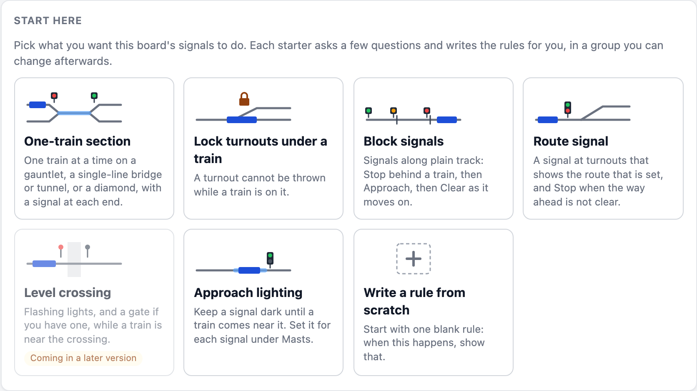

### The questions

| The form says | What it means | For the gauntlet |
|---|---|---|
| **Name** | The name of the section, and of the group of rules. It shows in the logs and in MQTTX. It starts as *Section*: type over it. | `Bridge` |
| **Blocks in the section** | The track that only one train may use at a time. Click **Add a block** and pick each one. | `Bridge` only |
| **Entrance 1**, **Entrance 2** | One for each way into the section. You need two to four. **Add an entrance** adds another. | Two |
| **A train waiting in** | The block where a train stands, asking to go in. | Left for entrance 1, Right for entrance 2 |
| **Signal** | The signal that protects that entrance. | Left Bridge, then Right Bridge |
| **shows** | What it shows to let the train go in. This is filled in for you when the signal has an aspect that means Clear. | Clear |

Each entrance needs its own waiting block. Two entrances cannot wait in the same one.

Under **More options** (folded away, and the starter works without opening it):

| The form says | What it means | Default |
|---|---|---|
| **Free the section when its blocks are clear for** | How long the section's blocks must stay empty before the next train may go in. This covers the tail of a train, and a gap between two cars. | 3 seconds |
| **Hold after cancelling** | If a signal drops in front of a train, keep the section for a while anyway, so the next train cannot be let in under it. Railways call this approach locking. | Off |
| **Trains also leave through entrance 1** (and 2) | See the next part. | Unticked |

Filled in for the gauntlet, with **More options** opened, the form looks like this. Each **shows** has a small picture of the signal in that aspect:

### The section it makes

When you click **Add**, the page writes two things.

- A **section** called Bridge, under **Sections**. A section is track only one train may use at a time. It holds the Bridge block, and it is freed when the Bridge block has been clear for 3 seconds: the card says so in a sentence, *Free the section when Bridge has been clear for 3 seconds.* You can see and edit it under **Sections**.
- A **group** called Bridge under **Groups**, with one rule for each entrance. Each rule is one sentence: *when this happens, show that.* **Rule 1** shows its sentence in the shaded box at the top, then its three parts, **When**, **Only if** and **Then**:
  - **When:** *While* Left is *occupied*. Its **More options** has **For** set to half a second, so a flicker is ignored.
  - **Only if:** nothing else is needed, so it says *Nothing else: the rule needs only its When.*
  - **Then:** **Signal** Left Bridge **Shows** Clear, and **Take the section** is Bridge.

The signal only clears when the section is free. Once Left Bridge has the section, Right Bridge cannot have it, so Right Bridge stays at Stop until the first train has gone through and the section is freed. This is why a gauntlet is safe: the two signals cannot both be Clear.

### Trains also leave through here

From the sensors alone, the board cannot tell a train **waiting** in Left from a train that is **leaving** the section through Left. The tick box tells it which.

- **Leave it unticked for the gauntlet.** The tracks separate beyond the bridge, so a train in Left or Right is always waiting its turn.
- **Tick it for a single line,** such as one track over a bridge or through a tunnel, where trains come out of the section through the same block they went in by. Tick it on both entrances. A train waiting at one end then goes first, and a train that has just arrived while the section is taken is treated as one leaving. It cannot ask for the section until its block has been clear once.

Success looks like:
- The Groups card shows the Bridge group with two rules, and the Sections card shows Bridge.
- The Masts card lists Left Bridge and Right Bridge.
- **Next steps** shows *Add blocks and signals* as **Done**, and *Try it* as **Next**.

---

## The signals

The rules set the signals, so the page needs to know what each aspect **means**. Open the **Masts** card. A signal joins it when a rule first sets it. Left Bridge and Right Bridge are there now.

Each aspect is drawn as a small picture of the mast, lit in that aspect. For each signal:

1. Under **Aspects**, check each aspect's **Meaning**: the list under its name. This is what the aspect tells the driver: Stop, Restricting, Approach, Advance Approach or Clear. Stop should say **Stop** and Clear should say **Clear**. They already do here, because the aspects came from the CATS list (R292 and R281), and CATS aspects arrive with their meaning filled in. For any other aspects, check them yourself: an aspect left at Stop is treated as Stop.
2. **Diverging route** is for a train that takes a turnout at reduced speed. The gauntlet does not need it.
3. **At stop and at start-up** is what the signal shows when the rules say Stop, and from power-on, before anything has been worked out. **Automatic** picks the aspect that means Stop. Pick another aspect if you want something particular, such as a red-over-red.
4. **Set by logic** is shown next to each signal that this board decides. JMRI and CATS cannot change it while logic is on, apart from a hold (see [CATS hold](#cats-hold)).

**Approach lighting** is for a signal that stays dark until a train is near. Leave it on **Always lit** for the gauntlet.

**Aspect names must be different** on each signal that logic uses. If two aspects on one mast have the same name, the page says so.

### Explain

Every signal that logic sets has an **Explain** button, at the top right of its card. Click it. A shaded box opens at the bottom of the card, with one plain sentence for each thing the signal can show, worked out from the rules, so it is always what the board does:

- *Left Bridge shows Clear when a train has been in Left for half a second and the Bridge section is free.*
- *Otherwise it shows Stop.*
- *If JMRI or CATS holds it, it shows Stop.* (See [CATS hold](#cats-hold).)

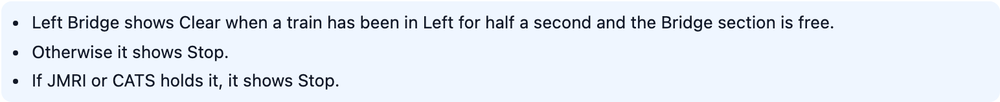

If a sentence is not what you meant, the rule behind it is wrong. Fix the rule, and Explain changes with it. The button now says **Hide**: click it to close the box.

Success looks like:
- Each signal has a meaning for every aspect, and Explain says what you expect.
- No red message at the top of the page.

---

## Try it

**Try it** lets you work the track on the page before you flash anything. Nothing here touches the layout or the board.

1. Scroll to the **Try it** card, below **Start here**. Its buttons are along the top: **Run**, **Step**, **Skip ahead 1 second**, **Skip ahead 10 seconds** and **Start again**. The gauntlet starter knows the shape of the track, so under **Track** you see a picture: Left, Bridge and Right in a row, with a signal on a post between each, both red.
2. Under **Signals**, Left Bridge and Right Bridge both show **Stop**. Under **Sections**, Bridge is **Free**.
3. **Put a train in Left.** Click the Left block in the picture. A red bar, the train, appears in it.
4. Click **Skip ahead 1 second**. The rule waits half a second to be sure the train is really there, so you must let a little time pass.

Success looks like:
- **Left Bridge** shows **Clear**: green in the picture and under **Signals**.
- **Bridge** says *Taken, waiting for the train*, and which rule took it.
- **Right Bridge** is still at **Stop**.

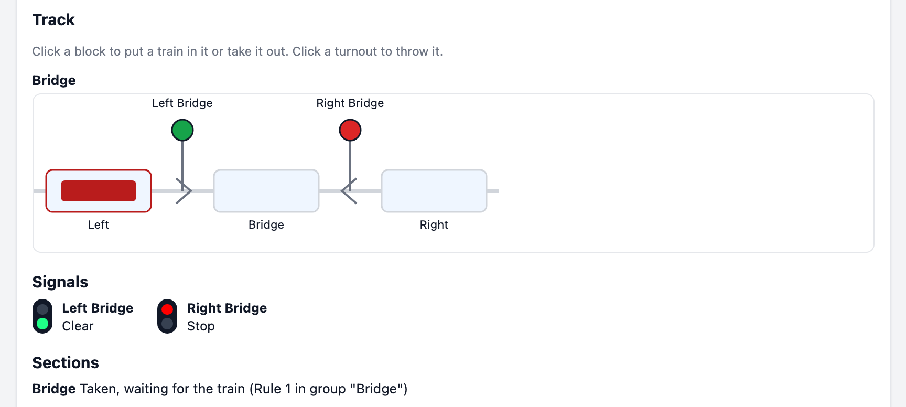

Now carry on. After each, click **Skip ahead 1 second**:

1. **Put a train in Bridge** (click Bridge). The section says *A train is in it*.
2. **Take the train out of Left** (click Left again). Left Bridge goes back to Stop, as the train has gone by.
3. **Put a train in Right** while Bridge is still occupied. Right Bridge stays at Stop. That train must wait.
4. **Take the train out of Bridge.** Click **Skip ahead 10 seconds**. The section is **Free** again (it waits 3 seconds of clear track first). Right Bridge, with its train still waiting in Right, now shows Clear.

That is the whole gauntlet. If something does not match, click **Start again** and try it a step at a time with **Step**, which moves time on by a tenth of a second.

The other controls:

- **Run** lets time pass at normal speed. **Stop** stops it.
- Under **Inputs** are the sensors the rules read (here Left current, Right current and Bridge current), each **Clear** or **Occupied**. You can change one there instead of clicking the picture.
- Under **Other boards** is each linked board, ticked while it is switched on and heard. Untick it to see what happens when that board is off.
- A value that is **Not known** is what another board reads when it is switched off or has not been heard from. It counts as occupied, so a signal never clears by mistake.

### Run a train

Clicking blocks one at a time is slow. **Run a train** does it for you. It is at the bottom of the Try it card.

1. Under **Run a train**, pick **Direction** (*As drawn, left to right*), **Starting in** (Left) and **Length in blocks** (1 is a short train). With more than one strip of track, there is also **Along**: pick the group, such as Bridge.
2. Click **Run a train**.
3. A table appears. Each row is one move of the train, named in the **Step** column, such as *Train enters Left* and *Train leaves Left*. **Blocks with a train** shows where the train is, and the other columns draw every signal as it is at that step.

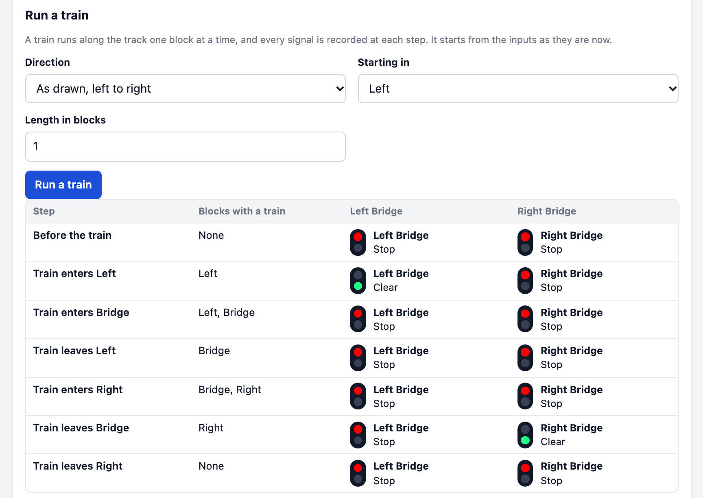

Run a train walks straight along the strip, so after the bridge this train runs on into Right. In the gauntlet a train never leaves that way, so the board takes it for a train waiting in Right: at *Train leaves Bridge*, Right Bridge shows Clear for it. That is the rules working as they should.

Run it both ways, and with a train waiting at the other end. Most mistakes show up here.

### Show timing details

You do not need this to make the gauntlet work. Open **Show timing details** when a signal does not do what you expected and you want to know why. It shows:

- **Time**: how far the pretend clock has moved.
- **Rules**: each rule and what it is doing. *Not in use*, *Waiting for its section*, *Has its section*, *The train is in the section*, or *Gave up, section still held*.
- **Waiting order**: when two entrances want the section, who is next. The one that has waited longest goes first. If two have waited equally, the one listed first in the group goes first.
- **What happened**: a list in plain words, such as *Rule 1 in group "Bridge" took section "Bridge"* and *Section "Bridge" is free again when its release condition held*.

If Right Bridge will not clear, look at **Rules**. A rule that says *Waiting for its section* is behind another one, and **What happened** says who has it.

---

## Problems

The page checks your work as you go. A message appears in the box at the top of every page, including the Download page. Each says **what is wrong, why it matters, and what to do**, and names the item. For example:

> *Section "Bridge" has block "Left", which is not on this board. Add it under Blocks, or remove it from the section.*

- A red message is an **error**. It stops the download until you fix it.
- A yellow message is a **warning**. It never stops the download, but read it, because it often points at a real mistake.
- Click **Show** at the end of a message. The page takes you to the part that needs fixing. Fix it, and the message goes.

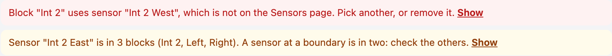

In the picture, Int 2 West was removed on the Sensors page while the Int 2 block still used it (the red error), and Int 2 East was put in the Left and Right blocks as well as Int 2 (the yellow warning). Adding Int 2 West back on the Sensors page, with the same name, and taking Int 2 East out of Left and Right clears both.

### What the checker says

Once nothing else is wrong, the page also runs a **checker**. It tries your rules against every mix of trains it can think of, then tells you what it found. A checker message has a **Show** link that does more than go to the page: it carries you to Try it and plays the exact steps that cause the problem, so you can watch it happen. Click **Step** to go on from there.

| The message begins | It means | What to do |
|---|---|---|
| *Rule 1 in group "Bridge" can be left waiting for section "Bridge" forever, with its train still there.* | A train can stand in front of a signal for ever. This is an **error**. | Click **Show** and watch what holds the section. Then check what has to happen for it to be free: its release, and the blocks listed in the section. |
| *… can be passed over forever: other trains keep getting section "Bridge" while it waits.* | A train at one entrance could be starved by trains at the other. A **warning**. | Click **Show**. On a busy layout, think about whether that is acceptable. |
| *… can never apply: no mix of trains, turnouts and signals makes its When and Only if true together.* | A rule asks for something impossible, usually a block that must be both occupied and clear. | Open the rule and look at its When and Only if. |
| *Signal "Left Bridge" can never show anything but Stop.* | No rule that sets it can ever apply. | Check the rules that set it. |
| *This board has too many combinations to check every one, so the checker tried N random runs.* | The board is large, and the checker could not try everything. | Treat a clean result as good, not as proof. Use Try it and Run a train as well. |

The checker only knows what you have told the page. It knows only one train fits in a section if you put that track in a section, and it cannot tell that two signals lead onto the same track unless a section says so.

Other messages you may meet, and what to do:

| The message says | What to do |
|---|---|
| *… reads signal "…", which is not on the Signal Masts page* | The signal was deleted or renamed on the Signal Masts page. Add it again, or pick another. Renaming on the page renames it in the rules; deleting does not. |
| *Block "…" is in sections "…" and "…". A block can be in one section only* | Take the block out of one section. Two sections over one block could let two trains in. |
| *… starts when something happens and has no Cancel* | A warning on a rule that starts with **When**. Add a **Cancel when…** if the train might not come. |
| *Signal "…" is set to … by group "…" and to … by group "…"* | A warning: two groups set one signal. It shows the most cautious of them. Check that is what you want. |
| *… sets signal "…" and also reads it* | A rule waits on itself. Read the signal ahead instead. |

---

## Download and flash

### The Logic version

1. Open the **Download** page. With Field Logic, the first card is **Logic version**, with a short code such as `ee555edb`. It matches the board when the board is running exactly what you checked. Under it are the **Download summary** button and **Warnings about the logic**, which lists any warnings (or says *No warnings about the logic.*).
2. If errors are left, the page says how many must be fixed first, and the Download button is greyed out.

Write the version down, or leave the page open. After you flash, the board shows the same code on its web page (**Logic version**). If they differ, the board is running an older file: flash again.

### Download summary

Click **Download summary**. It saves a one-page file, `<board name>-summary.html`. Open it in a browser and print it. It lists:

- each signal the logic sets, with its Explain sentences
- each block, with its sensors and the pin each is wired to
- each section, and when it is freed.

It carries the Logic version too. Keep it on the workbench or under the module, so that whoever wires or repairs it next knows what it is meant to do.

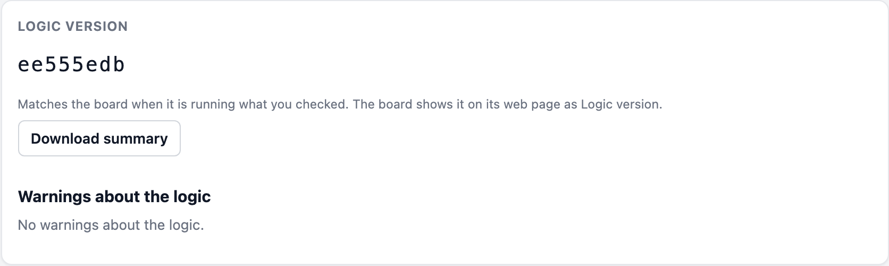

Your code may be different: it is worked out from your own rules, and changes whenever they do.

### Flash

Flash the board as in Step 6 of the groundwork, from the Download page, or with **Send to ESPHome**. Install by USB if you added a suffix. A board that has run logic before can be updated wirelessly.

The first build is long, because ESPHome fetches the Field Logic component from GitHub. The board then starts with the logic **on** (unless you unticked **Logic on at start-up** under **Settings**).

Success looks like:
- The board's web page shows **Logic version** with the same code as the Download page.
- It has a **Field logic** switch, which is on, and a **Release Bridge** button.

### Check it in MQTTX

Open MQTTX, connect to `127.0.0.1:1883` with no username, and subscribe to `trains/#`. The names below are for the board `gauntlet-k7m4x2`. Yours will have its own.

| Topic | What it shows |
|---|---|
| `trains/track/sensor/logic/gauntlet-k7m4x2/Bridge/Held` | `ACTIVE` while a rule has the Bridge section, and `INACTIVE` when it is free. This is the one to watch first. |
| `trains/track/logic/gauntlet-k7m4x2/Bridge/State` | The section in a word: `IDLE` (free), `ACTIVE` (taken, waiting for the train), `PASSED` (a train is in it) or `CANCELLING` (held a while after the request stopped). |
| `trains/track/signalmast/Left Bridge/State` | The aspect Left Bridge is showing, by its JMRI aspect name (the part of the aspect's JMRI match before the first `;`). Present when **Share with other boards** is ticked. |
| `trains/track/light/logic/gauntlet-k7m4x2` | `ON` or `OFF`: the **Logic on / off** light. |
| `trains/track/logic/gauntlet-k7m4x2/Version` | The Logic version, as the board sent it when it connected. |

Try it for real:

1. Cover the **Left current** sensor with your hand, or run a train into Left. After half a second, `Bridge/Held` goes `ACTIVE`, `Bridge/State` goes `ACTIVE`, and Left Bridge goes Clear.
2. Let the train onto the bridge. `Bridge/State` goes `PASSED`.
3. Clear the track. 3 seconds after the Bridge block clears, `Bridge/State` goes `IDLE` and `Held` goes `INACTIVE`.

> **Screenshot placeholder:** MQTTX showing the Bridge Held and State topics, and Left Bridge's State.

**Logic on / off.** The board's web page has a **Field logic** switch. Turn it off, and the board hands its signals back to JMRI and CATS, which set them as they did before. Turn it on, and the board works them out again. The light `MLlogic/gauntlet-k7m4x2` does the same from JMRI. Signals that no rule sets are never affected.

**Release.** If a detector fails, or a train stalls, the section can stay held. Click **Release Bridge** on the board's web page to free it by hand. The signals go to Stop, and a later pass of the rules can grant the section again. Releasing with a train still in the section is your call.

From JMRI, tick **Logic** on the Download page before you download the JMRI XML. It adds the on / off light, a **Release** turnout for each section (`MTlogic/<board>/Bridge/Release`), and a sensor that mirrors Held. Throwing the Release turnout presses the button, and it snaps back by itself. A release that arrives in the first 5 seconds after the board connects is ignored, because it may have been waiting on the broker for hours.

> **Screenshot placeholder:** the board's web page with the Field logic switch, Logic version and the Release Bridge button.

### CATS hold

CATS has a **Hold Only** option on a signal template. With it, CATS does not set the aspect. It only **holds** the signal at Stop when its own logic says Stop, and lets go when it says go. With Field Logic on, the board does the rest.

- A held signal shows Stop, whatever the rules say.
- A rule that wants a held signal does not get the section. It keeps waiting, and takes the section when the signal is no longer held.
- A hold that was left on the broker when JMRI closed keeps the signal at Stop. That is on purpose. To clear it, unhold the signal in CATS or JMRI, or press **Release** for that section, which clears the board's copy of the hold.

---

## Lock turnouts under a train

A short starter for a turnout that must not be thrown with a train on it. **Lock turnouts under a train** writes one rule for each turnout: while its block is occupied, the turnout stays locked.

1. On the Logic page, find **Add from starter** and click *Each starter writes a new group of rules.* to open its cards. Click **Lock turnouts under a train**.
2. Give the group a **Group name**.
3. Pick each **Turnout**, and the **Block it sits in**. **Add a turnout** adds another row.
4. Click **Add**.

While the block is occupied, the turnout ignores its fascia button and JMRI or CATS. When the block clears, it unlocks. A turnout with a toggle switch then catches up with where the switch now is.

You can try it in Try it: put a train in the block and the turnout shows *Locked by the rules*.

---

## Block signals

**Block signals** is the starter for a run of plain track with a signal for each block. Each signal shows **Stop** while the block ahead of it has a train in it. Further back, it shows **Approach**, then **Clear**, as the train moves on. The signals behind a train step down: Stop, then Approach, then Clear, as it gets further away. A signal that is at Stop for any reason, such as a one-train section in use, drops the signals behind it too.

1. Under **Add from starter**, open the cards as above and click **Block signals**.
2. Give the **Direction** a name, such as Up. List the signals in the order trains run: each row is a **Signal** and the **Block it protects**, which is the one just beyond it. **Add a signal** adds a row.
3. Under **After the last block**, choose **The next signal** (then pick it in **Next signal**), or **End of signalled track**.
4. For signals facing the other way too, tick **Both directions**. It adds a second group for them, over the same blocks.
5. Click **Add**.

Where two blocks share no sensor at their boundary, the page warns that a signal could clear while an unpowered car is still there. Put an optical sensor at the boundary in both blocks, as for Int 2 in Step 5.

Block signals do not stop two trains meeting head-on on single track. Put a One-train section over the single line as well. Its signals keep the entrance at Stop while the line is in use, and the block signals step down behind them.

The same chapters apply: Try it draws the strip, **Run a train** walks along it, and Explain says what each signal shows.

---

## Plant ends: joining two boards

So far everything sits on one board. A **plant end** (an **end** for short) is the edge of a board: the place where its track leaves for track that another board looks after. Give each board its ends and **pair** them, and the signals on one side can see the blocks and signals on the other. Neither board needs to know the other in advance. That suits a layout that grows, and modules that arrive at a meet in any order.

> **Not yet tried on real boards.** The steps below say what you should see. If you see something else, go to [When pairing goes wrong](#when-pairing-goes-wrong).

Some plain words first.

| Word | What it means |
|---|---|
| **End** | The edge of a board, named A, B, C. A board can have several. A board that covers several modules which always travel together needs ends only on the outside joints. |
| **Track** (of an end) | One line of rail through the end. They are numbered left to right, looking **out** through the end. |
| **Pair** | Telling two ends that they meet. Press **Pair** on both sides of a joint, and each remembers the other. |
| **Link** | What an end remembers: the board and end it meets, such as `kiama-south-p3q8w5/B`. |
| **End of the line** | An end with nothing beyond it. It reads as a clear block and a signal at Stop, so the last signal on your board shows Approach. |

For each track, an end tells its neighbour two things about what a train coming in through the end meets first on your board: whether the end's sensors are occupied, and what the first signal facing that train is showing. It hears the same two things back from the other side. An end **offers** what is on your board and **hears** what is on theirs.

Two ends that meet face each other. Track 1 of one meets the **last** track of the other, so two boards work whichever way round they are placed. Both ends must have the **same number of tracks**.

The example from here: your `gauntlet-k7m4x2` board leaves at the right of the Right block. Beyond it is a second board, `kiama-south-p3q8w5`, with its own signals. One track crosses the joint, so each end has one track. The second board needs the same steps, with its own names.

---

## Step A: Add an end

1. On the Logic page, find the **Plant ends** card, below **Linked boards**, and click **Add an end**. A card called **End A** appears, with one track. You can change its **Name**: A, B, C, or something that tells you which side of the board it is on.
2. Under **Tracks**, fill in **Track 1**:
   - **End sensors**: click **Add a sensor…** and pick every sensor between the end and the first signal, **including the one at that signal**. For the gauntlet that is **Right current**.
   - **What the track meets first**: **A signal on this board**, then **First signal**: the signal that faces a train coming in through this end. For the gauntlet that is **Right Bridge**.
3. A track with no signal of its own can choose **Passes through to another end** instead, and pick the track. It then offers its own sensors, or what the far track hears, so a block can run across several boards. You do not need this for a first pair.
4. **Add a track** for each further line through the end, in order, left to right, looking out.
5. Optional, **Pair button pin** and **LED pin**, at the top of the end's card beside its Name. Each starts at **No pin**:
   - The pair button is a push button between the pin and GND, like a turnout's button. You do not need one, because the board's web page always has a **Pair End A** button.
   - The LED shows the state of the end. Wire it as you would a signal lamp, through a resistor.

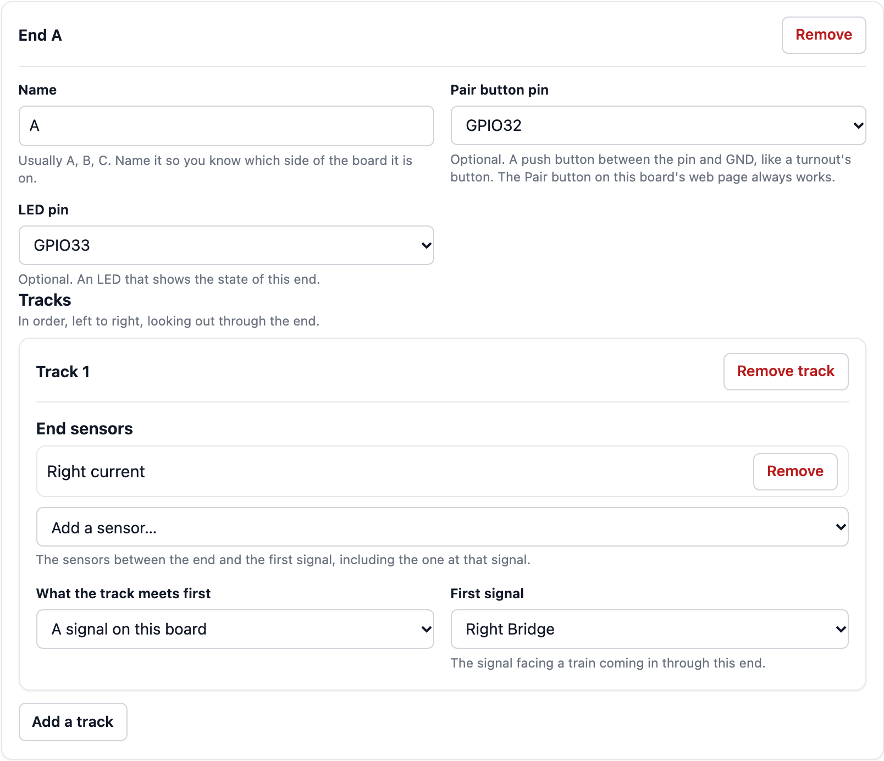

Success looks like:
- The Plant ends card lists End A with its track, and no red message appears at the top of the page.
- If the page says a sensor or signal was *not found*, pick it again.

Ends need MQTT. If **Disable MQTT** is ticked on the Board page, the page reports a problem. Untick it.

---

## Step B: Use the end as the next signal

A run of block signals needs to know what lies beyond its last block. Past the edge of your board, that is the neighbour's first signal, which your end hears.

1. Add a **Block signals** group (see [Block signals](#block-signals)). List the signals in the order trains run, towards the end. A starter's form only ever adds a new group, so for a Block signals group you already have, remove it under **Groups** and add it again.
2. Under **After the last block**, choose **The next signal**, and open the **Next signal** list. Below your own signals, under **What an end hears**, is **Next signal heard at end A, track 1**. Pick it.
3. Click **Add**.

The last signal on your board now follows the neighbour's first signal. If that shows Stop, the last signal on your board shows Approach, and the ones behind it step down as usual. If the neighbour is not heard at all, the end reads as a clear block with a signal at Stop, so the last signal shows Approach and never Clear. That is on purpose.

A block can also take in what an end hears, so it reaches across the joint. When you add a member to a block, **What end A, track 1 hears** is in the list. JMRI's copy of that block uses this board's own sensors only.

---

## Step C: Try it with a pretend neighbour

Before you flash, try the joint on the page.

1. Open **Try it**. Under **Pretend neighbours**, below the **Track** picture, there is **End A: pretend there is a neighbour**. Tick it.
2. A pretend neighbour is three blocks of track, numbered 1 to 3 from the joint, each with a signal, standing in for the board next door. It answers your end the way a real board would. Click one of its blocks to put a train in it, or take it out.
3. A line above its picture says which way its trains run, such as *Trains run towards this board*. Click **Turn it round** to change it.
4. The same line ends with what your board offers it, such as *This board offers it: block clear, signal Stop*.

Try these:
- Put a train in the pretend neighbour's block next to the joint, block 1. The last signal on your board should drop.
- Untick the pretend neighbour. Your end then reads what is set for it under **Inputs**, which starts as paired and heard, with the block beyond clear and its signal at Stop. So the signal facing the end shows Approach, never Clear. Set *End A: the board beyond* there to *Paired, not heard* to see a joint that is not heard.
- In **Run a train**, pick a run that goes towards the end. **Carry on across the joint** moves the train into the pretend neighbour. **Stay on this board** stops it at the edge.

---

## Step D: Flash both boards

1. Do Steps A and B on the second board, with its own end, tracks, sensors and first signal.
2. Check both ends have the **same number of tracks**.
3. Download and flash each board as in [Download and flash](#download-and-flash). The first build of each takes a while.

When a board starts, its web page has, for each end:
- a button, **Pair End A**
- a text box, **End A link**, which is empty
- a line of text, **End A state**, which should say *Not paired*.

If you wired the LED, it is **off** while the end is not paired.

> **Screenshot placeholder:** the board's web page with Pair End A, End A link (empty) and End A state (*Not paired*).

---

## Step E: Pair the boards

1. Power both boards. Both must be online, with `layout-mqtt.local` answering.
2. On the first board, press **Pair End A** on its web page, or the push button if you wired one.
3. Within **30 seconds**, press **Pair** on the end it meets: **Pair End B** on the second board.

Success looks like:
- After the first press, **End A state** says *Pairing: press Pair on the end it meets, within 30 seconds*, and the LED blinks **slowly**.
- Within a second or two of the second press, both ends say *Paired with kiama-south-p3q8w5/B, heard* (and the other way round), and the LED goes **steady**.
- **End A link** holds `kiama-south-p3q8w5/B`. It is saved, so it survives a power cut.

### What the LED shows

| LED | Meaning |
|---|---|
| Off | Not paired. |
| Slow blink | Pairing. You have 30 seconds to press Pair at the other end. |
| Steady | Paired and the other end is heard. Also steady at an end of the line. |
| Fast blink | A problem: the other end is not heard, it disagrees, or the last pairing was refused. A refusal blinks for about 10 seconds, then the LED shows the usual state. |

> **Screenshot placeholder:** two boards side by side, one LED blinking slowly, then both steady.

If you cannot pair them, you can set the link by hand. Type the other board and end into **End A link** on the web page, such as `kiama-south-p3q8w5/B`, and do the same on the other board. Both sides must name each other.

An end with nothing beyond it is set the same way: type `end` into its **End A link**.

---

## Step F: Check it in MQTTX

Connect MQTTX to `127.0.0.1:1883` and subscribe to `trains/track/end/#`. The names below are for the two boards in the example.

| Topic | What it shows |
|---|---|
| `trains/track/end/pairing` | While pairing: `<board>/<end>/<tracks>`, such as `gauntlet-k7m4x2/A/1`. It is sent when you press Pair and is not kept, so it only shows while you watch. |
| `trains/track/end/gauntlet-k7m4x2/A/Link` | The link this end holds: `kiama-south-p3q8w5/B`, empty, or `end`. |
| `trains/track/end/gauntlet-k7m4x2/A/1/Block` | `ACTIVE` while the end sensors of track 1 are occupied, `INACTIVE` otherwise. |
| `trains/track/end/gauntlet-k7m4x2/A/1/Mast` | What the first signal facing a train coming in through this end is showing, as its meaning (for example `stop`, `approach` or `clear`). |

The second board publishes the same under its own name and end. Once both are paired:

1. Cover **Right current** (the end sensor) on the first board. Its `A/1/Block` goes `ACTIVE`.
2. On the second board, the last signal before the joint changes, because it hears that block.
3. Put a train in the second board's block next to the joint. Its `B/1/Block` goes `ACTIVE`, and the last signal on the first board drops.

An end never reads back what it offers itself, so two paired ends cannot hold each other occupied.

> **Screenshot placeholder:** MQTTX showing the end topics for both boards, with Link set on each.

---

## At a meet

Nothing is reflashed at a meet.

- **Wi-Fi.** A board that cannot find its home network starts its fallback hotspot, named `<board> setup`. Join it from a phone, and the page that opens lets you pick the meet's network. The board keeps that network until it is next flashed with a changed setup or a newer ESPHome, and then the home network in its file applies again. Back home without flashing, choose the home network the same way.
- **Broker.** The boards look for `layout-mqtt.local`. One computer at the meet runs the install script, and every board finds it with no change. The script will not publish the name if another computer already answers it.
- **Pairing.** Press Pair on both sides of each joint, one joint at a time. Only two ends should be pairing at once.
- **The ends of the row.** Type `end` into the **End link** of the last end on each side.

A joint showing **Stop** is the safe answer when the board cannot be sure. An unpaired end, or one whose neighbour is off or not heard, reads as an occupied block with a signal at Stop. Look at **End A state**: it says which of these it is.

---

## When pairing goes wrong

Check one thing at a time. The board's **End A state** and its Logs say which.

**Not heard.** *Paired with …, not heard.* The LED blinks fast.
1. Check the other board is on and shows **Online** in ESPHome.
2. In MQTTX, check the other end's `Link` topic shows something. If nothing is there, check the other board has been flashed with its end.
3. Check both boards use the same broker.

**Disagreeing.** *Paired with …, but that end does not name this one, so it reads as empty.* The Logs show a warning. One side has been changed, or paired with someone else. Press Pair on both again, or fix the **End A link** box on the board that is wrong.

**Refused.** The state line ends *Last pairing: …* and the LED blinks fast for about 10 seconds. Fix the cause and press Pair on both again:
- *no other end pressed Pair in time*: the other side did not follow within 30 seconds.
- *more than two ends were pairing, so none paired*: a third end was pairing at the same time. Wait 30 seconds, then press Pair on only the two that meet.
- *the two ends have different numbers of tracks*: both sides of a joint need the same number. Fix the count on the Logic page (**Add a track**, or **Remove track**) and flash the board.

**Paired, but the signals still show Stop.**
1. Check **End A state** says *heard*. If not, see above.
2. Check which track meets which: track 1 of one end meets the last track of the other. With two tracks each side, the pairs cross.
3. Check the **First signal** is set on the other board's end, and that signal is not held by CATS or JMRI.

---

## When something is wrong

Check one thing at a time, in this order.

**The block stays occupied with nothing on the track.**
1. In MQTTX, check each sensor in the block. One of them is `ACTIVE`, or it is from another board.
2. For a sensor from another board, check that board's Online topic shows `ACTIVE`. If it shows nothing, tick **Share with other boards** on that board, flash it, then click **Refresh** on it here.
3. For a sensor on an expander, look in the board's Logs for an I2C or MCP23017 warning. Check the expander's power, SDA, SCL and address links.

**The block is not in JMRI.**
1. On the Download page, check **Logic** was ticked when you downloaded the JMRI XML.
2. If the configurator lists the block as left out, its MQTT topic has no `track/sensor/` in it. Set the topic back to `trains/track/sensor/<name>`.

**The Online sensor stays Inactive.**
1. Check the board shows **Online** in ESPHome.
2. Check the board's MQTT broker is `layout-mqtt.local`, as in the first board guide.

**The signal will not clear.**
1. In Try it, put a train in the block that asks for it. If the signal clears there, the rules are fine and the fault is in the wiring or the board. If not, open **Show timing details** and look at **Rules**.
2. A rule that says *Waiting for its section* is behind another rule or a held section. Check the section in MQTTX: `.../Held` should be `INACTIVE` when the track is empty.
3. A held section with an empty track means a block is still reading occupied. Check each of its sensors, as in the first answer above. Or press **Release** for the section.
4. Check the signal is not held by CATS or JMRI (see [CATS hold](#cats-hold)).

**Every signal shows Stop, and the rules seem right.**
1. Check the **Field logic** switch on the board's web page is on, and `trains/track/light/logic/<board>` is `ON`.
2. Check **Logic version** on the board's web page matches the Download page. If not, flash again.
3. Check **Meaning** for each aspect under Masts. An aspect left at Stop counts as Stop.

**The page says there is a problem, and Show goes nowhere.**
1. Scroll the Logic page: the part may be further down. Fix the first red message first, because others often follow from it.
2. Rename or delete on the Sensors, Turnouts or Signal Masts page? Deleting leaves the old name in the rules, and the message names it.

**The section never frees.**
1. Under **Sections**, check **Free the section when…**. With the default, every block in the section must be clear for 3 seconds.
2. Look at each block's sensors in MQTTX. One that reads `ACTIVE` with nothing on the track holds the section. A sensor on a linked board counts as occupied while that board is offline.
3. In an emergency, press **Release** for the section.
