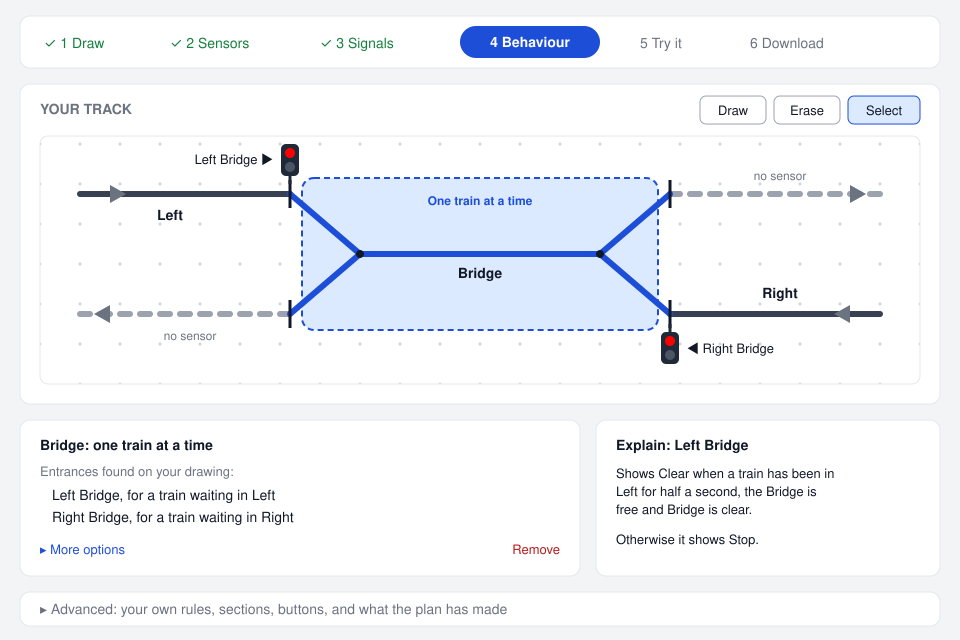

# Field Logic Track Plan — Feature Spec (draft)

Status: draft. The stored format and builder are built (`configurator/plan-builder.js`, work item 2); there is no editor yet. It changes how the Field Logic mode of the [Field Logic spec](field-logic-spec.md) is **set up**. The engine, the rule language and the fail-safe rules in that spec stay as they are, apart from the one question about [loops](#open-questions).

## Why

Field Logic asks you to think in blocks, masts, sections, groups and rules before you see your own track. Starters help, but they are a way into that model, not a picture of the layout, and it is hard to know where to begin or what builds on what.

The track plan turns this round. You **draw the track**, **place sensors and signals** on it, then **add behaviour** on top. The rules are worked out from the drawing.



*A sketch of the idea, not a screenshot.*

## Decisions

| Question | Decision |
|---|---|
| How is the track drawn? | On a grid, by dragging |
| What happens to rule cards? | Kept, folded under **Advanced**, for what a drawing cannot say |
| Plant ends in Field Logic | Removed from the page. Linked boards cover a permanent layout. MSS Logic keeps them |
| MSS Logic | Unchanged for now. The plan is designed so MSS Logic can move to it later |

## The page

Field Logic shows these steps, in order, around one picture. The picture stays in view while you work.

| Step | You do | You see |
|---|---|---|
| 1. Draw | drag track onto the grid | turnouts, joins and crossings appear where lines meet |
| 2. Sensors | cut the track into blocks; pick each block's sensors | each block named and shaded |
| 3. Signals | click a block break and a direction; pick a mast | the mast drawn on the plan, and what it protects when selected |
| 4. Behaviour | add what the drawing cannot imply, such as a one-train section | each signal's sentence (**Explain**) |
| 5. Try it | put trains on the plan, throw turnouts, run a train | the signals change on the same picture |
| 6. Download | as today | problems marked on the plan |

An empty page shows step 1 only, with one sentence: *Draw your track. Start at one end and drag to the other.*

Settings and Linked boards stay above the steps. **Advanced** is below them (see [Advanced](#advanced)).

## Drawing

Track is drawn between grid points, in eight directions. Dragging adds track; **Erase** removes it. What a point becomes follows from the track that meets there:

| Lines at a point | Becomes | You choose |
|---|---|---|
| 1 | an end of the drawing | [what is beyond it](#ends-of-the-drawing) |
| 2 | plain track or a bend | — |
| 3 | a turnout, or a **join with no turnout** (gauntlet track) | which turnout from the Turnouts page, which leg is straight, and the turnout position for each leg; or *no turnout* |
| 4 | a crossing | — (double slips are not drawn; use [Advanced](#advanced)) |

A bend sharper than 45° is not allowed, so a drawing always shows which way a train can run through a point.

Each stretch of track runs **both ways** unless you give it an arrow for **one way**. Arrows are how the plan tells a train waiting to enter a section from one that has just left it, in place of the *trains also leave through here* tick.

Nothing on the plan edits the Sensors, Turnouts or Signal Masts pages. It picks their items by name.

## Blocks and signals

- A **block break** is a point where one block stops and the next starts. A break can have a boundary sensor, which then holds both blocks, as today.
- A **block** is the track between breaks and drawing ends. It has a name, a topic and its sensors. It publishes to JMRI like any Field Logic block.
- A block with no sensor is **not detected**. It is drawn dashed, and nothing can be proved about it. A signal whose way ahead runs through one gets a warning.
- A block can include a **sensor** on a linked board, but not a linked board's block. Two boards can then never hold each other occupied.
- A **signal** stands at a break and faces trains going one way. A break with no signal needs nothing: the signal behind simply protects further.

## What the drawing does on its own

For each signal, the builder follows the track forward to the next signal facing the same way, or to an end of the drawing. Each possible way through is a **route**.

| From the drawing | Becomes |
|---|---|
| the blocks along a route | must all be clear |
| the turnouts along a route | must be set for it; a moving turnout matches neither position |
| a turnout's straight and diverging legs | whether the route is diverging |
| the next signal | the aspect: Approach behind a Stop, and so on, in the [Block signals](field-logic-spec.md#block-signals) order |
| no route set | Stop |

This replaces the Block signals and Route signal starters. Each signal picks an aspect for each indication it can show, prefilled for CATS masts, as in the [MSS Signals grid](mss-emulation-spec.md#signals-by-indication). Advance Approach and Approach Diverging are off by default.

**Turnouts lock under a train.** A turnout inside a detected block is locked while that block is occupied. This is on by default and can be unticked for each turnout.

## Behaviour you add

Select something on the plan to see what can be added to it.

| Select | You can add |
|---|---|
| one or more blocks | **One train at a time** |
| a signal | its aspects, **approach lighting** (dark until a chosen block is occupied) |
| a turnout | untick **lock under a train** |
| an end | what is beyond it |

### One train at a time

Select the blocks, then **One train at a time**. The selection is outlined on the plan. The page lists the entrances it found: every signal with a route into the selection, and the block behind each, where a train waits. There is nothing else to pick. **Free it when clear for** (3 s) and **Hold after cancelling** (off) are under **More options**.

It builds one section, and for each route from each entrance into it one reserving rule (a route that misses the section gets a plain rule):

| Part | From the plan |
|---|---|
| When | the block behind the signal is occupied, for 0.5 s |
| Only if | the route's turnouts are set and its blocks are clear, so the section is only given to a signal that can clear |
| Then | the signal shows the route's Clear; take the section; lock the route's turnouts |
| Leaving guard | on, if a train can run out of the section into the waiting block (the arrows say) |

These sit in a second group beside the drawing's own rules. A signal shows the [most restrictive answer](field-logic-spec.md#who-wins-a-mast), so it stays at Stop until it holds the section, then shows what the track ahead allows, and drops as soon as the drawing's rules say so. This also answers both cases in issue #92 (route locking with a following aspect, and routes that share a block).

The page **asks for it** where it is plainly needed: two signals lead onto the same two-way track from opposite ends, or two routes cross at a crossing, and no section covers it. The warning has a button that selects the blocks.

A section lives on one board. A single line that spans two boards still needs one board to own both signals, or [Advanced](#advanced) rules.

## Ends of the drawing

Each end says what is beyond it:

| Beyond | The signal before it |
|---|---|
| **End of signalled track** (default) | shows Approach at best |
| **Plain track, no more signals** | can show Clear |
| **Another board** | requires that board's chosen blocks clear, and reads its chosen signal. Unheard means occupied and Stop |

**Another board** picks from Linked boards. This replaces plant ends for a permanent layout.

## Worked example: gauntlet over a bridge

1. **Draw** two tracks that join, run over the bridge as one line, and separate again. Both joins are *no turnout*. Give each outer stretch its arrow: top track left to right, bottom track right to left.
2. **Sensors:** break all four lines just outside the joins. Name the top-left block **Left**, the middle **Bridge** (joins included) and the bottom-right **Right**, and pick a sensor for each. The two departing stretches have none.
3. **Signals:** the breaks sit on the lines just outside each join. Put **Left Bridge** at the top-left break facing right, and **Right Bridge** at the bottom-right break facing left.
4. **Ends:** set the two departing ends to *Plain track, no more signals*.
5. **Behaviour:** select Bridge, then **One train at a time**.

The result behaves as the [One-train section worked example](field-logic-spec.md#one-train-section) does: each signal clears only for a train waiting at it, and only while it holds the bridge. The departing stretches are not detected, so the page warns about each; here that is expected.

## Advanced

A folded part holding today's cards: **Rules** (groups and rule cards), **Sections**, **Buttons**, **Virtual masts**, and **Made by the plan**, the built blocks, sections and groups, read-only. Who uses what and the control table are there too.

- Your own rules run beside the plan's. The most restrictive answer wins, so a rule can hold a plan signal back, for example until a button is pressed, but cannot clear it past what the plan allows.
- A signal that only your own rules set works as it does today.
- Your rules can read the plan's blocks and sections.
- The **starter cards go**. Their builders stay, because the plan's builder uses the same code.

## Linked boards instead of plant ends

The Plant ends card is not shown in Field Logic. The one exception is a board that already has ends, such as one made by **Convert to Field Logic**, so nothing in a file is hidden. The engine, the C++ component and MSS Logic keep plant ends.

## How it is built

Like MSS Logic, the plan is **described, then built**. A new builder (`plan-builder.js`) turns the plan into ordinary blocks, sections and groups. `logic-yaml.js` reads them beside your own, so the YAML, JMRI XML, checker and component see nothing new. Built items are never stored.

| Reused | New |
|---|---|
| the engine, in JS and C++ | the grid editor |
| the checker, Try it's core, Run a train | `logic.plan` and its builder |
| the starters' rule builders, Explain | routes worked out from a drawing |
| the MSS picture's lamps and trains, the Signals grid | joins and crossings on the picture |

## Stored format

One new key, `logic.plan`. `logic.mode` stays `field`. Positions are grid points, `[x, y]`, with y down the page.

```json
"plan": {
  "track": [ [[0,0],[3,0]], [[3,0],[4,1]] ],
  "points": [ { "at": [5,1], "turnout": "P1", "straight": [6,1], "straightIs": "closed", "lock": true },
              { "at": [4,1], "turnout": null } ],
  "arrows": [ { "from": [0,0], "to": [2,0] } ],
  "breaks": [ { "at": [2,0], "sensors": [], "signals": [ { "mast": "Left Bridge", "facing": [3,0], "aspects": {}, "approachLight": "" } ] } ],
  "blocks": [ { "name": "Left", "at": [[0,0],[2,0]], "sensors": ["Left current"] } ],
  "ends": [ { "at": [12,0], "beyond": "plain" },
            { "at": [12,2], "beyond": { "board": "kiama-south-p3q8w5", "mast": "Home", "blocks": ["Up"] } } ],
  "sections": [ { "name": "Bridge section", "blocks": ["Bridge"], "release": "3s", "approachLock": "" } ],
  "advanceApproach": false,
  "approachDiverging": false
}
```

- `track` is straight pieces along the grid or at 45 degrees. Lines meet only at grid points.
- A block break sits on plain track, between two lines, never on a turnout, crossing or end. A turnout or join is therefore always inside a block.
- A point's `straight` is only needed where neither leg is in line with the third. `facing` is the next grid point along the track, the way the signal's train goes.
- An arrow covers its stretch of track up to the next turnout, crossing or end.
- A block is named by any piece of track in it (`at`).
- `ends[].beyond` is `signalled` (the default), `plain`, or another board's signal and blocks.
- `aspects` are the [MSS indications](mss-emulation-spec.md#masts) (`stop`, `approach`, `advance`, `clear`, `approachDiverging`, `divergingClear`, `divergingApproach`); a CATS mast needs none.
- A file without `plan` loads and generates exactly as it does today.

## Problems

Each is marked on the plan, in the page's plain words, saying what is wrong, why and what to do:

- A turnout point with no turnout chosen and not marked *no turnout*.
- A signal that faces a drawing end with no track ahead of it.
- A block with sensors that no signal protects, or a signal whose way ahead has an undetected block (warnings).
- Two signals onto the same two-way track, or a crossing, with no one-train section (warning, with the button above).
- Everything the checker finds, pointed back at the signal or section.

## Work, in order

| # | Work | Done when |
|---|---|---|
| 1 | Hide Plant ends in Field Logic; move the guide's chapter | a Field Logic board with no ends shows none |
| 2 | Stored format and builder, no drawing yet | hand-written plans for the gauntlet, a turnout junction, a passing siding and a diamond replay hand-worked engine cases |
| 3 | Grid editor: draw, blocks, signals, ends | each of those plans can be drawn from an empty page |
| 4 | Behaviour, Advanced, problems on the plan | the gauntlet needs no rule card |
| 5 | Try it and Run a train on the plan | as for MSS Logic today |
| 6 | New Field Logic guide and its pictures | a newcomer builds the gauntlet from it |
| later | MSS Logic on the same editor | its own spec |

This comes before Release 5 (merge to `main`) in the [implementation plan](field-logic-implementation-plan.md). The current Field Logic guide read-through and screenshots wait for step 6.

## Continuous run

Signals right round a loop read each other in a circle, which validation otherwise rejects. A loop made **only of the drawing's own signals** is allowed. Each checks its own track, and what a signal shows for each meaning ahead never feeds back into itself, so the loop settles (engine cases `plan-loop-block-signals` and `plan-loop-advance`, replayed by both engines). A loop with any other rule in it is still an error, as is a loop with only one signal.

## Open questions

- **Checker size.** A drawn station can put many blocks and turnouts in one part. Measure the plans from step 2 against the [checker limits](field-logic-spec.md#checker-limits).
- **How big a grid** fits the page before it needs to scroll or zoom.
