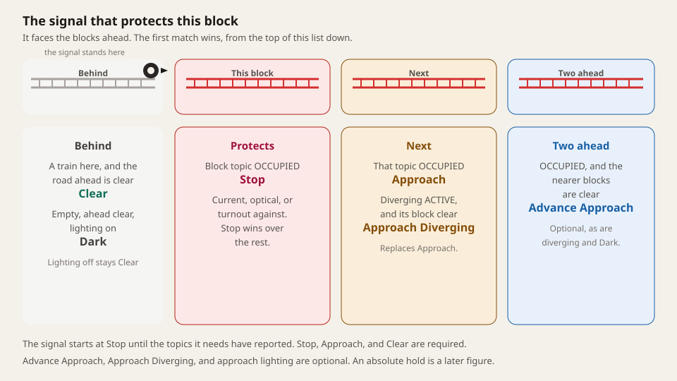
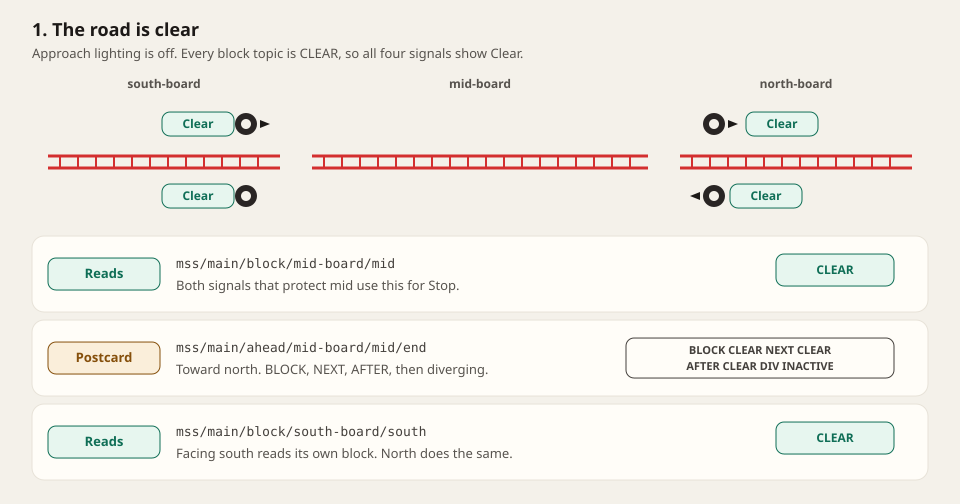
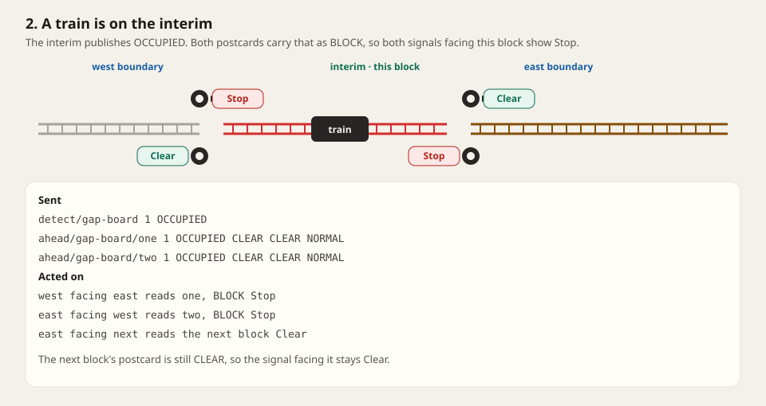
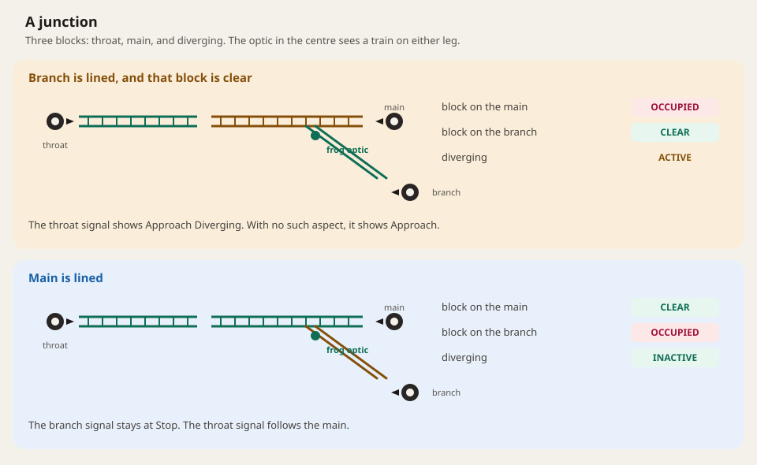

# MSS-ESPHome

**Version 1.**

The [Modular Signal System](http://www.modularsignalsystem.info/) (MSS 2.0.2) animates signals from the blocks ahead. No computer has to choose each aspect. This standard keeps those indications. A dispatcher can hold a home signal at Stop, and the same script fills the aspect once the hold lifts.

How the configurator draws the pieces, and how the web page is laid out, is in [the configurator notes](block-signalling.md).

The MSS standard, the fundamentals, and the planning notes are the three PDFs on the MSS site:

- [Design standard 2.0.2](http://www.modularsignalsystem.info/ModularSignalSystemStandardV2.0.2.pdf)
- [User guide part 1, fundamentals](http://www.modularsignalsystem.info/MSSUserGuide1.pdf)
- [User guide part 2, planning](http://www.modularsignalsystem.info/MSSUserGuide2.pdf)

## Version

This document is version **1**.

The first word of every payload is the version that board implements. A version 1 board sends `1` and then the words defined here. Each board sends its own version, so an older board and a newer board can share the broker.

A board reads a payload whose version is the same as its own or lower. A higher version is unheard. An unheard detector, optic, or postcard counts as occupied. An unheard diverging payload counts as `INACTIVE`. An unheard pair message is ignored.

```
1 OCCUPIED
1 CLEAR
1 ACTIVE
1 INACTIVE
1 ONLINE
1 OFFLINE
1 CLEAR CLEAR CLEAR INACTIVE
1 OFFER west-board/right
1 ACCEPT east-board/left west-board/right
```

## The three boards

A block runs from one boundary or junction to the next boundary or junction. Those two are marked *. An interim cannot be the end of a block.


**Boundary \*.** The optic and the signals sit in the centre, facing both ways. A block detector sits on the left, and another on the right. The left detector occupies the block on the left. The right detector occupies the block on the right. The optic occupies both blocks that meet at the signals.

**Interim.** One block detector. No signals and no optic. The detector occupies the one block this board sits in. Several interims in a row all belong to that same block.

**Junction \*.** A turnout, with the optic in the centre of it, so a train on either leg is seen. One signal on each leg — throat, main, and branch — facing the turnout. Three block detectors. The throat block is the throat approach and the turnout. The main block is the main route. The diverging block is the diverging route. The centre optic occupies the throat block. It does not occupy the main block or the diverging block.


## Occupancy and aspects

Each signalled track is its own set of topics. A block is occupied when any of these is true:

- The left or right block detector on a boundary sees a train. That occupies the block on that side.
- A block detector on an interim in the block sees a train.
- The optic in the centre of a boundary sees any part of a train. That occupies both blocks that meet there, so the signals hold until the last car clears the joint.
- The throat, main, or diverging block detector on a junction sees a train. That occupies that block.
- The optic in the centre of a turnout sees a train on either leg. That occupies the throat block.
- A turnout in a junction is set against the route that signal is protecting.


Signals stand at the boundaries, and on each leg of a junction. The one facing a block shows the first row that matches:

| What the script sees | Indication |
|---|---|
| An absolute mast, and CATS is holding it | Stop |
| The block it protects is occupied | Stop |
| That block is clear, the next is occupied, and diverging is active | Approach Diverging |
| That block is clear, and the next block is occupied | Approach |
| Those two are clear, and the one after is occupied | Advance Approach |
| Those are clear, and a train is in the block behind | Clear |
| Nothing ahead, and the block behind is clear, with approach lighting on | Dark |
| Nothing ahead, and approach lighting is off | Clear |

Stop wins over everything. Approach Diverging replaces Approach, and only then. Advance Approach, Approach Diverging, and approach lighting are optional. Stop, Approach, and Clear are not. The absolute row applies only to a mast marked Absolute. A permissive mast skips it.



An interim is not a step in that list. A train on an interim occupies the whole block between the two starred boards, so the signals that protect that block show Stop. The next block shows Approach only when that whole block is the next one.

The route that is not lined at a junction is held occupied, so the signal on that leg stays at Stop. Approach Diverging is sent only when the branch is lined and that block is clear. A signal that has no Approach Diverging aspect still sees the lined-away block as occupied, so it shows Approach.

Sidings and spurs that are not signalled stay out of this. Both rails are still gapped at each block boundary, and every feeder for a block still passes through a current detector.

## What a board publishes

Facts are retained, QoS 1. The payload is the version, then `OCCUPIED` or `CLEAR` for a detector, a joint, or a turnout, and `ACTIVE` or `INACTIVE` for diverging.

```
mss/<track>/detect/<board>
mss/<track>/detect/<board>/<place>
mss/<track>/joint/<board>
mss/<track>/turnout/<board>
mss/<track>/diverging/<board>
```

`detect/<board>` is an interim's one block detector. `detect/<board>/<place>` is one block on a boundary (`left`, `right`) or a junction (`throat`, `main`, `branch`). `joint` is the optic in the centre of a boundary. `turnout` is the optic in the centre of the turnout. `diverging` is `ACTIVE` only when the branch is lined and that block's own detectors are clear.

JMRI train tracking stays on `trains/track/sensor/...`, and those messages are not retained. The signal script does not read that topic.

Each end also publishes one postcard, retained, QoS 1:

```
mss/<track>/ahead/<board>/<end>
```

The payload is the version, then four words: `BLOCK NEXT AFTER DIVERGING`. A clear road reads `1 CLEAR CLEAR CLEAR INACTIVE`.

An interim adds itself to the block and passes the rest through. `BLOCK` is occupied when its own detector is occupied or the postcard from the other end says the block is occupied. `NEXT`, `AFTER`, and `DIVERGING` are copied.

A boundary or a junction is the edge of a block. The postcard it sends across that edge names this block as `BLOCK`, the next signal block as `NEXT`, and the one after as `AFTER`.

Two boundaries can be neighbours with no interim between them. Each reads the other's postcard. A row of interims still adds up to one block, and `NEXT` still arrives at the far boundary.

Each board also publishes:

```
mss/<track>/node/<board>/online
```

`1 ONLINE` while it is connected, `1 OFFLINE` as its last will. Both are retained. Detector, joint, turnout, diverging, and postcard topics are published again about once a second. A block input counts as occupied unless the board is `ONLINE`, the payload is `CLEAR`, and a copy arrived within the last three seconds. A missing diverging topic stays `INACTIVE`.


## Pairing

A boundary has two ends, `left` and `right`. A junction has three legs, `throat`, `main`, and `branch`. An interim has two ends, `one` and `two`. Either interim end can take either neighbour. Each end is used once.

Each end stores the neighbour's address, such as `east-board/left` or `gap-board/one`. That address is `<board>/<end>` on the postcard topic.

Pairing uses one topic for the whole track:

```
mss/<track>/pair
```

It is not retained. QoS 1. Pair one joint at a time.

1. One end publishes `1 OFFER west-board/right` and flashes the signals on that side.
2. An end of the other board publishes `1 ACCEPT east-board/left west-board/right`.
3. West stores `east-board/left` as its right neighbour. East stores `west-board/right` as its left neighbour.
4. Both ends flash three slow blinks. An interim has no signals, so the board with signals flashes. Both ends store the address.

An offer lasts 30 seconds. A new offer replaces one that has not been accepted. A board ignores an offer from itself.


## A plain stretch

West and east are boundaries. An interim named gap sits between them. That is one block. The track past east is the next block.


West's right neighbour is `gap-board/one`. The interim's `one` end stores `west-board/right`. Its `two` end stores `east-board/left`. East's left neighbour is `gap-board/two`.

The signal on west that faces east protects this block. Stop is this block. Approach is the next block, which east names in `NEXT`. The signal on east that faces east protects the next block. The signal on east that faces west protects this block.






Approach lighting is off in these pictures, so a clear road shows Clear. Another interim between west and east still belongs to this one block. Pair west straight to east, with no interim, and the same two signals still protect the block between them.

## A junction

A junction is a starred end of every block that meets it. The three signals face the turnout, so each one protects entry along that leg. The leg that is not lined is held occupied. The centre optic and the throat detector occupy the throat block, whichever leg the train is on. The main detector occupies the main route. The diverging detector occupies the diverging route.



Thrown lines the branch. An interim on the way to the junction adds its detector to the approach block. The postcard into the junction carries that block as `BLOCK`. The junction sends `DIVERGING` as `ACTIVE` only when the branch is lined and clear, and the interim copies that field through to the boundary one block back.

Advance Approach stays the block one past the next. It stays on the straight path when the junction is thrown.

## On the mast

The script picks the aspect by the name configured for that mast (`Stop`, `Approach`, and so on). One mast, one signal. The signal starts at Stop until the topics it reads have reported.

Approach lighting needs a Dark aspect with every lamp off, and the block behind the signal. It is off unless that mast is configured for it. With it off, a clear road stays Clear and the mast stays lit.

The board publishes the name of the aspect it is showing, and only that name. Example: `Approach`.

## A dispatcher, when you want one

Permissive signals follow the blocks. Home signals, and the signals at a junction, are the ones marked Absolute.


An absolute mast listens on the topic it already has, `trains/track/signalmast/<name>`. The payload is the JMRI line, such as `Stop; Lit; Held`.

- `Held` forces Stop. The aspect word in that message can be stale, so the board does not paint it. Lit and Unlit are ignored.
- `Unheld` means the dispatcher has cleared the signal. The script then shows Clear, Approach, Advance Approach, or Approach Diverging.
- The board publishes the bare aspect name. A full `Approach; Lit; Unheld` line would clear the hold CATS had just set.

The mast topic is not retained, and CATS publishes when its rule changes. After a reboot an absolute mast stays at Stop until a fresh `Held` or `Unheld` arrives.

While that signal is cleared, the board ignores fascia throws for the points in the block it protects. After CATS returns the signal to Stop, those points stay locked until the block is clear. A permissive signal does not take that lock. A turnout against the route still occupies the block.

With no dispatcher, leave Absolute off. The line runs from the blocks alone.
