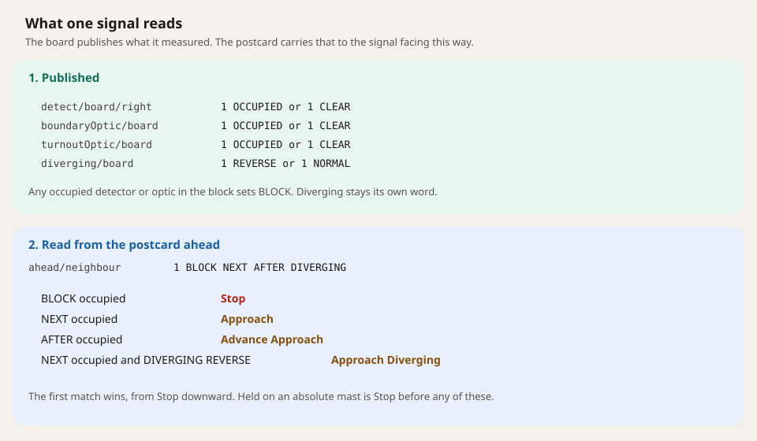
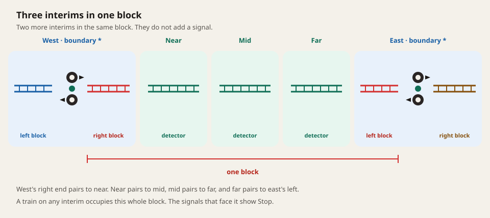
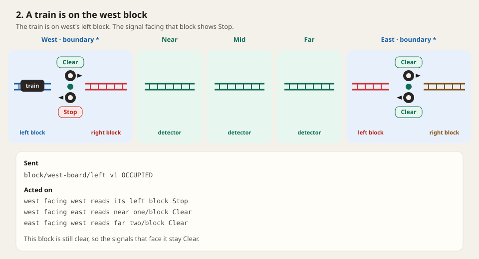
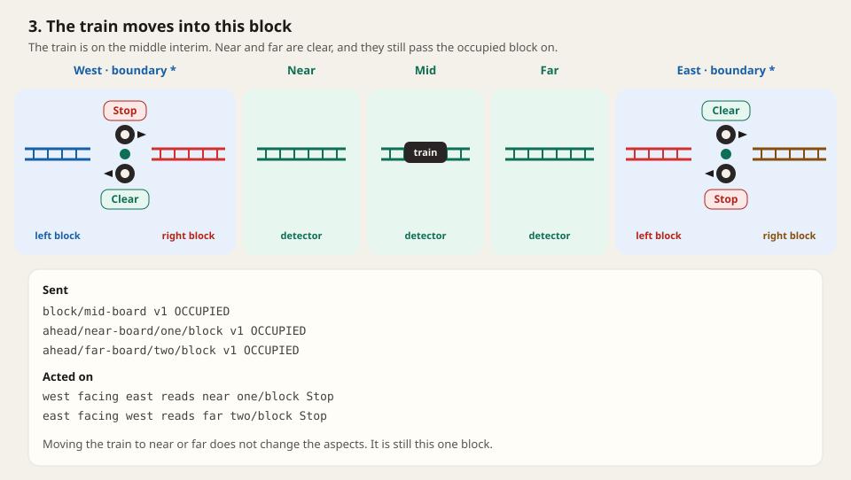
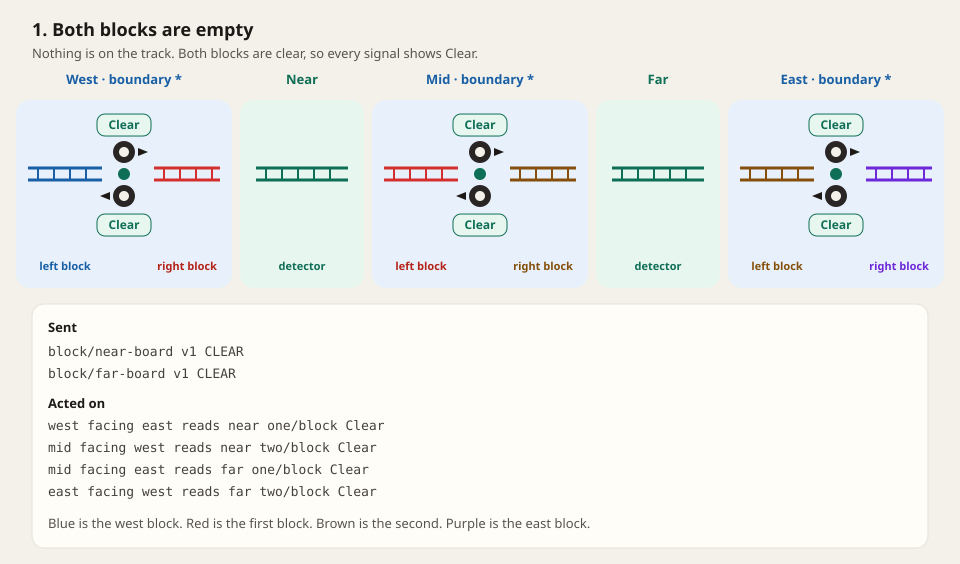
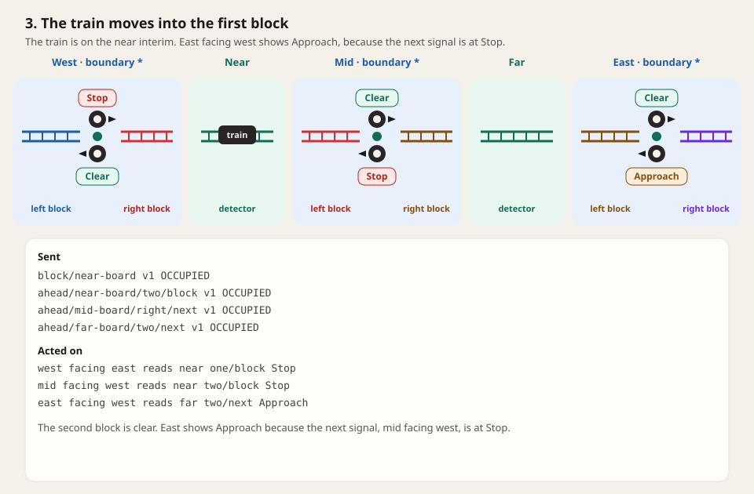
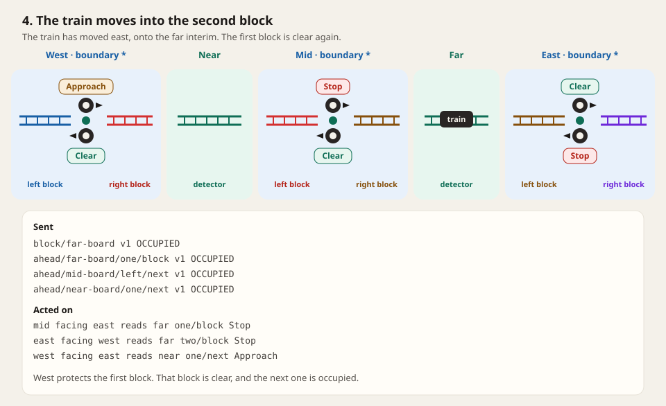

# MSS-ESPHome

**Version 1.**

The [Modular Signal System](http://www.modularsignalsystem.info/) (MSS 2.0.2) animates signals from the blocks ahead. No computer has to choose each aspect. This standard keeps those indications. A dispatcher can hold a home signal at Stop, and the same script fills the aspect once the hold lifts.

How the configurator draws the pieces, and how the web page is laid out, is in [the configurator notes](block-signalling.md).

The MSS standard, the fundamentals, and the planning notes are the three PDFs on the MSS site:

- [Design standard 2.0.2](http://www.modularsignalsystem.info/ModularSignalSystemStandardV2.0.2.pdf)
- [User guide part 1, fundamentals](http://www.modularsignalsystem.info/MSSUserGuide1.pdf)
- [User guide part 2, planning](http://www.modularsignalsystem.info/MSSUserGuide2.pdf)

## Version

This document is version **1**.

The first word of every payload is the version that board implements, written `v1` for this standard. The words after it are the event. Each board sends its own version, so an older board and a newer board can share the broker.

A board reads a payload whose version is the same as its own or lower. A higher version is unheard. An unheard block, optic, or ahead fact counts as occupied. An unheard turnout counts as `NORMAL`. An unheard pair message is ignored.

```
v1 OCCUPIED
v1 CLEAR
v1 REVERSE
v1 NORMAL
v1 ONLINE
v1 OFFLINE
v1 Approach
v1 OFFER west-board/right
v1 ACCEPT east-board/left WITH west-board/right
```

## The three boards

A block runs from one boundary or junction to the next boundary or junction. Those two are marked *. An interim cannot be the end of a block.


**Boundary \*.** The optic and the signals sit in the centre, facing both ways. A block detector sits on the left, and another on the right. The left detector occupies the block on the left. The right detector occupies the block on the right. The optic occupies both blocks that meet at the signals.

**Interim.** One block detector. No signals and no optic. The detector occupies the one block this board sits in. Several interims in a row all belong to that same block.

**Junction \*.** A turnout, with the optic in the centre of it, so a train on either leg is seen. One signal on each leg — throat, main, and branch — facing the turnout. Three block detectors. The throat block is the throat approach and the turnout. The main block is the main route. The diverging block is the diverging route. The centre optic occupies the throat block. It does not occupy the main block or the diverging block.



## Occupancy and aspects

Each signalled track is its own set of topics. A block is occupied when any of these is true:

- The left or right block detector on a boundary sees a train. That occupies the block on that side.
- A block detector on an interim in the block sees a train.
- The optic in the centre of a boundary sees any part of a train. That occupies both blocks that meet there, so the signals hold until the last car clears the boundary.
- The throat, main, or diverging block detector on a junction sees a train. That occupies that block.
- The optic in the centre of a turnout sees a train on either leg. That occupies the throat block.
- A turnout in a junction is set against the route that signal is protecting.


Signals stand at the boundaries, and on each leg of a junction. The one facing a block shows the first row that matches:

| What the script sees | Indication |
|---|---|
| An absolute mast, and CATS is holding it | Stop |
| The block it protects is occupied | Stop |
| That block is clear, the next is occupied, and the turnout is REVERSE | Approach Diverging |
| That block is clear, and the next block is occupied | Approach |
| Those two are clear, and the one after is occupied | Advance Approach |
| Those are clear, and a train is in the block behind | Clear |
| Nothing ahead, and the block behind is clear, with approach lighting on | Dark |
| Nothing ahead, and approach lighting is off | Clear |

Stop wins over everything. Approach Diverging replaces Approach, and only then. Advance Approach, Approach Diverging, and approach lighting are optional. Stop, Approach, and Clear are not. MSS 2.0.2 lists the same three as required, and Advance Approach as optional. A mast without Advance Approach skips that row and shows Clear. The absolute row applies only to a mast marked Absolute. A permissive mast skips it.


An interim is not a step in that list. A train on an interim occupies the whole block between the two starred boards, so the signals that protect that block show Stop. The next block shows Approach only when that whole block is the next one.

The route that is not lined at a junction is held occupied, so the signal on that leg stays at Stop. Approach Diverging is sent only when the turnout is `REVERSE` and that block is clear. A signal that has no Approach Diverging aspect still sees the lined-away block as occupied, so it shows Approach.

Sidings and spurs that are not signalled stay out of this. Both rails are still gapped at each block boundary, and every feeder for a block still passes through a current detector.

## What a board publishes

The topic says what changed. The payload says what it is now. Facts are retained, QoS 1. A block or an optic is `v1 OCCUPIED` or `v1 CLEAR`. A turnout is `v1 NORMAL` or `v1 REVERSE`.

```
mss/<track>/block/<board>
mss/<track>/block/<board>/<place>
mss/<track>/optic/boundary/<board>
mss/<track>/optic/turnout/<board>
mss/<track>/turnout/<board>/lined
```

`block/<board>` is an interim's one block detector. `block/<board>/<place>` is one block on a boundary (`left`, `right`) or a junction (`throat`, `main`, `branch`). `optic/boundary` is the optic in the centre of a boundary. `optic/turnout` is the optic in the centre of the turnout. `turnout/<board>/lined` is `v1 REVERSE` when the branch is lined, and `v1 NORMAL` when the main is lined.

JMRI train tracking stays on `trains/track/sensor/...`, and those messages are not retained. The signal script does not read that topic.

Each end passes those facts on, one topic per fact, retained, QoS 1:

```
mss/<track>/ahead/<board>/<end>/block
mss/<track>/ahead/<board>/<end>/next
mss/<track>/ahead/<board>/<end>/after
mss/<track>/ahead/<board>/<end>/turnout
```

`block`, `next`, and `after` are `v1 OCCUPIED` or `v1 CLEAR`. `turnout` is `v1 NORMAL` or `v1 REVERSE`. A clear road is `block`, `next`, and `after` all `v1 CLEAR`, and `turnout` `v1 NORMAL`. When a train enters the block, `ahead/<board>/<end>/block` changes to `v1 OCCUPIED`. The topic that changed is the event.

An interim adds itself to the block and passes the rest through. `ahead/<board>/<end>/block` is occupied when its own block topic is occupied, or the block topic from the other end is occupied. `next`, `after`, and `turnout` are copied.

A boundary or a junction is the edge of a block. Across that edge, `block` is this block, `next` is the next signal block, and `after` is the one after that.

Two boundaries can be neighbours with no interim between them. Each reads the other's ahead topics. A row of interims still adds up to one block, and `next` still arrives at the far boundary.

The aspect that signal is showing:

```
mss/<track>/signal/<board>/<end>
```

The payload is the version, then the aspect name. Examples: `v1 Stop`, `v1 Approach`, `v1 Approach Diverging`. Other boards do not read this topic. An interim has no signals, so it does not publish it.

Each board also publishes:

```
mss/<track>/board/<board>/online
```

`v1 ONLINE` while it is connected, `v1 OFFLINE` as its last will. Both are retained. Block, optic, turnout, ahead, and signal topics are published again about once a second. A block input counts as occupied unless the board is `v1 ONLINE`, the payload is `v1 CLEAR`, and a copy arrived within the last three seconds. A missing turnout topic stays `v1 NORMAL`.


## Pairing

A boundary has two ends, `left` and `right`. A junction has three legs, `throat`, `main`, and `branch`. An interim has two ends, `one` and `two`. Either interim end can take either neighbour. Each end is used once.

Each end stores the neighbour's address, such as `east-board/left` or `gap-board/one`. That address is `<board>/<end>` on the ahead topics.

Pairing uses one topic for the whole track:

```
mss/<track>/pair
```

It is not retained. QoS 1. Pair one end at a time.

1. One end publishes `v1 OFFER west-board/right` and flashes the signals on that side.
2. An end of the other board publishes `v1 ACCEPT east-board/left WITH west-board/right`. The first address is the end that accepted. `WITH` is the offer it accepted.
3. West stores `east-board/left` as its right neighbour. East stores `west-board/right` as its left neighbour.
4. Both ends flash three slow blinks. An interim has no signals, so the board with signals flashes. Both ends store the address.

An offer lasts 30 seconds. A new offer replaces one that has not been accepted. A board ignores an offer from itself.


## A plain stretch

West and east are boundaries. An interim named gap sits between them. That is one block. The track past east is the next block.


West's right neighbour is `gap-board/one`. The interim's `one` end stores `west-board/right`. Its `two` end stores `east-board/left`. East's left neighbour is `gap-board/two`.

The signal on west that faces east protects this block. Stop is this block. Approach is the next block, which arrives on `next`. The signal on east that faces east protects the next block. The signal on east that faces west protects this block. The signal on west that faces west protects the west block.

The next pictures follow one train from the west block to the east.


Approach lighting is off in these pictures, so a clear road shows Clear. Another interim between west and east still belongs to this one block. Pair west straight to east, with no interim, and the same two signals still protect the block between them.

## Two more interims

The same block, with two more interims between west and east. An interim still cannot end a block. A train on any of the three occupies the whole block, so moving from one interim to the next does not change the signals.



West's right neighbour is `near-board/one`. Near pairs onward to mid, mid pairs onward to far, and far's other end is `east-board/left`. East's left neighbour is `far-board/two`. Each interim adds its own detector to this block and passes `next` through.







## Two blocks

West, mid, and east are boundaries. Near sits in the first block, between west and mid. Far sits in the second, between mid and east.


West's right neighbour is `near-board/one`, and near's other end is `mid-board/left`. Mid's right neighbour is `far-board/one`, and far's other end is `east-board/left`.

The signal on west that faces east protects the first block, and so does the signal on mid that faces west. The signal on mid that faces east protects the second block, and so does the signal on east that faces west.









Advance Approach is the block after the next. It is optional. A mast without it stays Clear. With it, west shows Advance Approach here, because both signal blocks are clear and the block past east is occupied.

## A junction

A junction is a starred end of every block that meets it. The three signals face the turnout, so each one protects entry along that leg. The leg that is not lined is held occupied. The centre optic and the throat detector occupy the throat block, whichever leg the train is on. The main detector occupies the main route. The diverging detector occupies the diverging route.


Thrown lines the branch. An interim on the way to the junction adds its detector to the approach block. The ahead block topic into the junction carries that block. The junction publishes `turnout/<board>/lined` as `v1 REVERSE` when the branch is lined, and `v1 NORMAL` when the main is lined, and the same word on `ahead/<board>/<end>/turnout`. The interim copies that topic through to the boundary one block back.

Advance Approach stays the block one past the next. It stays on the straight path when the junction is thrown.

## On the mast

The script picks the aspect by the name configured for that mast (`Stop`, `Approach`, and so on). One mast, one signal. The signal starts at Stop until the topics it reads have reported.

Approach lighting needs a Dark aspect with every lamp off, and the block behind the signal. It is off unless that mast is configured for it. With it off, a clear road stays Clear and the mast stays lit.

The board publishes that name on `signal/<board>/<end>`, and only that name. Example: `v1 Approach`.

## A dispatcher, when you want one

Permissive signals follow the blocks. Home signals, and the signals at a junction, are the ones marked Absolute.


An absolute mast listens on the topic it already has, `trains/track/signalmast/<name>`. The payload is the JMRI line, such as `Stop; Lit; Held`.

- `Held` forces Stop. The aspect word in that message can be stale, so the board does not paint it. Lit and Unlit are ignored.
- `Unheld` means the dispatcher has cleared the signal. The script then shows Clear, Approach, Advance Approach, or Approach Diverging.
- The board publishes the bare aspect name. A full `Approach; Lit; Unheld` line would clear the hold CATS had just set.

The mast topic is not retained, and CATS publishes when its rule changes. After a reboot an absolute mast stays at Stop until a fresh `Held` or `Unheld` arrives.

While that signal is cleared, the board ignores fascia throws for the points in the block it protects. After CATS returns the signal to Stop, those points stay locked until the block is clear. A permissive signal does not take that lock. A turnout against the route still occupies the block.

With no dispatcher, leave Absolute off. The line runs from the blocks alone.
