# MSS Logic Guide

MSS Logic lets a board signal a module the way an MSS (Modular Signal System) module does, with no rules to write. You describe the module: its ends, its tracks and its junctions. The board works out the signals from that, and it keeps working when JMRI is closed. At a meet, you pair the modules' ends and the signals carry on across the joint.

It is an imitation of MSS over MQTT, not MSS hardware. There is no RJ45 cable and no 12V logic. Each module has an ESP32, and the layout has an MQTT broker. If a module cannot hear its neighbour, the signal at that joint shows Stop.

This guide builds two modules from an empty Logic page and pairs them:

- **West**, a plain stretch of track with two blocks.
- **East**, a track that ends at a turnout junction with two ways out.

Use it after the [First Board Setup Guide](first-board-setup-guide.md) and the [JMRI MQTT Verification Guide](jmri-mqtt-verification-guide.md). Each board should be online in ESPHome, and JMRI should have its MQTT connection set up. The [Field Logic Guide](field-logic-guide.md) covers the groundwork this guide leans on: the name suffix, sensors, expanders, flashing and MQTTX. MSS Logic and Field Logic run on the same engine, so what you learn there carries over.

> **Being rebuilt:** the MSS Logic page now starts from the standard MSS modules: Pick your module, then Wire it, Signals, Try it, Download and Pair ([the spec](mss-patterns-spec.md)). This guide still describes the earlier page, where you described the ends, tracks and junctions yourself, and is rewritten for the new one in work item MP 7.

> **Testers:** MSS Logic is not on the live configurator yet. Until it is, open it from the `feature/logic` branch, as the testers' note in the Field Logic Guide describes. Nothing in this guide has been tried on hardware yet. It says what should happen, from the design and from the test cases the configurator is checked against. If your board does something else, that is worth reporting.

---

## The worked example

**West** has one track from end A to end B. It is cut into two blocks, with one block boundary between them:

- **W1 current** and **W2 current**: a current detector in each block, as in the [detector wiring](README.md).
- **W12 optical**: an optical sensor at the block boundary. It sees any car at that spot, powered or not, so the tail of a train cannot slip out of a block unseen.
- Two signals at the block boundary, one facing each way: **W toward A** (seen by trains heading towards end A) and **W toward B** (seen by trains heading towards end B).

**East** has three ends. A train enters at end A, crosses two blocks, and meets a turnout junction. From there one way goes straight on to end B, and the other branches off to end C:

- **E1 current** and **E2 current**, with **E12 optical** between them, and one signal, **E Outer**, for trains heading towards the junction.
- **E Home**: the signal facing into the junction.
- **E Junction optical**: an optical sensor at the junction, so a car standing on it holds every way out.
- **E Main current** (towards end B) and **E Branch current** (towards end C).
- **E P1**, the turnout.

At the meet, **West end B meets East end A**.

> **Screenshot placeholder:** a sketch of the two modules side by side. West: end A, block W1, an optical sensor, block W2, end B. East: end A, blocks E1 and E2, the junction with E P1, and its two ways out to ends B and C.

Before you start, put the parts on the foundation pages, as in the first board guide. The Logic page picks them by name and never changes them.

Each module is its own board, and the configurator holds one board at a time. Go through Steps 1 to 7 for West, and download its YAML. Then go through them again for East: each step says what differs. The page has no button for a new board, so start East in a private (incognito) window, which opens the configurator with nothing saved. To change West later, open it again with **Import**, **From a file…**, and pick West's `board.yaml`.

A new board starts with one example sensor (`Kiama/Up XOver`) and one example turnout (`Kiama/Up Loop`). Rename them to the first of your own, or click **Remove** on them.

- **Board** page: type the board's name, such as `kiama-west`. The page adds a six-character suffix after it, such as `-k7m4x2`, so the full name is `kiama-west-k7m4x2`. Two boards at a meet must never share one. See Step 1 of the Field Logic Guide.
- **Sensors:** every sensor named above. Click **Add sensor** for each and type its **Name**. Wire an optical sensor like a current detector: its output to the pin, and its GND to GND. Leave **Debounce** at `500ms`.
- **Turnouts:** `E P1` on the East board. West has none, so remove the example turnout there.
- **Signal Masts:** every signal named above. A signal can be a WS2812B strip or one pin for each lamp. Add its lamps first, then its aspects: pick a CATS aspect from the list and click **Add CATS aspect**, then click a lamp in the small mast and pick its colour. The Signals grid in Step 5 fills itself in from aspects named as in the CATS signal template: **R292** (Stop), **R285** (Approach) and **R281** (Clear), plus **ADV_NORM**, **R282**, **R283** and **R286** if you use the other indications.

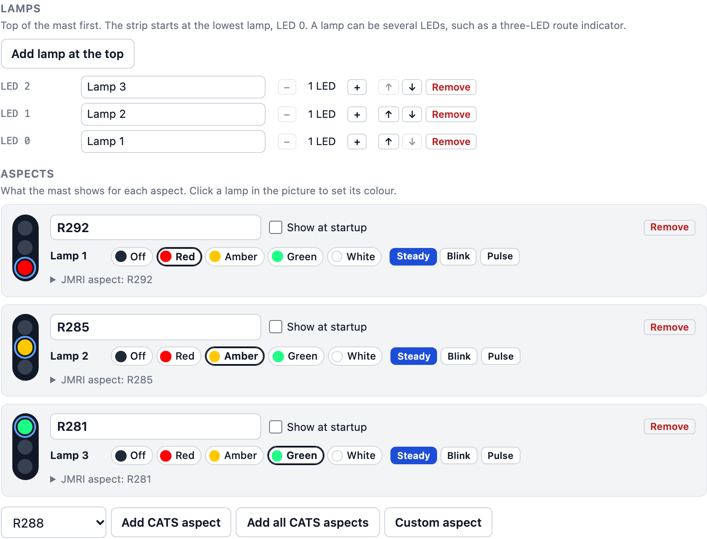

---

## Step 1: Choose MSS Logic

1. Open the **Logic** page.
2. Set **Logic** to **MSS Logic**.

The page now lists the steps under **Set up this module**: **Ends**, **Tracks**, **Junctions** (marked **Optional**), **Signals**, **Try it** and **Download**. Each has a short hint, and each name is a link to its part of the page. You can do them in any order and come back to any of them. A step with a problem says how many things there are to fix, in red. A step that is finished is crossed out and marked **Done**.

Under **Settings** it says *Always on in MSS Logic: neighbouring boards read it.* Sharing with other boards is always on in this mode, so there is nothing to tick.

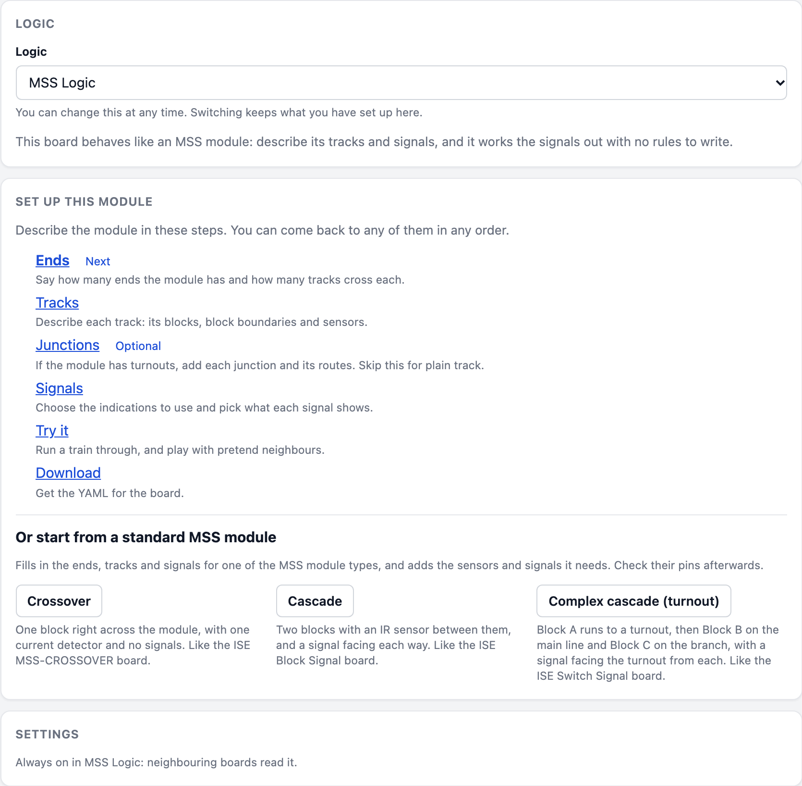

There are no rule cards in this mode. The views of what the board is doing (who uses what, the control table) still show, read-only, and each item is marked **Made by MSS Logic**. You never edit those. You change the description, and they are made again.

Success looks like:
- The steps appear, and **Ends** is marked **Next**.

---

## A shortcut: start from a standard MSS module

Under the steps, while the module is still empty, **Or start from a standard MSS module** offers the three MSS module types, as the MSS standard defines them:

- **Crossover**: one block right across the module, one current detector, no signals.
- **Cascade**: two blocks with an IR sensor between them, and a signal facing each way.
- **Complex cascade (turnout)**: Block A runs to a turnout, then Block B on the main line and Block C on the branch, with a signal facing the turnout from each. Signal A has two heads: the upper head is the main line, the lower the branch.

Click one. A panel lists what it will add: the sensors, the turnout and the signals, with the CATS aspects so the Signals grid fills itself in. Each signal head is a red, a yellow and a green LED, each on its own free pin. Anything with the same name already on the board is used as it is. Click **Add it**, then check the pins on the Sensors, Turnouts and Signal Masts pages against your wiring.

**Pins.** The Complex cascade's signals need 12 LED pins, and an ESP32 has only so many. If the board has too few free pins that are safe at start-up, the panel says so: an LED on GPIO0, 2, 5, 12 or 15 can stop the board starting. Tick **Use one WS2812B LED for each head instead** to need one data pin per signal, or remove what the board does not need first (a new board's example sensor and turnout, for instance).

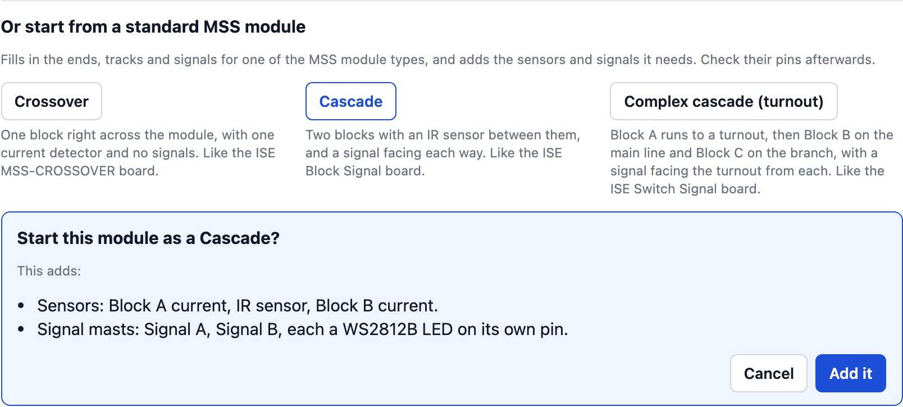

The signals are named for the end their trains come in at: **Signal A** faces trains coming in at end A. Here is the Complex cascade, one click later:

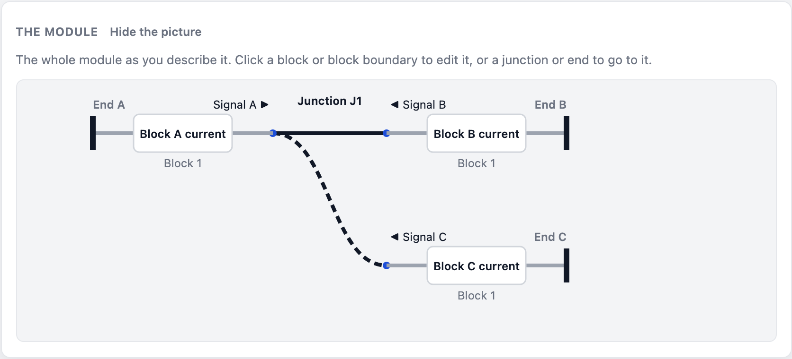

West, in the worked example, is a Cascade with its own names, and East is a Complex cascade with two blocks before the turnout. The steps below build them by hand, so you can see each part, and change a template's module to fit yours.

---

## Step 2: Ends

An end is where track leaves the module and meets the next one. Name each end with the letter marked on the module.

On **West**:

1. Under **Ends**, click **Add an end**. The page names it **A**, with **Tracks across this end** at `1`. Leave both. One is single track and two is double track.
2. Click **Add an end** again. The page names it **B**, also with one track.
3. Optional: pick a **Pair button pin** and an **LED pin** for each end. The Pair button is a push button between the pin and GND. The LED shows the end's state (see Step 9). Leave them at **No pin** if you wish: the board's web page has a Pair button too, and it always works.

Each end is a card of its own. Until you draw the tracks, each one has a red edge and the message *End A track 1 has no track*, the **Ends** card has a red dot by its title, and the **Ends** step says *2 things to fix*. That is expected, and Step 3 fixes it.

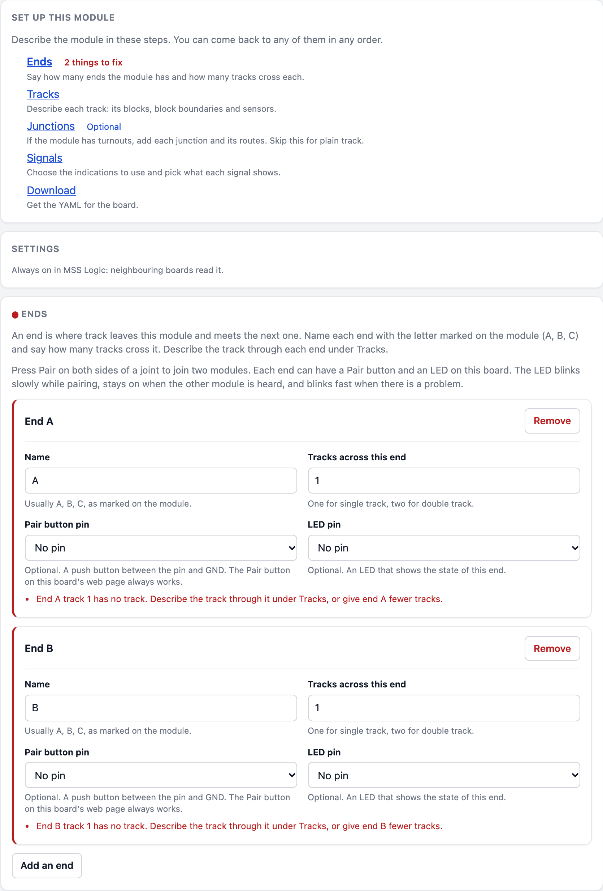

On **East**, add ends **A**, **B** and **C**, each with one track. Here end A has a Pair button on `GPIO32` and an LED on `GPIO33`.

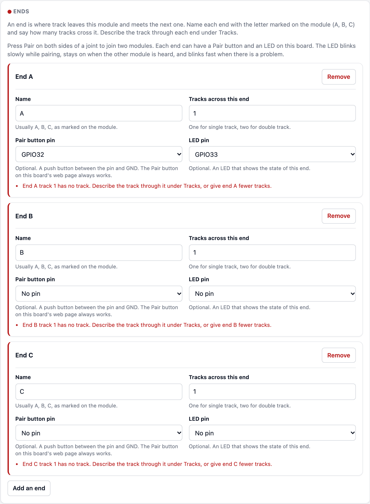

Success looks like:
- Each end is listed, with the name and track count you gave it. The *has no track* messages stay until Step 3.

---

## Step 3: Draw the track

Once a module has a track, **The module** card at the top of the page draws the whole module: the ends at the sides, each track as a row of blocks, and the junctions where tracks meet. It fills in as you go, and stays at the top of the window while you work down the page. **Hide the picture** folds it away on a small screen.

You edit in the picture: click a block or block boundary there, and its form opens in its track's card under **Tracks**. Click a junction or an end in the picture to go to its card.

On **West**:

1. Under **Tracks**, click **Add a track**.
2. Check **From** and **To** in the track's card. The page fills them in with the first end tracks no other track uses, so here they already say **End A, track 1** and **End B, track 1**. Change them if they are wrong. (The **To** list also has **Dead end (stops on the module)**, for a track that stops, as at a terminus.)

The track appears in the picture, from **End A** on the left to **End B** on the right. It starts as one block, labelled **Through track (no signals)**. The block is red because it has no sensor yet, and its form, **Track 1: Block 1**, is open in the track's card with the message.

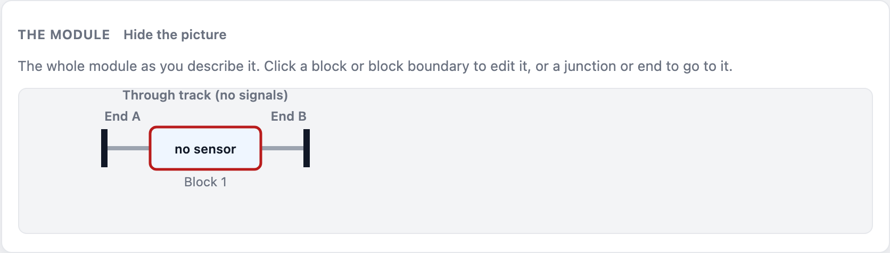

Add the block boundary:

3. Click **Add a block boundary**, at the bottom of the track's card. It splits the last block in two: **Block 1**, a **Block boundary 1** (the upright bar), and **Block 2**. The block boundary is picked, so it is drawn blue, and its form is open.

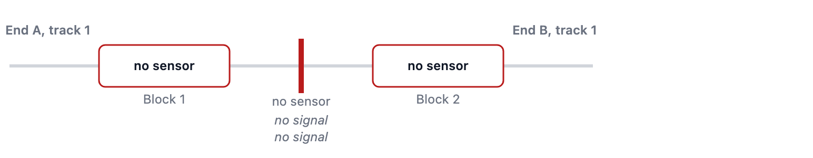

4. Click **Block 1** in the picture. Its form, **Track 1: Block 1**, opens just under the picture. Under **Sensors**, pick **W1 current** from the **Add a sensor…** list. It shows as a chip, and in the picture in place of *no sensor*. Click **Block 2** in the picture and do the same with **W2 current**. A block can have more than one sensor: pick another from the same list. The **×** on a chip takes it off.

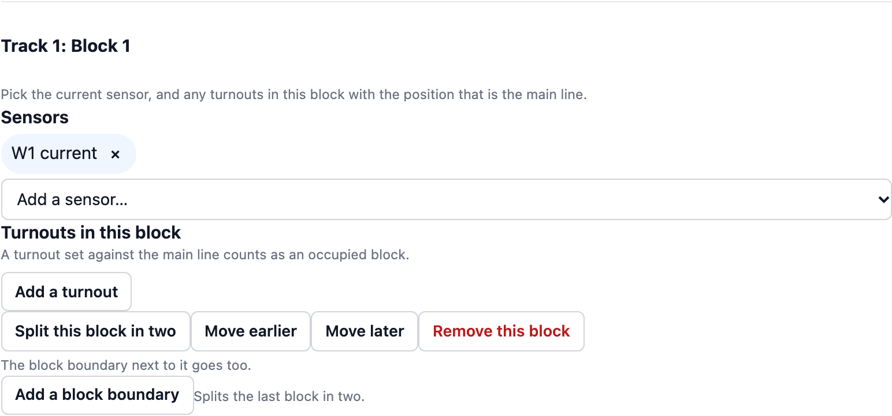

5. Click **Block boundary 1** in the picture. Under **Sensors**, pick **W12 optical**. Then pick the two signals: **Signal for trains heading towards End B, track 1** is **W toward B**, and **Signal for trains heading towards End A, track 1** is **W toward A**.

The two signals are drawn under the block boundary as arrows, each pointing the way its trains go: ◀ **W toward A** for trains heading to End A, and **W toward B** ▶ for trains heading to End B. They follow the module's own ends, so nothing changes if the module is turned round at the meet.

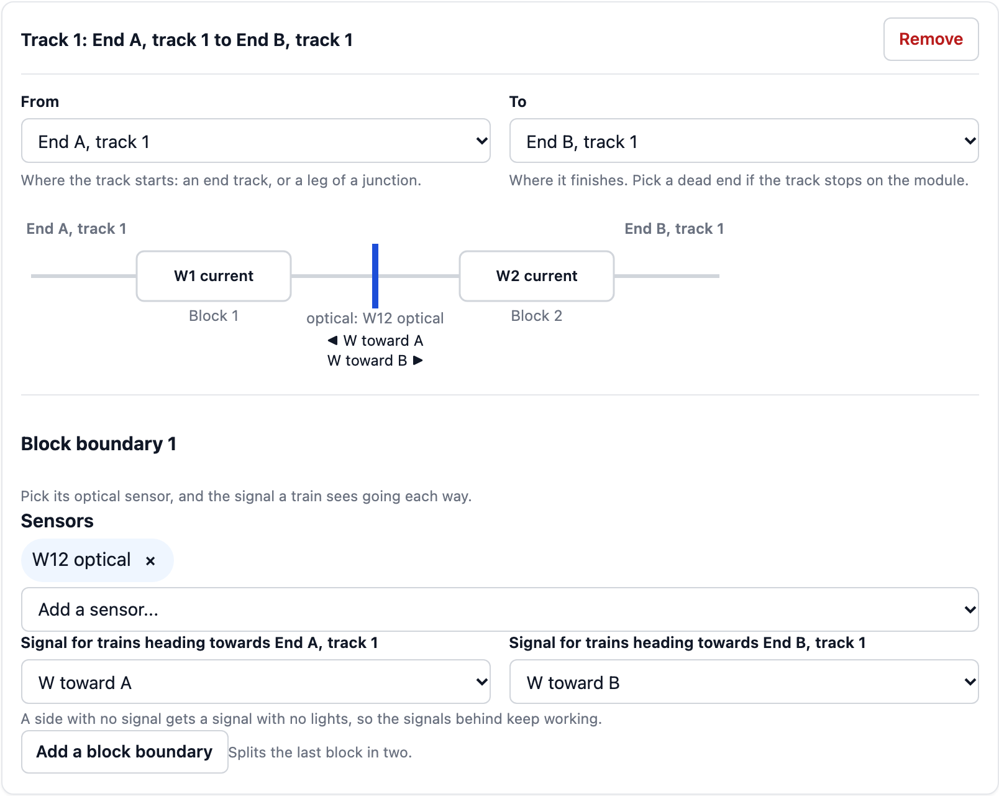

**A side with no signal** shows *no signal* in grey under the block boundary. Leave its list at **no signal** if the module has none there. The page makes one with no lights, so the signals behind it keep working.

**A block boundary holds both blocks.** The optical sensor counts as part of both Block 1 and Block 2, so a block stays occupied until the last car has cleared it, even a car that draws no current.

**Turnouts in a block.** If a block has a turnout in it, click **Add a turnout** under **Turnouts in this block**, pick the turnout, and set **Main line is** to the position that is the main line. A turnout set against the main line counts as an occupied block.

The other buttons under a block's form change the track: **Split this block in two**, **Move earlier**, **Move later**, and **Remove this block** (which takes the block boundary next to it too).

Success looks like:
- Nothing in the picture is red, and the track's title has no *to fix* at the end.
- The ends from Step 2 no longer report having no track, and the **Ends** and **Tracks** steps are **Done**. On West, **Signals** is **Done** too, because its signals have the CATS aspects (Step 5), and **Try it** is **Next** (see [Try it](#try-it), before you flash).

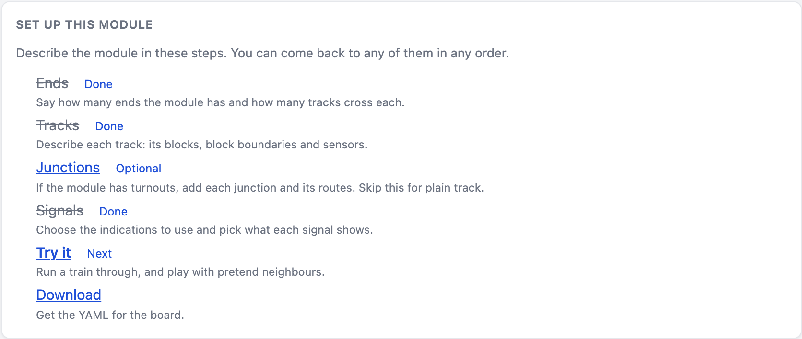

---

## Step 4: A junction from a shape

This step is for **East** only. A module of plain track needs no junctions.

Add the junction first. Its legs then appear in the **From** and **To** lists of the tracks.

1. Under **Junctions**, at **Add a junction**, pick a **Shape**: **Turnout, left**. It is picked already on a new page. The other shapes are **Turnout, right**, **Wye**, **Siding end**, **Single to double track**, **Double-track crossover** and **Custom**. Under the shapes, a line says which leg is which.
2. Check the **Turnout** list says **E P1**. The page fills in the first turnout no junction uses yet. Click **Add junction**.

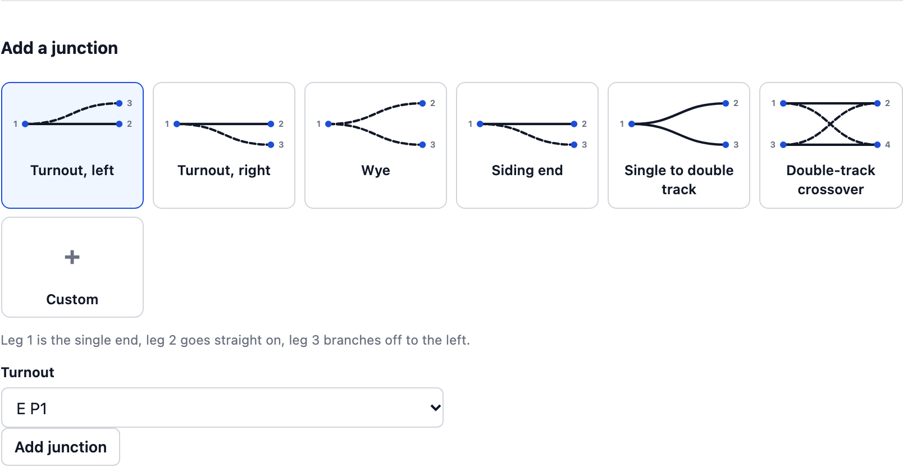

The junction is added as **Junction J1**, with its legs and routes filled in:

| Leg | Where it goes |
|---|---|
| Leg 1 | the single end |
| Leg 2 | straight on |
| Leg 3 | branches off to the left |

| Route | Joins | Set when | |
|---|---|---|---|
| Route 1 | leg 1 to leg 2 | E P1 is closed | main |
| Route 2 | leg 1 to leg 3 | E P1 is thrown | diverging (**Diverging** is ticked) |

A route is **set** while every turnout in it is in its position. A turnout that is moving matches neither position, so no route through it is set.

3. In the junction's card, under **Sensors**, pick **E Junction optical** from the **Add a sensor…** list. A car standing on the junction holds every leg, so each leg's first block includes it.
4. Under **Legs**, pick the signal facing into the junction from **Leg 1**: **E Home**. A small mast at Stop shows beside it. Legs 2 and 3 stay at **No signal**: trains leaving the junction face the next module's signals, not this one's.

The junction appears in the picture on its own, with its legs as blue dots. Until the tracks are drawn, each leg says it has no track. Now draw East's tracks, as in Step 3. Click **Add a track** three times, then set each one's **From** and **To**. To give a track's block its sensor, click the block in the picture first:

1. **Track 1:** from **End A, track 1** to **Junction J1, leg 1**. Click **Add a block boundary** to give it two blocks: **E1 current** in Block 1, **E2 current** in Block 2, and **E12 optical** at the block boundary. For its signals, pick **E Outer** for **Signal for trains heading towards Junction J1, leg 1**, and leave the other at **no signal**.
2. **Track 2:** from **Junction J1, leg 2** to **End B, track 1**, one block with **E Main current**.
3. **Track 3:** from **Junction J1, leg 3** to **End C, track 1**, one block with **E Branch current**.

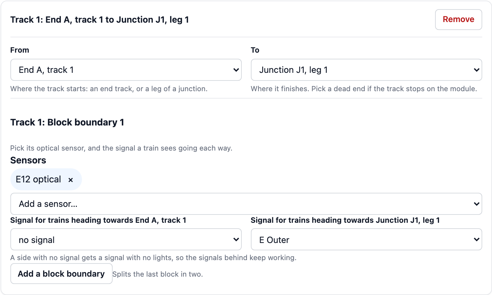

The picture now shows East as one piece. Track 1 runs from End A into leg 1 of J1. The main route carries on to End B, and the diverging route (dashed) climbs to the row above and runs to End C. **E Home** ▶ stands at leg 1, facing trains heading into the junction. Ends B and C line up at the right edge.

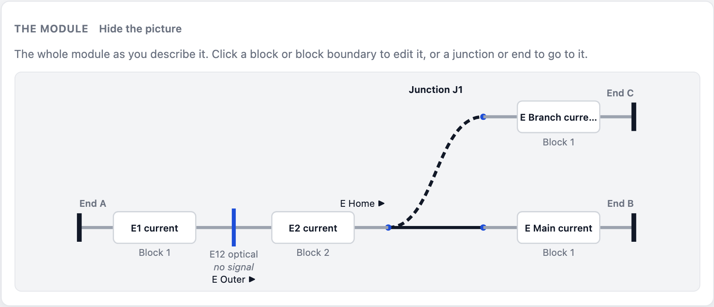

The junction's card now has no messages. **Which legs join** draws the legs and routes, and lists each route in words. A solid line is a main route and a dashed line a diverging one.

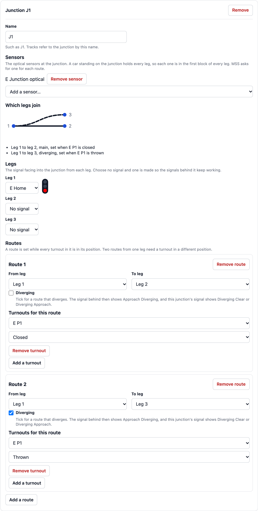

Hover over a route's card to light it on the drawing. Here the mouse is over Route 2, so the dashed line from leg 1 to leg 3 is drawn blue.

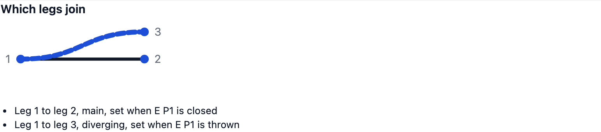

If your turnout is wired the other way round, change the **Closed** or **Thrown** list beside the turnout under **Turnouts for this route**, rather than the wiring. If the shapes do not fit, **Custom** starts empty: click **Add a route** for each route, and pick its legs and turnouts.

Success looks like:
- Junction J1 is listed with two routes and no red messages.
- The **Junctions** step is **Done**.

---

## Step 5: The Signals grid

Under **Signals** there is one row for each signal the module uses and one column for each indication, in the order below. Each cell is the aspect that signal shows for that indication, with a small mast lit the way the Signal Masts page lights it. The aspects named in the CATS signal template are filled in already. A signal you picked in Step 3 or Step 4 has a row here; a place with no signal has none.

| Indication | CATS aspect (filled in) | What it means |
|---|---|---|
| Stop | R292 | the block ahead is occupied |
| Approach | R285 | prepare to stop at the next signal |
| Advance Approach | ADV_NORM | the signal two blocks ahead is at Stop. **Off by default.** |
| Clear | R281 | the way ahead is clear |
| Approach Diverging | R282 | the signal ahead shows a diverging aspect. **Off by default.** |
| Diverging Clear | R283 | junction signals only, when a diverging route is set |
| Diverging Approach | R286 | junction signals only, when a diverging route is set |

1. Under **Indications to use**, tick **Advance Approach** and **Approach Diverging** if you want them. They are off by default, as in MSS. Agree on this with the owners of the other modules at the meet, so the signals mean the same thing everywhere. Turning one off hides its column. Aspects you picked are kept.
2. Check each cell shows the aspect you want, for every row. A cell that is empty says **Pick an aspect**. A signal's aspects come from its own page, so if a cell has nothing to pick, add the aspect on the Signal Masts page.
3. **Same as above** copies the row above into this one, for the aspects both have. Use it for signals of the same kind.

East's **E Home** shows two more columns, **Diverging Clear** and **Diverging Approach**, because it has a diverging route. **E Outer** shows *Not used* in those two. West's two signals show only Stop, Approach and Clear.

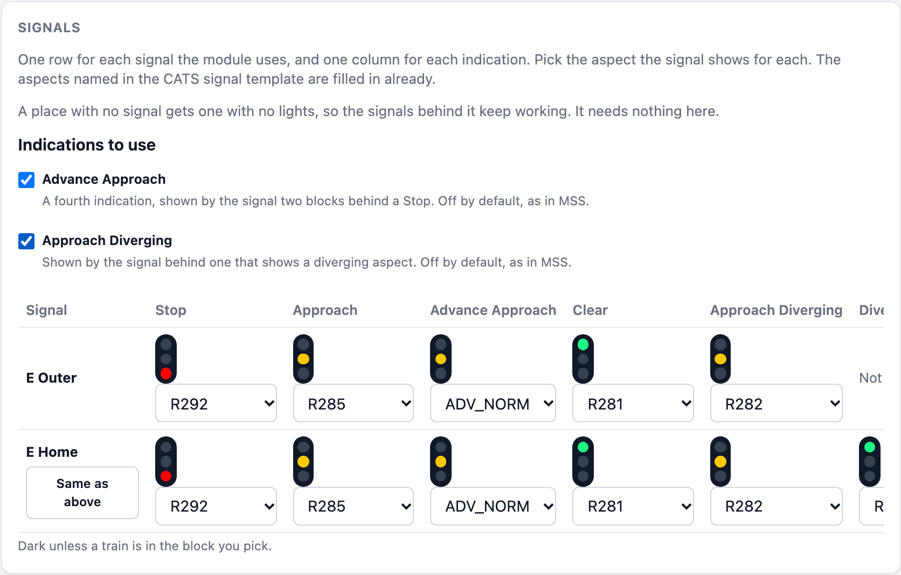

The grid is wider than the page, so scroll it sideways to see the last columns: **Diverging Clear**, **Diverging Approach** and **Approach lighting**.

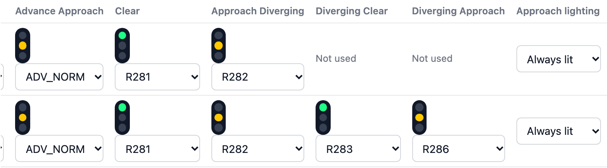

### Approach lighting

A signal can stay dark until a train is near. In the grid's last column, **Approach lighting**, pick a block or sensor for the signal. The list has the blocks MSS Logic made from your tracks (named like *A1 to B1 block 1*, for track 1's first block from end A track 1 to end B track 1), then your sensors. The signal shows nothing unless a train is in that block. Leave it at **Always lit** for a signal that should always show.

Success looks like:
- The **Signals** step is **Done** and no cell is empty.

---

## Step 6: Problems

Problems show in three places:

- **At the top of the page**, in red for errors that stop the download and amber for warnings. Each says what is wrong, why, and what to do. The **Download YAML** button is greyed out while there is a red one.
- **On the Logic page.** The step says how many things there are to fix. The card has a red dot by its title (amber for a warning). The part that causes it is marked red: an end's card has a red edge, a block or block boundary in the picture is drawn red, as is a junction's name and routes, and the message sits under it, in the end's card, the block's form, the junction's leg or the signal's row.
- **Show** beside a message at the top. It opens the page and scrolls to the part.

Here is the top of East's page just after adding the junction, before any tracks: each end and each leg has no track (red), and the junction has no sensor yet (amber).

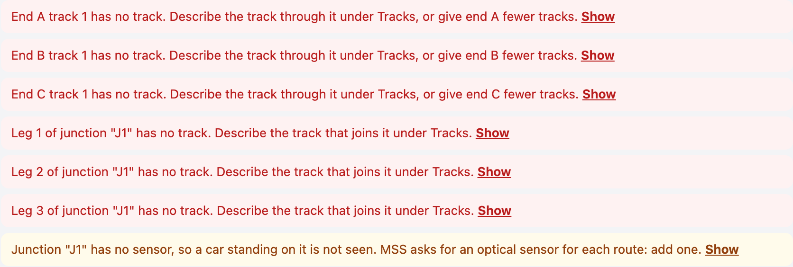

Some you may meet:

| Message says | What to do |
|---|---|
| An end has no track | Describe the track through it under **Tracks**, or give the end fewer tracks. |
| A block has no sensor | Pick the block's current sensor. |
| A block boundary has no sensor | A warning. The signals there can clear behind unpowered cars. Pick an optical sensor. |
| A leg has no track | Describe the track that meets it under **Tracks**. |
| Two routes can both be set | Two routes leave the same leg and their turnouts do not tell them apart. Give one a turnout in the other position. |
| A junction has no sensor | A warning. Pick an optical sensor, so a car on the junction is seen. |
| A signal has no aspect for an indication | Pick one in the Signals grid. |

Fix the first red message first, because others often follow from it.

Renaming a sensor, turnout or signal on its own page renames it here too. Deleting one leaves its old name behind, and the message names it.

Success looks like:
- Nothing red at the top of the page, no step says *to fix*, and no card has a dot.

---

## Step 7: Download

The **Download** page shows the **Logic version**, a short code that is a hash of what the board has been told to do. The board shows the same code on its web page as **Logic version**. When the two match, the board is running what you checked.

In MSS Logic the page also offers **Download module card**. It is a file that opens in any browser and prints. Print it for the underside of the module, or the meet paperwork. It is made with the YAML, so it always matches, and it holds:

- the module's name, the Logic version and the date;
- each end with its tracks and its Pair and LED pins;
- every sensor and signal with its pin and where it sits (block, block boundary, leg);
- **At a meet:** how to join the meet's Wi-Fi from a phone, how to pair, what the end LED means, and the first checks when a joint shows Stop.

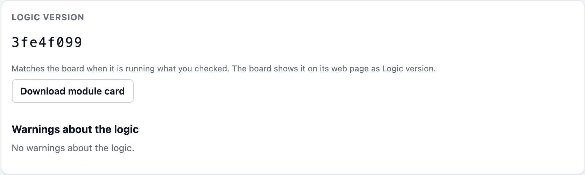

Click **Download module card**, then open the file it saves (`<board>-module-card.html`) in a browser and print it from there. Besides the list above, it has a **Turnouts** table, with each turnout's servo and buttons.

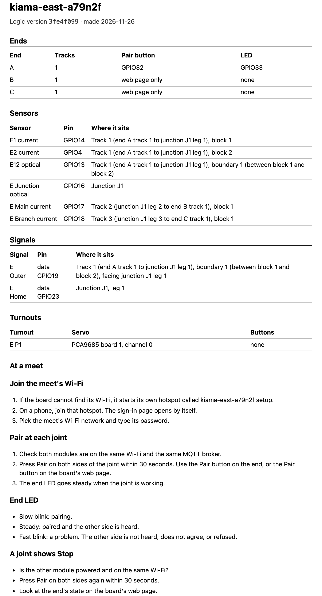

Download the YAML for each board as in the first board guide.

---

## Step 8: Flash

1. Install each board's YAML, as in the [First Board Setup Guide](first-board-setup-guide.md). Install by USB the first time, or if you changed the board's name.
2. On each board's web page, check **Logic version** matches the Download page.
3. Open **MQTTX**, connect to `127.0.0.1:1883` with no username, and subscribe to `trains/#`.

Success looks like:
- Each board is **Online** in ESPHome.
- `trains/track/sensor/board/<board>/Online` is `ACTIVE`.
- Covering **W12 optical** with a hand shows `ACTIVE` on its own topic. Uncovering it shows `INACTIVE` after about half a second (the Debounce).
- The board's signals show something. A joint that is not paired yet shows Stop (see Step 9), so expect West's **W toward B** and East's **E Outer** to show a stop or approach for now.
- Each end's two values are published, retained, as `trains/track/end/<board>/<end>/<track>/Block` and `.../Mast`.

If a board does not show **Online**, go to the first board guide's checks. If the signals stay dark, check the board's **Logic on** switch (labelled **Field logic** on its web page) is on.

### Try it

Before you flash, run trains through the module on the page. **Try it** works the module's signals exactly as the board will, with nothing connected. It is the card near the bottom of the Logic page, and the **Try it** step links to it. Here it is on East.

Its buttons are along the top: **Run** lets time pass at normal speed, **Step** moves it on a tenth of a second, **Skip ahead 1 second** and **Skip ahead 10 seconds** jump, and **Start again** puts everything back.

Under **Track** is the picture of the module, live:

- **Click a block** to put a train in it (a red bar), and click again to take it out.
- **Each signal has a lamp** in the colour it shows: red for Stop, amber for Approach and Advance Approach, green for Clear.
- **Click a turnout** under a junction (or under a block) to throw it. The route the turnouts set is drawn solid; the other is pale.

Try this on East:

1. Click the block with **E Main current** (towards End B), then **Skip ahead 1 second**. E Home, which faces into the junction, goes red: the main line beyond it is occupied. E Outer, behind it, shows amber.

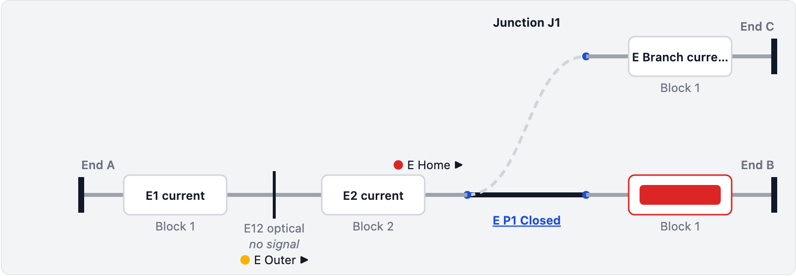

2. Click **E P1 Closed** under junction J1 to throw it, then **Skip ahead 1 second**. The route to End C is now solid, and E Home shows amber for the branch, which is clear, rather than red for the occupied main line.

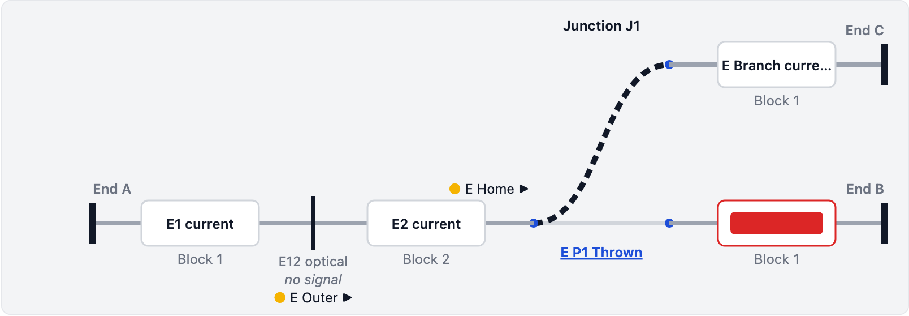

**Run a train**, at the bottom of the card, runs a whole train for you. Pick where it **Comes in at** and its **Length in blocks**. Under them the page says the way it will go, block by block, and where it leaves: it follows the route the turnouts are set for, so throw them first. Click **Run a train**. A table appears with one row for each move of the train and every signal it meets at each step. Here the train runs in at End A on the main line: E Outer drops to Stop behind it, then comes back to Approach and Advance Approach as it goes.

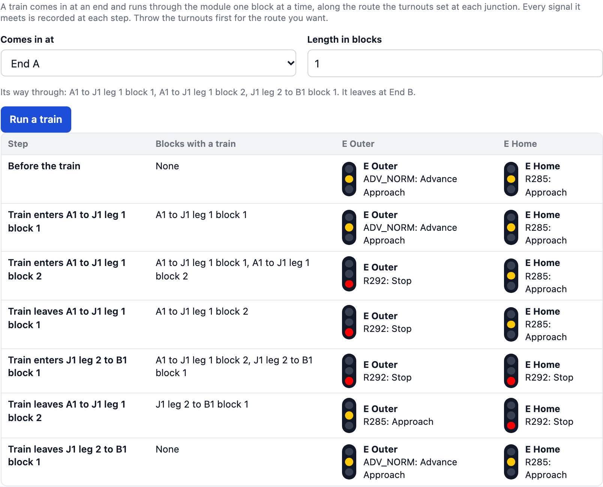

**Pretend neighbours.** Under **Pretend neighbours**, tick **pretend there is a neighbour** for an end. It stands in for the module next door: three blocks with a signal at each, answering the end as a real module would. With one ticked, **Run a train** offers to start the train in it, or carry it on into it, so you can watch the signals tumble down across the joint.

**Inputs** lists every sensor, turnout and end, if you would rather set them from a list. **Show timing details**, at the bottom, explains what each signal's rules are doing.

---

## Step 9: Pair two modules

Pairing tells each end which end it meets. Nothing is reflashed at a meet.

1. Power both boards and check both are on the same Wi-Fi and the same MQTT broker.
2. On each board's web page there is a **Pair End A** button (and **Pair End B**, and so on). Press **Pair End B** on West, and **Pair End A** on East, within 30 seconds of each other. Or use the push button on the end's pin, if you wired one.

Each end announces itself while it waits, on `trains/track/end/pairing`. If exactly two ends are waiting, and they have the same number of tracks, each sets itself paired with the other.

The end's LED, if you wired one, shows how it is going:

| LED | Meaning |
|---|---|
| Slow blink | pairing |
| Steady | paired, and the other side is heard |
| Fast blink | a problem: the other side is not heard, does not agree, or refused |

Success looks like:
- On each board's web page, the end says it is **Paired with** the other and the other is heard.
- In MQTTX, West's `trains/track/end/<west>/B/1/Block` and `.../Mast` match what East's signals offer, and East's `.../A/1/...` the same the other way. Put a car on **W2 current**: East's **E Outer** should show Approach or Stop within a second or two, once the joint's message has crossed.
- Take East's power off. West's end B no longer hears it, and West's **W toward B** shows Stop. That is the fail-safe: a neighbour that is not heard counts as occupied.

**Setting it by hand.** If two boards will not pair, type the other board and end into the end's link box on each web page, such as `kiama-south-p3q8w5/B`. Both sides must name each other.

**Which tracks meet.** Facing each other across a joint, one end's track 1 meets the other end's last track. So a double-track joint pairs the right tracks whichever way round the module is placed. Two ends with different track counts do not pair.

**Ends that meet nothing.** East's ends B and C meet no module here. An unpaired end reads as occupied, so the signals behind it show Stop. To tell an end it is the end of the line, open that end's text box on the board's web page (for end B it is named `End B link`, its name in ESPHome) and type `end`. Then its Block reads clear, and the signal behind it shows Approach, as it would at a terminus. The box is saved across reboots.

> **Screenshot placeholder:** East's web page with Pair End A, End A paired and heard, and MQTTX showing the two end topics.

---

## Step 10: At a meet

Nothing is reflashed.

1. **Wi-Fi.** A board that cannot find its home network starts its own hotspot, called `<board> setup`. On a phone, join it. The sign-in page opens by itself. Pick the meet's Wi-Fi and type its password. The board keeps that network until it is next flashed with changed settings. The module card says all this.
2. **Broker.** Boards look for `layout-mqtt.local`. One computer at the meet runs the install script, and every board finds it with no change.
3. **Pair.** Press Pair on both sides of each joint.

Modules can be plugged together in any order, and either way round. Turning a module round needs no change to its description, because its tracks follow its own ends and not compass directions.

If the broker goes down, each board still signals its own track. The masts at the joints drop to Stop.

---

## Step 11: When something is wrong

Check one thing at a time, in this order.

**A joint shows Stop.**
1. Is the other module powered and on the same Wi-Fi and broker?
2. Press Pair on both sides again, within 30 seconds.
3. On the board's web page, read what the end says. If it names the wrong end, press Pair again on both. A line ending *Last pairing:* says why it was refused: no other end pressed Pair in time, more than two ends were pairing, or the two ends have different numbers of tracks. Fix that and press Pair on both again.
4. In MQTTX, `trains/track/end/<board>/<end>/<track>/Block` and `.../Mast` from the other board should appear, retained. If they do not, check that board is Online: MSS Logic always shares, so it needs nothing ticked.

**A signal stays at Stop with an empty track.**
1. In MQTTX, check each sensor in the block and the optical sensor beside it. A block boundary's optical sensor holds both blocks beside it.
2. A turnout set against the main line in a block counts as occupied.
3. At a junction, the optical sensor holds every leg, so a car standing there stops all of them.
4. Check the signal is not held by CATS or JMRI (the board follows a CATS hold, which shows Stop and passes it back behind).

**A junction signal shows Stop though the turnout looks set.**
1. A turnout that is still moving shows Stop and the signal behind it Approach. Wait for the throw to finish.
2. Check the position you gave each route matches how the turnout is really set (Step 4).

**A signal shows the wrong aspect.**
1. Check its cell in the Signals grid, and the aspect's lamps on the Signal Masts page.
2. If Advance Approach or Approach Diverging is on at one module and off at the next, the signals at the joint will not agree. Match them.

**The board is not running what you checked.**
1. Compare **Logic version** on the board's web page with the Download page. If they differ, flash again.
2. Check the board's logic switch is on.

**The page says there is a problem, and Show goes nowhere.**
1. Scroll the Logic page: the part may be further down. Fix the first red message first.

---

## What MSS Logic does differently from MSS

- **A lost neighbour means Stop.** On an MSS bus, an unplugged cable floats high and reads clear. Here, a neighbour that is not heard counts as occupied.
- **It needs a broker.** MSS needs only the cable. Here each module has an ESP32 and the layout has an MQTT broker.
- **It is not instant.** Each signal is about 100 ms behind the next, and there is MQTT time across a joint.
- **A stop passes back as far as there are signals**, not only two blocks. With Advance Approach on, that gives the same four aspects as MSS.
- **A car on a junction holds every leg**, not only the active route's.
- **No head-on protection.** That matches MSS, which is built for following moves. For a board that needs it, draw its track in Field Logic, whose routes protect it.
