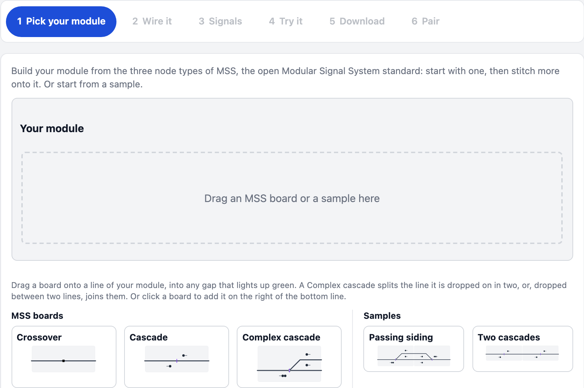
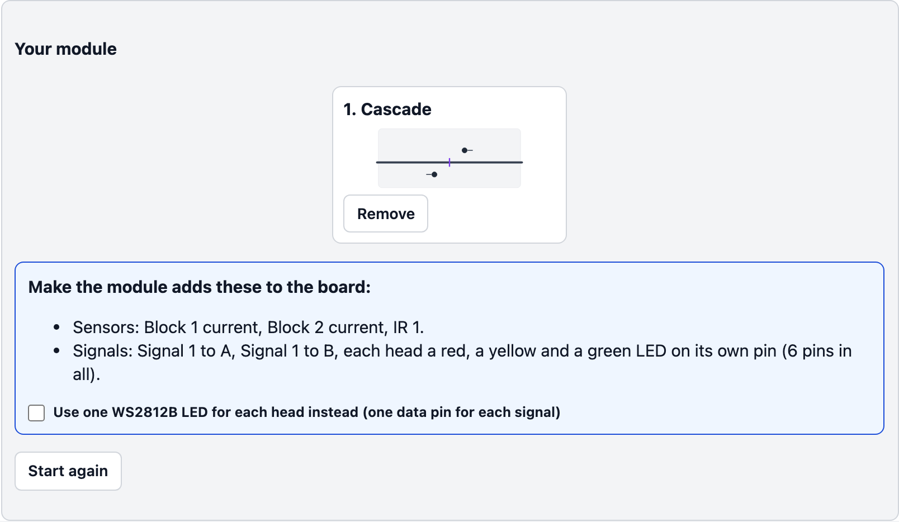
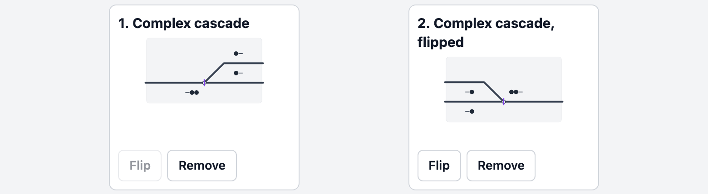
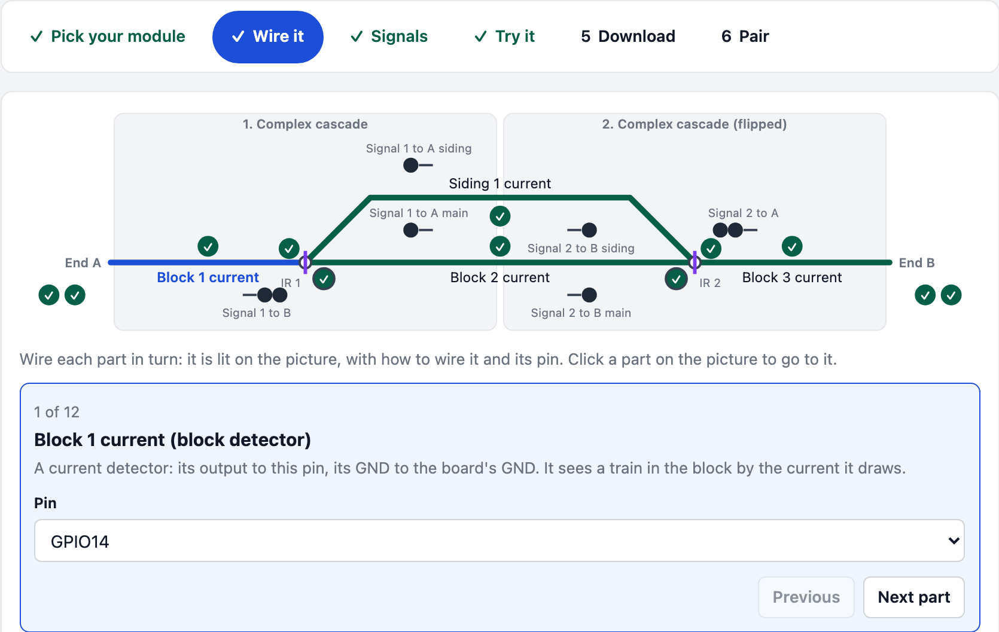
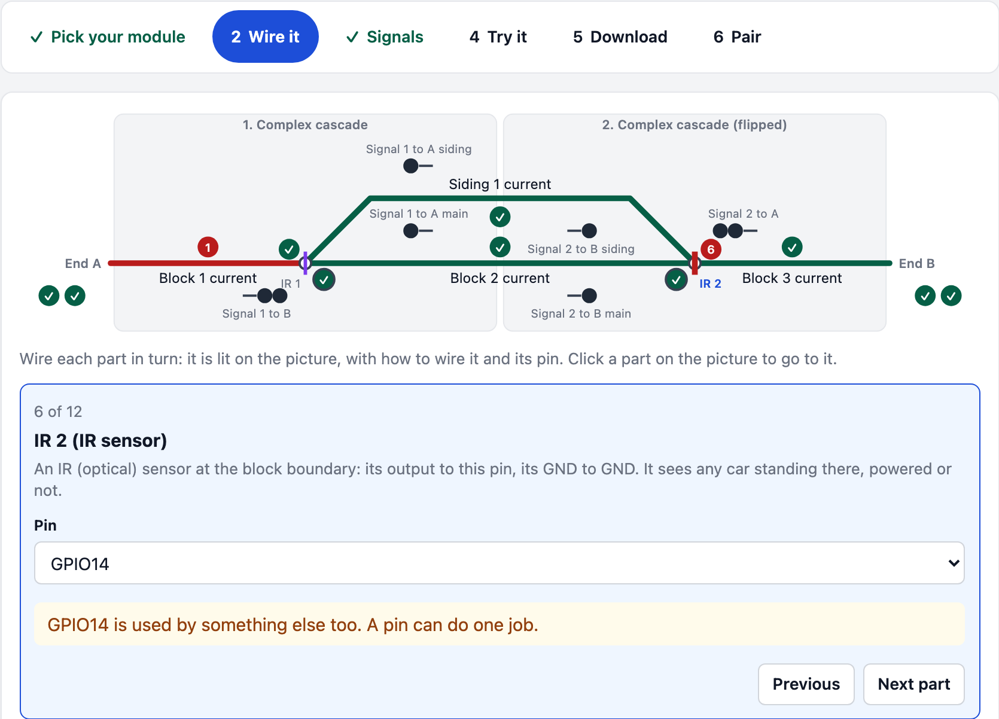
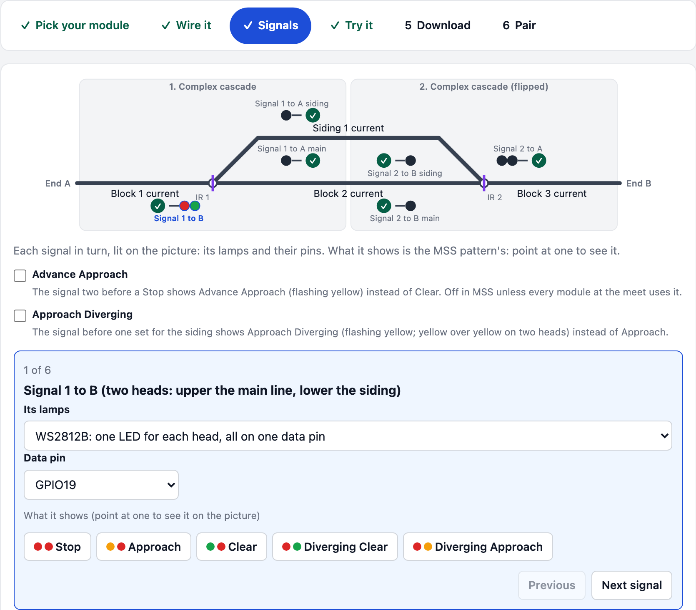
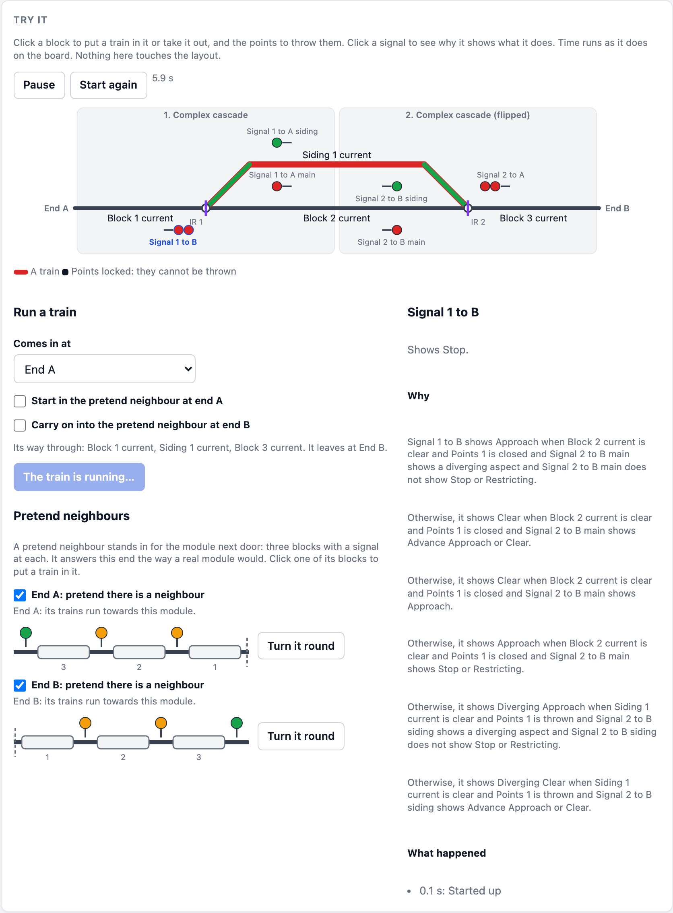
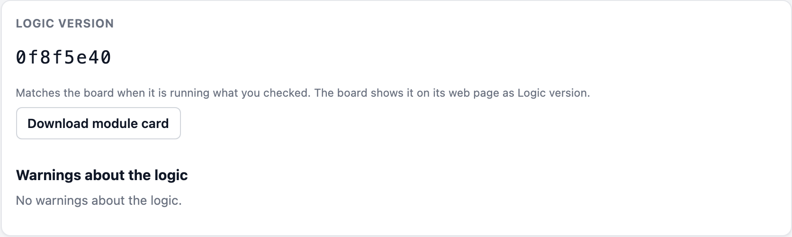
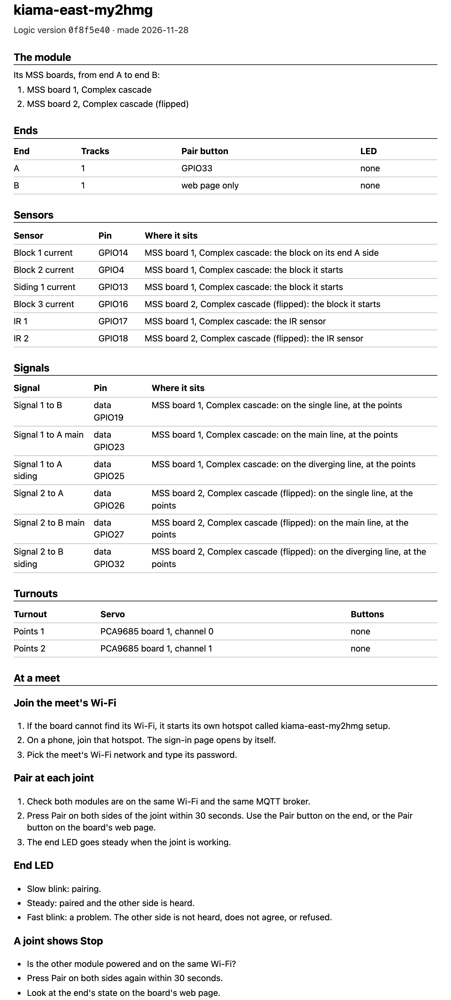

# MSS Logic Guide

MSS Logic lets a board signal a module the way an MSS (Modular Signal System) module does, with no rules to write. You build the module from the three standard MSS boards: **Crossover**, **Cascade** and **Complex cascade**. The configurator makes the sensors, turnouts and signals, and the board works out what the signals show. It keeps working when JMRI is closed. At a meet, you pair the modules' ends and the signals carry on across the joint.

It is an imitation of MSS over MQTT, not MSS hardware. There is no RJ45 cable and no 12V logic. Each module has an ESP32, and the layout has an MQTT broker. If a module cannot hear its neighbour, the signal at that joint shows Stop.

This guide makes two modules from an empty Logic page and pairs them:

- **West**: a **Cascade**, a plain stretch of track with two blocks and a signal facing each way.
- **East**: a **passing siding**, two **Complex cascades**, one at each end of the loop.

Use it after the [First Board Setup Guide](first-board-setup-guide.md) and the [JMRI MQTT Verification Guide](jmri-mqtt-verification-guide.md). Each board should be online in ESPHome, and JMRI should have its MQTT connection set up. The [Field Logic Guide](field-logic-guide.md) covers groundwork this guide leans on: the name suffix, flashing and MQTTX. MSS Logic and Field Logic run on the same engine, so what you learn there carries over.

> **Testers:** MSS Logic is not on the live configurator yet. Until it is, open it from the `feature/logic` branch, as the testers' note in the Field Logic Guide describes. Nothing in this guide has been tried on hardware yet. It says what should happen, from the design and from the test cases the configurator is checked against. If your board does something else, that is worth reporting.

---

## The three MSS boards

MSS describes a module as a row of standard boards, end A on the left and end B on the right:

| Board | What it is |
|---|---|
| **Crossover** | One block right across the module, with one current detector and no signals. |
| **Cascade** | A block each side of an IR sensor, and a signal facing each way at it. |
| **Complex cascade** | Where the track divides at points: a block up to the points, then the main line and the diverging line. A two-head signal faces the points from the single line (upper head the main line, lower the diverging line), and one head faces back from each of the others. |

A Complex cascade splits a line in two. Flipped, it joins two lines into one. A module can have as many boards as you like, one after another, on any line: a Cascade on the loop of a passing siding, for example.

> **Screenshot placeholder:** a sketch of the two modules side by side. West: end A, Block 1, IR 1 with a signal each way, Block 2, end B. East: end A, Block 1, Points 1, the main line and the siding, Points 2, Block 3, end B.

At the meet, **West end B meets East end A**.

---

## Before you start

Each module is its own board, and the configurator holds one board at a time. Go through Steps 1 to 6 for West, and download its files. Then go through them again for East. The page has no button for a new board, so start East in a private (incognito) window, which opens the configurator with nothing saved. To change West later, open it again with **Import**, **From a file…**, and pick West's `board.yaml`.

1. **Board** page: type the board's name, such as `kiama-west`. The page adds a six-character suffix after it, such as `-k7m4x2`, so the full name is `kiama-west-k7m4x2`. Two boards at a meet must never share one. See Step 1 of the Field Logic Guide. Type the Wi-Fi name and password too.
2. A new board starts with an example sensor and an example turnout. MSS Logic makes its own, so take them away: on the **Sensors** page click **Clear this page**, then **Yes, clear the Sensors page**, and do the same on the **Turnouts** page.

Leave the **Sensors**, **Turnouts** and **Signal Masts** pages empty. **Make the module** (Step 2) fills them in, with free pins.

---

## Step 1: Choose MSS Logic

1. Open the **Logic** page.
2. Set **Logic** to **MSS Logic**.

The page now shows its steps along the top: **Pick your module**, **Wire it**, **Signals**, **Try it**, **Download** and **Pair**. Only **Pick your module** is open: the others open once the module is made. Under it is an empty module, and the palette: a card for each MSS board, and the samples **Passing siding** and **Two cascades**.

**Settings**, at the right of the top line, folds the mode card away. It says *Shared with the boards beside it: always*: sharing is always on in this mode, so there is nothing to tick.

Success looks like:
- **Pick your module** is the step shown, and the palette has the three MSS boards.

---

## Step 2: Pick your module

On **West**:

1. Drag the **Cascade** card from the palette onto the empty module. While you drag, the places it fits light up green.

   No mouse? Click the card (or press Enter on it) and it goes on the right of the bottom line.

The module now has one board, **1. Cascade**, with its picture. Under the module, the page lists what **Make the module** will add: the sensors **Block 1 current**, **Block 2 current** and **IR 1**, and the signals **Signal 1 to A** and **Signal 1 to B**, each head a red, a yellow and a green LED on its own pin.

A signal is named for the end its trains are heading to: **Signal 1 to B** is seen by trains heading to end B.

**LEDs or WS2812B.** Each signal head is three LEDs on three pins, unless you tick **Use one WS2812B LED for each head instead (one data pin for each signal)**. If the board has too few free pins that are safe at start-up, the page ticks it for you and says so: an LED on GPIO0, 2, 5, 12 or 15 can stop the board starting.

2. Click **Make the module**. The sensors and signals are added on their pages, each on a free pin, and the page goes on to **Wire it**.

Nothing is added to the board until you click **Make the module**, so try boards in and out as much as you like first. Each card has **Remove**, and a Complex cascade has **Flip**. Drag a card to move it, or onto **Drop a board here to take it out of the module**. **Start again** empties the module. A module you change after making it is made again when you click **Make the module** (only its new parts are added).

On **East**, build the passing siding from two Complex cascades:

1. Drag **Complex cascade** onto the empty module. It splits the line in two: the main line along the bottom, and the siding above it.
2. Drag a second **Complex cascade** onto the module, into the thin gap to its right between the two lines. A Complex cascade dropped there joins the two lines into one. Its card says **2. Complex cascade, flipped**.

(The **Passing siding** sample is these two boards: drag it onto an empty module instead, if you like.)

East's six signals need more pins than an ESP32 has free for LEDs, so the WS2812B box is ticked: one data pin for each signal. Click **Make the module**.

Success looks like:
- The page shows **Wire it**, and the steps **Pick your module**, **Wire it**, **Signals** and **Try it** are open.
- The **Sensors** and **Signal Masts** pages (and on East, **Turnouts**) list the parts, each with a pin.

---

## Step 3: Wire it

The module's picture is now at the top of each step, above its panel. **Wire it** takes each part in turn: every block's current detector, then the IR sensors, the points, and then each end's Pair button and LED. The part being wired is lit on the picture. Every part has its number beside it, and a tick once it has a pin that nothing else uses.

For each part, the panel says how to wire it and which pin it is on:

- **A current detector**: its output to the pin, its GND to the board's GND. It sees a train in the block by the current it draws.
- **An IR (optical) sensor** at the block boundary: its output to the pin, its GND to GND. It sees any car standing there, powered or not.
- **The points' servo**: plugged into its channel of the PCA9685 board.
- **The end's Pair button** (optional): a push button between the pin and GND, beside the end. The board's web page has a Pair button too.
- **The end's LED** (optional): an LED and a resistor (about 330 Ω) from the pin to GND, beside the end. It shows whether the end is paired.

Change a pin in the list if your wiring differs. **Next part** and **Previous** move along, the list under the panel jumps to any part, and clicking a part on the picture picks it.

A pin used twice turns both parts red, with *is used by something else too. A pin can do one job.* Pick another pin for one of them.

On East, give end A a Pair button: click **End A Pair button** in the list and pick a pin. Leave the others at **No pin**: East has no more pins that are safe for them, and the board's web page has a Pair button for each end, and says whether it is paired.

Success looks like:
- Every badge on the picture is a tick, and **Wire it** is ticked in the steps.

Click **Next: signals**.

---

## Step 4: Signals

Two ticks at the top are for the whole module:

- **Advance Approach**: the signal two before a Stop shows Advance Approach (flashing yellow) instead of Clear.
- **Approach Diverging**: the signal before one set for the siding shows Approach Diverging (flashing yellow; yellow over yellow on two heads) instead of Approach.

Both are off, as in MSS. Agree on them with the owners of the other modules at the meet, so the signals mean the same thing everywhere.

Then each signal in turn, lit on the picture: its lamps (**Individual LEDs** or **WS2812B**) and their pins. **What it shows** lists the signal's indications, with the CATS aspect names, so there is nothing to pick. Point at one and the signal on the picture lights the way it would show it.

Changing a signal's lamps from LEDs to WS2812B (or back) makes its lamps and aspects again, with free pins.

Success looks like:
- Every signal has a tick on the picture, and **Signals** is ticked in the steps.

---

## Step 5: Try it

Before you flash, run trains through the module on the page. **Try it** works the signals exactly as the board will, with nothing connected. The picture is live, and time runs as it does on the board.

- **Click a block** to put a train in it (drawn red), and again to take it out.
- **Click the points** to throw them. The way they are set is drawn green.
- **Each signal's lamps** show what it shows.
- **Click a signal** to see why it shows what it does, under **Why**. **What happened** lists each change.
- **Pause** stops the time, **Carry on** runs it again, and **Start again** puts everything back.

**Pretend neighbours.** A module on its own sees nothing past its ends. Tick **End A: pretend there is a neighbour** (and end B) to stand in for the module next door: three blocks with a signal at each, answering the end as a real module would. Click one of its blocks to put a train in it, and **Turn it round** to make its trains run the other way.

**Run a train.** Pick where it **Comes in at**. Under it, the page says its way through, block by block, and where it leaves: it follows the way the points are set, so throw them first. Click **Run a train**: it moves on a block every three seconds. With a pretend neighbour ticked, it can start in that neighbour or carry on into the one at the far end.

Try this on East:

1. Tick both pretend neighbours.
2. Click **Points 1** and **Points 2** to throw them for the siding. **Signal 1 to B** shows **Diverging Approach**.
3. Pick **End A** and click **Run a train**. As the train goes into the siding, **Signal 1 to B** drops to Stop behind it. Once the train has gone, it clears again.

---

## Step 6: Download

Click **Next: download**. The step sends you to the **Download** page: open it from the list of pages on the left.

The **Download** page shows the **Logic version**, a short code that is a hash of what the board has been told to do. The board shows the same code on its web page as **Logic version**. When the two match, the board is running what you checked.

In MSS Logic the page also offers **Download module card**. It is a file that opens in any browser and prints. Print it for the underside of the module, or the meet paperwork. It is made with the YAML, so it always matches, and it holds:

- the module's name, the Logic version and the date;
- the module's MSS boards, in order from end A;
- each end with its tracks and its Pair and LED pins;
- every sensor and signal with its pin, and which MSS board it is on;
- **At a meet:** how to join the meet's Wi-Fi from a phone, how to pair, what the end LED means, and the first checks when a joint shows Stop.

Click **Download module card**, then open the file it saves (`<board>-module-card.html`) in a browser and print it from there.

Download the YAML for each board as in the first board guide. **Download JMRI XML** gives JMRI the board's sensors, turnouts and signal masts.

**Names at a meet.** Every module made from the same MSS boards gets the same names (**Block 1 current**, **Signal 1 to B** and so on), and so the same MQTT topics. The board's own signals are not affected: each board reads its own sensors, and hears its neighbours only through its ends. But JMRI or CATS watching the whole meet would see two modules on one topic. If they will, rename the parts on the **Sensors**, **Turnouts** and **Signal Masts** pages before you download, such as **West Block 1 current**. A part renamed there is renamed in the module too.

---

## Step 7: Flash

1. Install each board's YAML, as in the [First Board Setup Guide](first-board-setup-guide.md). Install by USB the first time, or if you changed the board's name.
2. On each board's web page, check **Logic version** matches the Download page.
3. Open **MQTTX**, connect to `127.0.0.1:1883` with no username, and subscribe to `trains/#`.

Success looks like:
- Each board is **Online** in ESPHome.
- `trains/track/sensor/board/<board>/Online` is `ACTIVE`.
- Covering **IR 1** with a hand shows `ACTIVE` on its own topic. Uncovering it shows `INACTIVE` after about half a second (the Debounce).
- The board's signals show something. A joint that is not paired yet shows Stop (see Step 8), so expect the signals facing out of the module to show Stop for now.
- Each end's two values are published, retained, as `trains/track/end/<board>/<end>/<track>/Block` and `.../Mast`.

If a board does not show **Online**, go to the first board guide's checks. If the signals stay dark, check the board's **Logic on** switch (labelled **Field logic** on its web page) is on.

---

## Step 8: Pair two modules

The **Pair** step on the Logic page says the same as this one, in short.

Pairing tells each end which end it meets. Nothing is reflashed at a meet.

1. Power both boards and check both are on the same Wi-Fi and the same MQTT broker.
2. On each board's web page there is a **Pair End A** button (and **Pair End B**). Press **Pair End B** on West, and **Pair End A** on East, within 30 seconds of each other. Or use the push button on the end's pin, if you wired one.

Each end announces itself while it waits, on `trains/track/end/pairing`. If exactly two ends are waiting, and they have the same number of tracks, each sets itself paired with the other.

The end's LED, if you wired one, shows how it is going:

| LED | Meaning |
|---|---|
| Slow blink | pairing |
| Steady | paired, and the other side is heard |
| Fast blink | a problem: the other side is not heard, does not agree, or refused |

Success looks like:
- On each board's web page, the end says it is **Paired with** the other and the other is heard.
- In MQTTX, West's `trains/track/end/<west>/B/1/Block` and `.../Mast` match what East's signals offer, and East's `.../A/1/...` the same the other way. Put a car in East's **Block 1 current**: West's **Signal 1 to B** should show Stop within a second or two, once the joint's message has crossed.
- Take East's power off. West's end B no longer hears it, and West's **Signal 1 to B** shows Stop. That is the fail-safe: a neighbour that is not heard counts as occupied.

> **Screenshot placeholder:** East's web page with Pair End A, End A paired and heard, and MQTTX showing the two end topics.

**Setting it by hand.** If two boards will not pair, type the other board and end into the end's link box on each web page, such as `kiama-west-k7m4x2/B`. Both sides must name each other.

**Which tracks meet.** Facing each other across a joint, one end's track 1 meets the other end's last track. So a double-track joint pairs the right tracks whichever way round the module is placed. Two ends with different track counts do not pair.

**Ends that meet nothing.** East's end B meets no module here. An unpaired end reads as occupied, so the signals facing out of it show Stop. To tell an end it is the end of the line, open that end's text box on the board's web page (for end B it is named `End B link`, its name in ESPHome) and type `end`. Then its Block reads clear, and the signal behind it shows Approach, as it would at a terminus. The box is saved across reboots.

---

## Step 9: At a meet

Nothing is reflashed.

1. **Wi-Fi.** A board that cannot find its home network starts its own hotspot, called `<board> setup`. On a phone, join it. The sign-in page opens by itself. Pick the meet's Wi-Fi and type its password. The board keeps that network until it is next flashed with changed settings. The module card says all this.
2. **Broker.** Boards look for `layout-mqtt.local`. One computer at the meet runs the install script, and every board finds it with no change.
3. **Pair.** Press Pair on both sides of each joint.

Modules can be plugged together in any order, and either way round. Turning a module round needs no change, because its tracks follow its own ends and not compass directions.

If the broker goes down, each board still signals its own track. The signals at the joints drop to Stop.

---

## When something is wrong

Check one thing at a time, in this order.

**The page shows a problem.**
1. Problems show on the step that has them: the step says how many, in red, and the part is red on the picture. Fix the first one first, because others often follow from it.
2. Messages at the top of the page say what is wrong, why, and what to do. **Show** opens the Logic page at the module.
3. *Not made yet* or *Not on its page*: a part the module uses is not on its page, because the module was changed or the part was removed. Click **Make the module** on **Pick your module** to add it, or add it on its page with that name.

**A joint shows Stop.**
1. Is the other module powered and on the same Wi-Fi and broker?
2. Press Pair on both sides again, within 30 seconds.
3. On the board's web page, read what the end says. If it names the wrong end, press Pair again on both. A line ending *Last pairing:* says why it was refused: no other end pressed Pair in time, more than two ends were pairing, or the two ends have different numbers of tracks. Fix that and press Pair on both again.
4. In MQTTX, `trains/track/end/<board>/<end>/<track>/Block` and `.../Mast` from the other board should appear, retained. If they do not, check that board is Online: MSS Logic always shares, so it needs nothing ticked.

**A signal stays at Stop with an empty track.**
1. In MQTTX, check each sensor in the block and the IR sensor beside it. An IR sensor holds both blocks beside it.
2. Check the signal is not held by CATS or JMRI (the board follows a CATS hold, which shows Stop and passes it back behind).

**A signal at the points shows Stop though the points look set.**
1. Points that are still moving show Stop, and the signal behind them Approach. Wait for the throw to finish.
2. Check the points go where the board says. If *closed* sends them to the siding, move the turnout's sliders on the board's web page until closed is the main line and thrown the siding. The help beside each turnout on the Turnouts page says how.

**A signal shows the wrong aspect.**
1. Check its lamps' pins on the **Signals** step, and its aspects on the Signal Masts page.
2. If Advance Approach or Approach Diverging is on at one module and off at the next, the signals at the joint will not agree. Match them.

**The board is not running what you checked.**
1. Compare **Logic version** on the board's web page with the Download page. If they differ, flash again.
2. Check the board's logic switch is on.

---

## What MSS Logic does differently from MSS

- **A lost neighbour means Stop.** On an MSS bus, an unplugged cable floats high and reads clear. Here, a neighbour that is not heard counts as occupied.
- **It needs a broker.** MSS needs only the cable. Here each module has an ESP32 and the layout has an MQTT broker.
- **It is not instant.** Each signal is about 100 ms behind the next, and there is MQTT time across a joint.
- **A stop passes back as far as there are signals**, not only two blocks. With Advance Approach on, that gives the same four aspects as MSS.
- **No head-on protection.** That matches MSS, which is built for following moves. For a board that needs it, draw its track in Field Logic, whose routes protect it.
