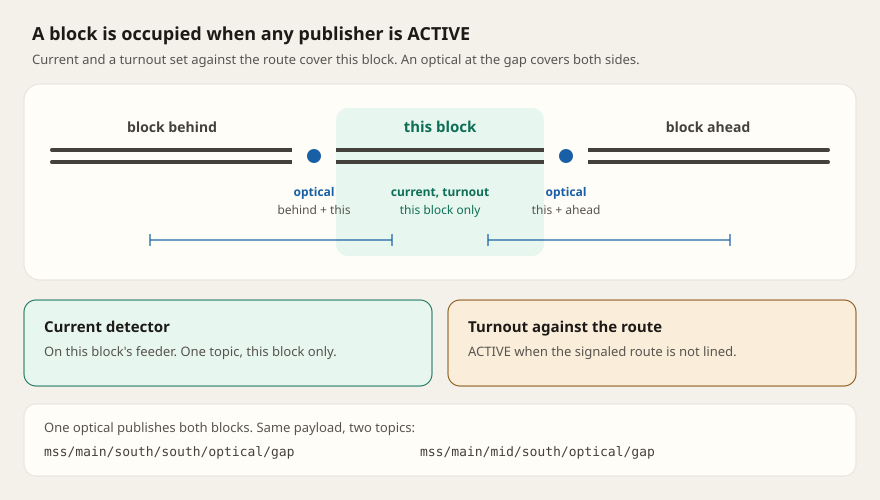
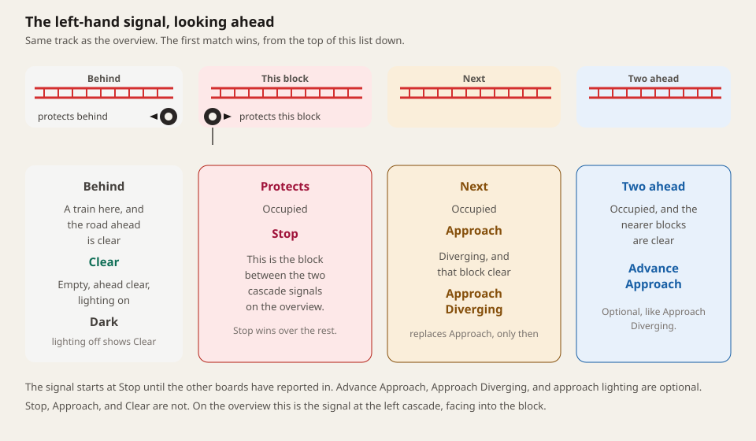
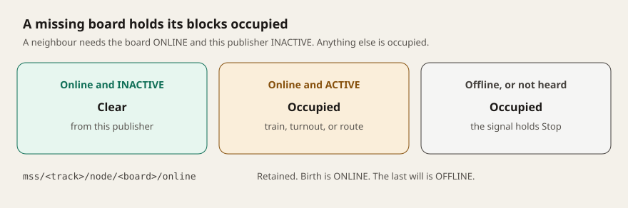
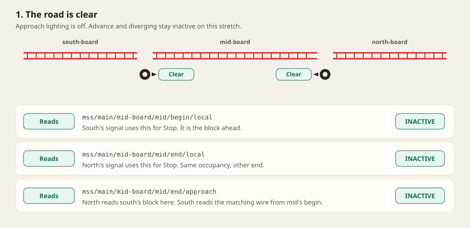
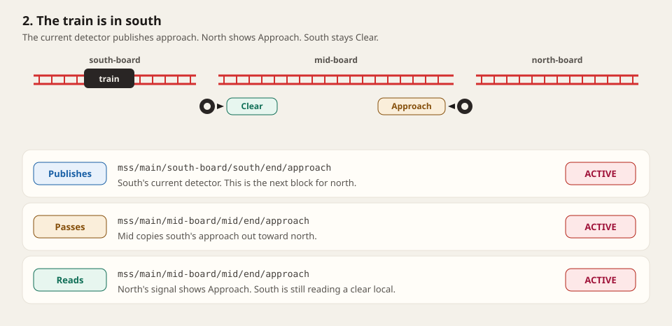
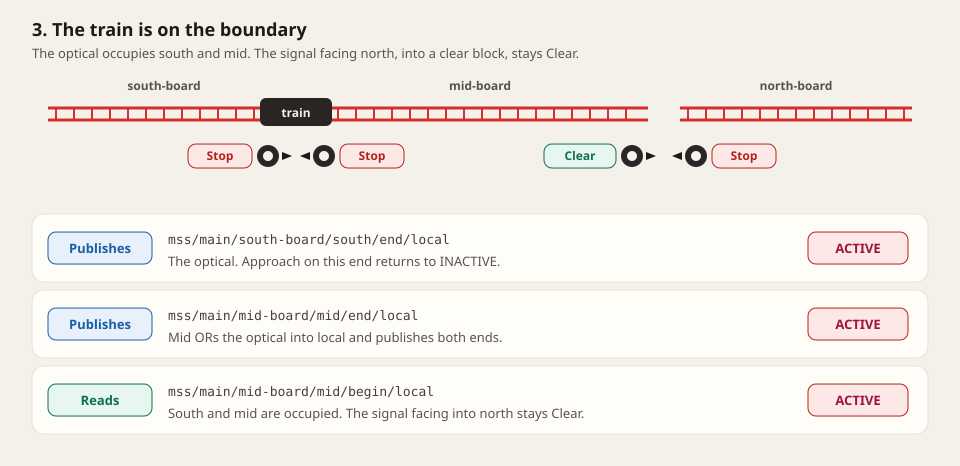
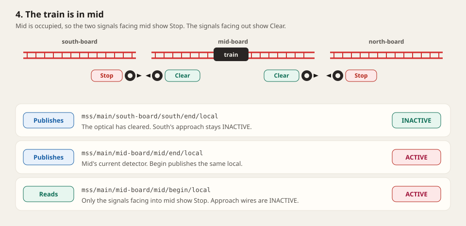
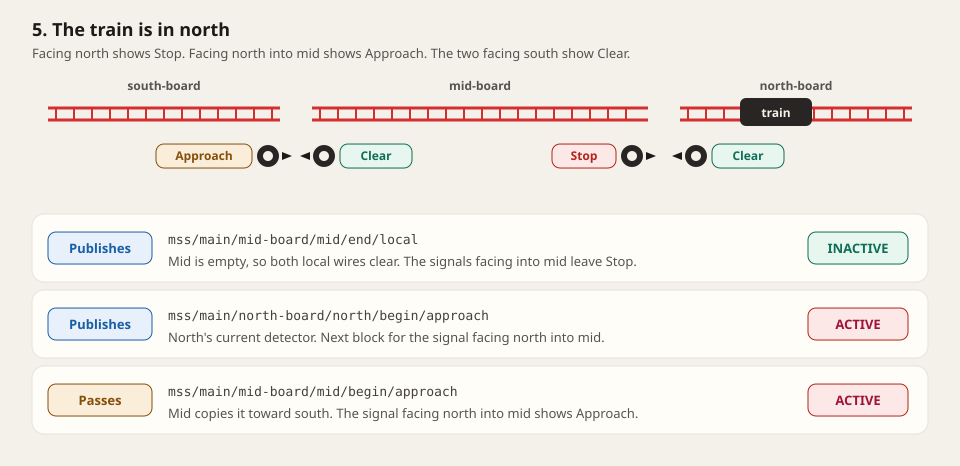

# Modular Signal System over MQTT

The [Modular Signal System](http://www.modularsignalsystem.info/) (MSS 2.0.2) is a way for modules to animate signals from the blocks ahead, without a computer deciding each aspect. The wired system carries that occupancy on a CAT5 bus. Here the same rules ride on MQTT, and the Board Configurator writes the YAML.


The standard, the fundamentals, and the planning notes are the three PDFs on the MSS site:

- [Design standard 2.0.2](http://www.modularsignalsystem.info/ModularSignalSystemStandardV2.0.2.pdf)
- [User guide part 1, fundamentals](http://www.modularsignalsystem.info/MSSUserGuide1.pdf)
- [User guide part 2, planning](http://www.modularsignalsystem.info/MSSUserGuide2.pdf)

Optical detectors and signal masts each have their own page in the [configurator](https://aaron9589.github.io/esphome-for-model-railroading/). **Modular signals** assigns one of each to the ends of a signal block. Skip that page if JMRI is still choosing the aspects.

On Modular signals you add signal blocks. Each block uses current sensors you already created on the Blocks page. Each end of the block is a boundary. It gets an optical detector and two signals, one facing into the block and one facing out toward the neighbor. Optical detectors are their own page: a GPIO input for now, until the sensing circuit is filled in. When two signal blocks meet on this board, one end names the other block. An end that meets another module is filled in on the board's web page at the layout. The module already knows its own detectors. It only needs the neighbor's address.

## What stays the same

Each signaled track is its own bus. A signal block is a stretch of that track. A block is occupied when any of these is true:

- A current detector on its feeder sees a train.
- An optical detector at either boundary sees any part of a train. That sensor occupies both blocks, so the signals hold until the last car clears the boundary.
- A turnout in the block is set against the signaled route.



Signals stand at the block boundaries. The one facing a block shows the first row that matches:

| Blocks ahead | Indication |
|---|---|
| The block it protects is occupied | Stop |
| That block is clear, and the junction ahead is diverging with its block clear | Approach Diverging |
| That block is clear, and the next block is occupied | Approach |
| Those two are clear, and the one after is occupied | Advance Approach |
| Those are clear, and a train is in the block behind | Clear |
| Nothing ahead, and the block behind is clear | Dark, if approach lighting is on |
| Nothing ahead, and approach lighting is off | Clear |

Stop wins over everything. Approach Diverging replaces Approach, and only then. Advance Approach, Approach Diverging, and approach lighting are optional. Stop, Approach, and Clear are not.



A crossover module only detects. It has no signal. A cascade module is a block boundary and usually has the signals. A junction is a cascade where the signaled track splits. The inactive route is held occupied, so a signal looking at it cannot show Clear into a misaligned switch. Approach Diverging is published only when the diverging route is lined and that block is actually clear. Signals that do not understand Approach Diverging still see the block as occupied, so they show Approach.

Sidings and spurs that are not signaled are not part of this. Both rails are still gapped at each block boundary, and every feeder for a block still passes through a current detector. The planning guide's list (one optical at each boundary, current detection on every module that feeds the track, a contact on each signaled turnout) is unchanged.

## What MQTT changes

Modules do not need an odd number of crossover cables, and a module does not have to be reversible. You name the blocks when you build the module. At a meet you do not reflash, and you do not type a list of the other module's detectors.

Open `http://<board-name>.local`. Each end that was marked for the web page has a text box. The box name uses dashes, like `board - block - begin neighbor`, because ESPHome rejects `/` in a name. The address you type still uses slashes: `board/block/end`. Type the address of the other module. There is also a Signaled track field, already set to the name you flashed (usually `main`). Both modules must show the same track name. The broker address stays in the flashed file.

Each end then publishes four wires, retained, QoS 1, `ACTIVE` or `INACTIVE`:

```
mss/<track>/<board>/<block>/<end>/local
mss/<track>/<board>/<block>/<end>/approach
mss/<track>/<board>/<block>/<end>/advance
mss/<track>/<board>/<block>/<end>/diverging
```

`local` is this block, including a crossover neighbor's detectors and the optical at the boundary. `approach` is the next block. `advance` is the one after that. `diverging` is ACTIVE only when a junction is lined for the diverging route and that block is clear. A crossover end passes the three wires from its other neighbor, so the cascades at the ends of a block do not need the names of the modules in between.

The signal that protects a block reads Stop from `local`, Approach from `approach`, and Advance Approach from `advance`. Approach Diverging replaces Approach when `diverging` is ACTIVE.

Each board also publishes:

```
mss/<track>/node/<board>/online
```

`ONLINE` while it is connected, `OFFLINE` as its last will. Both are retained. A neighbor is clear only when its board is `ONLINE` and the wire is `INACTIVE`. A blank address, a board that has not been heard, or a board that has dropped off holds that end occupied. On the wired bus a disconnected detector floats to clear. This is the one deliberate difference: a missing module shows Stop, not Clear.



The Blocks page is separate. Those topics are for JMRI (`trains/track/sensor/...`, not retained). An MSS current sensor is one you already created there. The optical detectors are added on Optical detectors.

## A plain stretch

Three boards, one signaled track named `main`. Block `south`, then `mid`, then `north`. Each boundary has two signals, one facing each way.


**south** is the cascade at the south end of `mid`. On its web page the north end's neighbor is `mid-board/mid/begin`.

- Current detector on block `south`. That occupancy goes out as `approach`, so it is the next block for the signal facing into `mid` from the north.
- Optical at the boundary. That goes out as `local`, so it occupies `mid` as well as `south`.
- The signal facing south protects `south`. Stop is `south`: its current detector and the optical at this boundary. A train that is only in `mid` does not put this signal at Stop.
- The signal facing north protects `mid`. Stop is `mid`'s `local`. Approach is whatever `mid` passes through from `north`.

**mid** is the crossover. Both ends are web-page neighbors, `south-board/south/end` and `north-board/north/begin`. It has a current detector and no signal. Its `local` is that detector plus the opticals the two cascades send. It passes `approach` and `advance` from one neighbor to the other.

**north** mirrors south. Its south end's neighbor is `mid-board/mid/end`.

Watching MQTTX on `127.0.0.1:1883`, subscribe to `mss/main/#`. A train in `south` sets `mss/main/south-board/south/end/approach` to `ACTIVE`. The signal facing south at that joint shows Stop. The signal facing north into `mid` stays Clear, because its Stop is `mid`'s `local`. Mid passes that approach wire on, so the signal facing south into `mid` shows Approach, and the signal facing north stays Clear. On the optical, that sensor occupies `south` and `mid`, so the three signals protecting those blocks show Stop, and the signal facing north stays Clear. Fully in `mid`, the two signals facing `mid` show Stop. The signals facing `south` and `north` show Clear, because those blocks are empty.

Approach lighting is off in these pictures, so a clear road shows Clear. `advance` and `diverging` stay INACTIVE, and every board stays online.











## A junction

Tick **The track splits here** on the signal block that holds the points. That block is a complex cascade: Beginning, Main, and Diverging, and each of those three signals faces into the block. The block you are editing is the straight route. Pick the branch and the point, or a pin, that lines it. Thrown lines the branch unless you untick that.


The inactive route is held occupied on the `local` and `approach` wires, so a signal that has no Approach Diverging aspect still shows Approach. The `diverging` wire is ACTIVE only when the diverging route is lined and that block is clear. A crossover passes that wire through, so the signal one block back does not need the junction's name. On this board, the signal's Points ahead field is still `board/name`, such as `south/wye`.

Advance Approach is the `advance` wire coming from the far end. It stays on that path when the junction is thrown.

## On the mast

The Signals page still paints the lamps. MSS picks the aspect by the label you type there (`Stop`, `Approach`, and so on). It does not read the JMRI string, and it does not subscribe to that mast's topic. One mast, one MSS signal.

Approach lighting needs a Dark aspect with every lamp off, and the block behind the signal. The signal starts at Stop until the other boards have reported in.

Open `http://<board-name>.local` for the same brightness and blink sliders as any other mast.
