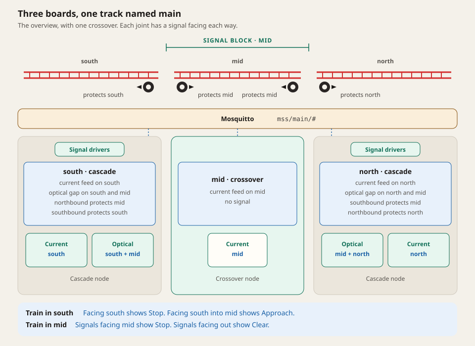
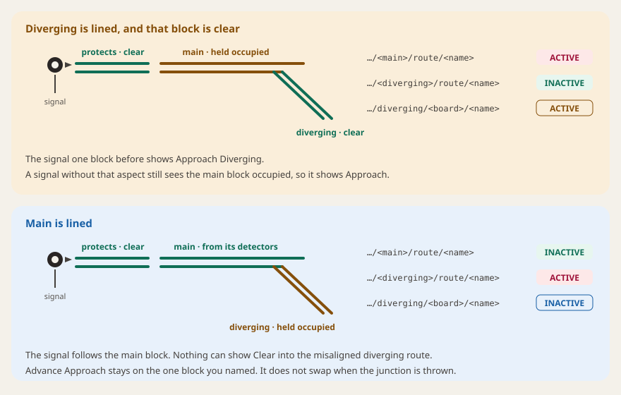

# Modular Signal System over MQTT

The [Modular Signal System](http://www.modularsignalsystem.info/) (MSS 2.0.2) is a way for modules to animate signals from the blocks ahead, without a computer deciding each aspect. The wired system carries that occupancy on a CAT5 bus. Here the same rules ride on MQTT, and the Board Configurator writes the YAML.

The standard, the fundamentals, and the planning notes are the three PDFs on the MSS site:

- [Design standard 2.0.2](http://www.modularsignalsystem.info/ModularSignalSystemStandardV2.0.2.pdf)
- [User guide part 1, fundamentals](http://www.modularsignalsystem.info/MSSUserGuide1.pdf)
- [User guide part 2, planning](http://www.modularsignalsystem.info/MSSUserGuide2.pdf)

Build the mast on the Signals page first, then open **Modular signals** in the [configurator](https://aaron9589.github.io/esphome-for-model-railroading/). Skip that page if JMRI is still choosing the aspects.

## What stays the same

Each signaled track is its own bus. A signal block is a stretch of that track. A block is occupied when any of these is true:

- A current detector on its feeder sees a train.
- An optical detector at either boundary sees any part of a train. That sensor occupies both blocks, so the signals hold until the last car clears the boundary.
- A turnout in the block is set against the signaled route.


Signals stand at the block boundaries. The one facing a block shows the first row that matches:

| Blocks ahead | Indication |
|---|---|
| The block it protects is occupied | Stop |
| That block is clear, and the junction ahead is diverging with its block clear | Approach Diverging |
| That block is clear, and the next block is occupied | Approach |
| Those two are clear, and the one after is occupied | Advance Approach |
| Those are clear, and a train is in the block behind | Clear |
| Nothing ahead, and the block behind is clear | Dark, if approach lighting is on |
| Nothing ahead, and approach lighting is off | Clear |

Stop wins over everything. Approach Diverging replaces Approach, and only then. Advance Approach, Approach Diverging, and approach lighting are optional. Stop, Approach, and Clear are not.


A crossover module only detects. It has no signal. A cascade module is a block boundary and usually has the signals. A junction is a cascade where the signaled track splits. The inactive route is held occupied, so a signal looking at it cannot show Clear into a misaligned switch. Approach Diverging is published only when the diverging route is lined and that block is actually clear. Signals that do not understand Approach Diverging still see the block as occupied, so they show Approach.

Sidings and spurs that are not signaled are not part of this. Both rails are still gapped at each block boundary, and every feeder for a block still passes through a current detector. The planning guide's list (one optical at each boundary, current detection on every module that feeds the track, a contact on each signaled turnout) is unchanged.

## What MQTT changes

Modules do not need an odd number of crossover cables, and a module does not have to be reversible. You name the blocks. A signal lists the block it protects, the next one, and optionally the one after that. That list is the cascade.

Each detector publishes its own topic. A block is occupied if any of its publishers says so. There is no single topic that several boards write, because the last write would wipe the others.

```
mss/<track>/<block>/<board>/<kind>/<name>
```

`kind` is `current`, `optical`, `turnout`, or `route`. The payload is `ACTIVE` or `INACTIVE`, retained, QoS 1. The publisher id you copy into the next board is the last three parts: `south/current/feed`.

Each board also publishes:

```
mss/<track>/node/<board>/online
```

`ONLINE` while it is connected, `OFFLINE` as its last will. Both are retained.

A neighbour treats a publisher as occupied unless the board is `ONLINE` and that publisher is `INACTIVE`. A board that has not been heard yet, or one that has dropped off, holds its blocks occupied. On the wired bus a disconnected detector floats to clear. This is the one deliberate difference: a missing module shows Stop, not Clear.


The Blocks page is separate. Those topics are for JMRI (`trains/track/sensor/...`, not retained). An MSS detector is added on Modular signals, on its own pin.

## A plain stretch

Three boards, one signaled track named `main`. Block `south`, then `mid`, then `north`. Signals stand at the two boundaries.



**south** is the boundary between `south` and `mid`.

- Current detector `feed` on block `south`.
- Optical detector `gap` on `south` and `mid`.
- Signal facing north. It protects `mid`, the next block is `north`, and the block behind it is `south` if you want approach lighting.
- Publishers it does not own: `mid/current/feed` on `mid`, and `north/current/feed` on `north`.

**mid** is only a detector, the crossover module.

- Current detector `feed` on block `mid`. No signal.

**north** mirrors south.

- Current `feed` on `north`, optical `gap` on `north` and `mid`.
- Signal facing south. It protects `mid`, the next block is `south`.
- Publisher it does not own: `south/current/feed` and `south/optical/gap` on `south`, and `mid/optical/gap` if you want the south optical included twice. One of them is enough; either optical occupies `mid`.

Watching MQTTX on `127.0.0.1:1883`, subscribe to `mss/main/#`. A train in `south` sets `mss/main/south/south/current/feed` to `ACTIVE`. The north-facing signal on `south` is still looking at `mid`, so it does not go to Stop for that. The south-facing signal on `north` protects `mid` and uses `south` as its next block, so it goes to Approach. When the train reaches `mid`, both signals go to Stop, because each one protects `mid`.

## A junction

A junction has a main block and a diverging block, and a point or a pin that says which is lined. Thrown means diverging unless you untick that.



The board publishes three extra topics:

- `mss/<track>/<main-block>/<board>/route/<junction>` is `ACTIVE` while diverging is lined.
- `mss/<track>/<diverging-block>/<board>/route/<junction>` is `ACTIVE` while main is lined.
- `mss/<track>/diverging/<board>/<junction>` is `ACTIVE` only when diverging is lined and the diverging block is clear.

The publisher id for the first two is `<board>/route/<junction>`. Add it on the signal that watches that block, on top of the real detectors. A signal one block before the junction lists the junction as `<board>/<junction>` if it has an Approach Diverging aspect.

Advance Approach stays on the single block you named as two ahead. This version does not swap that block when the junction is thrown.

## On the mast

The Signals page still paints the lamps. MSS picks the aspect by the label you type there (`Stop`, `Approach`, and so on). It does not read the JMRI string, and it does not subscribe to that mast's topic. One mast, one MSS signal.

Approach lighting needs a Dark aspect with every lamp off, and the block behind the signal. The signal starts at Stop until the other boards have reported in.

Open `http://<board-name>.local` for the same brightness and blink sliders as any other mast.
